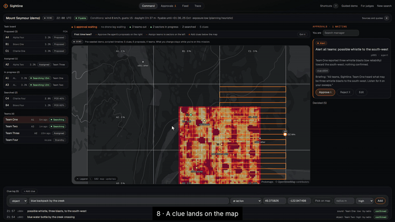
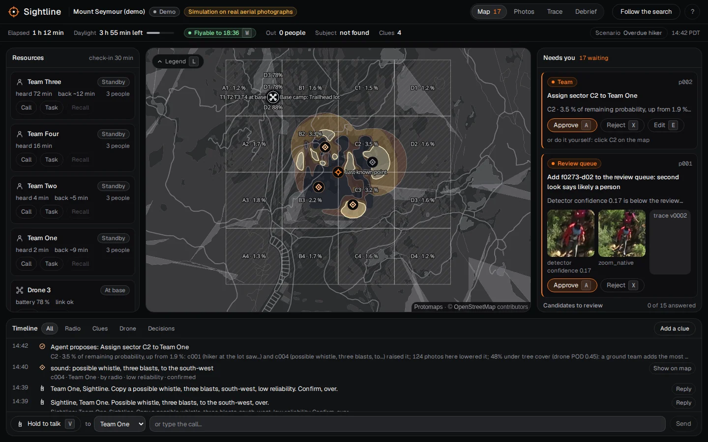

# Sightline



*The console on the demo mission (`#m/demo/map`), 18 s, recorded before the one-console bar of #171: a clue added on the map, then the fleet with Drone 1 re-tasked to the water-bottle clue (recorded from the local build by `scripts/demo_video/run.sh`; the mission, the drones and their links are simulated).*

Sightline is the brain of a drone search for a missing person: it finds the likeliest people in hundreds of drone photos with OpenCV 5, and turns every photo, searched sector and radio report into one probability map of where the person could still be. From that map an agent proposes where drones and ground teams go next, and a search manager approves every move before anything happens. It assists searchers and never rules an area out; it began at BCS Hackathon 2026 and became a live system for the OpenCV and Nebius hackathons.

**[Live demo](https://sightline-iota-sandy.vercel.app) · [Demo console, now](https://sightline-iota-sandy.vercel.app/#m/demo/map) · [Report](docs/report/OPENCV_REPORT.md) · [Architecture](docs/architecture/sightline-architecture.html) · [Run it](#reproduce-the-results-cpu-only-about-14-minutes)**

**For judges:** open the [live site](https://sightline-iota-sandy.vercel.app) (the console at t0, the call) and press **Follow the search** (3 min); the Debrief at the end has "For judges: where to look, in order" ([`#m/demo?t=5&judges`](https://sightline-iota-sandy.vercel.app/#m/demo?t=5&judges); the old `#judges` redirects there). Answers to the questions we expect, with their evidence, in [docs/JUDGE_QA.md](docs/JUDGE_QA.md).


## Results

The HERIDAL test set: 101 photos, 337 people, never used for training or threshold tuning (but see the disclosure below the table). From `metrics.json`:

| HERIDAL test set | Recall | Precision | AP50 | Time per 4000×3000 photo |
|---|---|---|---|---|
| Sightline, strict VOC scoring (one box per person, IoU ≥ 0.5) | 0.864 | 0.802 | 0.868 | 0.25 s (GPU, Torch) · 1.9 s (CPU, OpenCV 5 `cv2.dnn`) · 0.30 s (GPU, `cv2.dnn` on a custom CUDA build of OpenCV 5, [CV2_CUDA.md](docs/report/CV2_CUDA.md)) |
| Sightline, loose SAR-APD scoring | 0.896 | 0.898 | — | same |
| Human reference, SAR-APD (quoted by Pyrrö et al. 2021; not a matched study) | 0.68 | 0.59 | — | 33 s |

Reproduce the two Sightline rows, CPU only (both backends, identical scores; 12 min 48 s for this command on a 16-core desktop, about 14 minutes with the [setup below](#reproduce-the-results-cpu-only-about-14-minutes)):

```bash
uv run --extra ml python scripts/parity_table.py --splits test --device cpu \
  --pt data/weights/release_v2/yolo11s_tiles_run1_best.pt --onnx data/weights/release_v2/sightline-detector-v2.onnx
```

Beyond the detector (simulated or with fake models where marked; every headline number with its source: report §9):

| Result | Headline | Reproduce |
|---|---|---|
| Agent evaluation: the real mission API, worker, map, planner and agent driven over HTTP through the creek scenario and three variants, 3 runs each (fake models, scripted detector) | the drone, alert, team and promotion go to the person's sector or detection in every run (6/6, 9/9, 9/9, 3/3); approval-gate checks pass in 12 of 12 runs; Token Factory fully down costs about 82 s in all, not minutes per call ([AGENT_EVAL.md](docs/report/AGENT_EVAL.md)) | `uv run python scripts/agent_eval.py` (about 20 s) |
| Fleet v2 (simulated): three drones, coordinated on one shared map vs a hand split of the area, with a clue at the start | found within 30 min in 22.7 % vs 20.0 % of trials (ideal), 15.9 % vs 11.5 % (realistic wind, battery, GPS and link loss), 13.5 % vs 10.0 % (harsh); level with no clue ([FLEET_V2.md](docs/report/FLEET_V2.md)) | `uv run python scripts/fleet_eval.py` (about 2 min) |

- **The human row is a reference point, not a head-to-head.** Pyrrö, Naseri & Jung (2021, arXiv:2111.09406) quote it from Pyrrö's master's thesis: "the average human achieves roughly ... 59% PRC, 68% RCL and 33 s ATI, with less than around 200 images to inspect". They don't say who the people were or whether they saw these 101 photos. SAR-APD is loose on purpose (one box may cover a group; an IoU of 0.0025 counts), so every other number in this repo uses the strict VOC scoring. Report §3.9.
- **Disclosure:** the threshold and every inference setting were chosen on the validation split, but two earlier model choices were made with test scores in view: keeping training run 2 over run 1, and dropping the hard-negative fine-tune (test F2 0.840 vs 0.850). The test numbers above are therefore slightly optimistic; **our best estimate of true test recall is about 0.86, the reported 0.864 or slightly below**, and 0.825 at the four test sites the model never saw. Since then every choice is made on validation only ([scripts/README.md](scripts/README.md)).
- **GPU time** is from the evaluation run on an RTX 4080 SUPER (`detector_metrics.json`: 0.251 s); the separate OpenCV parity run on the same GPU measured 0.30 s for the same Torch path (report §3.1).
- **Mirror-image experiment (not in the demo).** Running each photo and its mirror image and fusing the boxes passed our validation rule (val F2 0.857 vs 0.831, 95% CI of the gain [+0.004, +0.048]). Scored once on test it gave recall 0.858, precision 0.835, AP50 0.872 at 0.50 s per photo: within noise of the single view, with 2 fewer people found and twice the time. The demo's photos were detected single-view and there was no time to rebuild the demo and every number around it, so the single-view model stays the reported one. That last decision was made after the mirror test score was seen, so both are reported here. Details: [docs/LANE_A_ML.md](docs/LANE_A_ML.md) §6.3a.
- **Ranking (demo survey):** all 6 photos with a person were in the first 7 photos of the review queue; the first one is photo 1.
- **Search map (simulated, 1,341 trials with the person in a photographed cell, 5 m cells):** a ground team checks a median of 1,213 cells with Sightline's map, against 1,743 for a naive map that treats every photographed cell as searched for certain (seed 7, the best of the three seeds tried). In the robustness check on the same 5 m map it was better in all 15 runs (3 seeds × 5 noise levels): 28–30% fewer cells at the default noise, 19–23% with noise matching the canopy estimate's measured error (docs/LANE_C_SEARCH.md).
- **Where it fails:** groups of people, clothing that matches pale or dark rock, people sitting or lying down. While analysing the misses we found 42 test labels squashed by a size bug in four photos; fixing it moved recall from 0.769 to 0.864. Details: [docs/DETECTOR_LIMITS.md](docs/DETECTOR_LIMITS.md).

Published results on the HERIDAL test set, in per cent (the full table, sources and caveats: report §3.10):

| Method | Precision | Recall | AP |
|---|---|---|---|
| AIR with NMS (Accenture, self-reported; scoring protocol not stated) | 90.1 | 86.1 | 84.6 |
| Faster R-CNN (Marušić et al. 2018, as quoted by AIR) | 67.3 | 88.3 | 86.1 |
| Two-stage multimodel CNN (Kundid Vasić & Papić 2020, as quoted by AIR) | 68.9 | 94.7 | — |
| **Sightline, strict VOC (IoU ≥ 0.5)** | **80.2** | **86.4** | **86.8** |

The rows are not strictly comparable: the published ones do not state their matching rule on the page, each is one operating point, and we have not checked that they scored the same 101 photos and labels. Ours is the row you can check in about 5 minutes on a CPU (`scripts/reproduce_cv2.py`, below).

## What the demo shows

The site is one console on a demo mission. The landing (`#`, which opens `#m/demo`) is the console at t0, the call, with a pitch bar; **Follow the search (3 min)** runs the mission clock through five checkpoints, each with a coach mark and its own address (`#m/demo?t=1` to `?t=5`; → next, ← back, Esc leaves the story at that mission time):

1. **Photos land** (`?t=1`, the Photos view): 500 drone photos from a search over Mount Seymour; the detector reads each one, the queue puts the likeliest people first, and the map updates as each photo is placed.
2. **Confirm** (`?t=2`, the Review view): a searcher answers each candidate (Person, Not a person, Unsure); the third scored only 0.18, and a second look caught it.
3. **Where next** (`?t=3`, the Map): a probability map of where the person could still be (photographed ground fades, ground never photographed stays marked as not yet searched), and the agent proposes Team One for A1 with its reason; you approve it.
4. **Run** (`?t=4`): eighteen minutes on, the teams are out and B4 is searched at POD 60 %, lowered but never ruled out.
5. **Results** (`?t=5`, the Debrief): the measured numbers with their sources, what breaks first, and where to look, in order, for judges.

The view switch (Map · Photos · Review · Trace · Debrief, keys 1 to 5) works at any moment; **Skip to now** (or `#m/demo/map`) opens the console at the end of the timeline, the wordmark opens the About sheet (`#about`: who it is for, how it works), and `#new` is the empty console for a new search. The old guided-demo addresses (`#survey`, `#rank`, `#review`, `#search`, `#results`, `#judges`, `#try`) redirect to these moments. The Mount Seymour flight path, the fleet and the mission's timeline are simulated, and the site labels them that way.

## Live missions

A live mission runs the same detector and map while the search happens, through a mission API (`python -m sightline.pipeline serve --mission-root missions`):

- **Photos in** after each landing (drag the SD card's photos in, or `python -m sightline.client watch FOLDER`), or replayed at drone pace (`... client replay`). Each one is detected with OpenCV 5 `cv2.dnn`, placed on the map from its GPS and camera pose, and steps the probability map.
- **An agent proposes; a person decides.** Uncertain detections get a second look (OpenCV 5 re-look tools, then Nemotron VL). The agent turns verdicts, clues, conditions and the planner's legs into proposals: promote a detection, fly a drone leg, re-task a flying drone, assign a sector to a team, alert the teams. Nothing happens until the search manager approves it in **the console** (task board, team roster, approval inbox, clue log, live heat map, printable assignment cards with GPX/KML). Every model and tool call is in the mission's trace.
- **The radio desk** puts Sightline on a secondary voice channel: teams ask questions and report clues by voice; a clue is logged only after Sightline reads it back and the team confirms; it transmits only briefings the search manager approved, when the operator presses Transmit.
- **Conditions from the web** (Tavily, below) gate the drones and shape the briefings.
- **A simulated drone fleet** (labelled so everywhere) flies approved legs and sends its photos through the same API (`python -m sightline.search.fleet run`); `scripts/creek_run.py` runs the whole story: a team's clue → the agent re-tasks a drone → its photo shows the person → review → alert.
- **A debrief** from the log: every proposal and who decided it, each sector's coverage and POD (`GET /missions/{id}/debrief.md`).

Try the console without a server: **`#`** on the live site opens it on the demo mission at t0 and **`#m/demo/map`** at the end of its timeline (simulated data; the old `#m/demo/command` redirects there). The API runs on AWS between demos (`deploy/aws/`). The OpenCV report, with the measured numbers: [docs/report/OPENCV_REPORT.md](docs/report/OPENCV_REPORT.md).



## How the detector works


A person is about 70 px wide in a 4000×3000 photo, so shrinking the photo to the model's input loses them. YOLO11s (9.43 M parameters) is fine-tuned for 80 epochs on overlapping 1024 px tiles from 890 labelled HERIDAL photos, and runs the same way: SAHI slices each photo into 1024 px tiles and merges the boxes. The merge settings and the 0.29 threshold were chosen on validation (the threshold by maximising F2), because a missed person costs more than a false alarm a searcher dismisses in seconds. What pays off is working at native resolution. Trained the same way on whole photos shrunk to 1920 px, the model's test recall is 0.804 against 0.864 (AP50 0.776 against 0.868). At inference, slicing is not the only way to keep that scale: the same weights run on the whole 4000 px photo in one pass score as well as tiling (test recall 0.905, AP50 0.887, precision 0.723 against 0.802) in about a third of the time, but need 5.7 GB of GPU memory against 0.28 GB for tiles. Shrinking the photo to 1024 px is what fails (test recall 0.234). The reported detector still uses tiled inference (the demo's 1000×750 frames fit in one pass either way). Every threshold was chosen on validation; full table in [scripts/README.md](scripts/README.md).

Both diagrams, with notes: [docs/architecture/sightline-architecture.html](docs/architecture/sightline-architecture.html). They are drawn to the [Diagram Design](https://github.com/cathrynlavery/diagram-design) rules by `docs/architecture/build_architecture.py`.

## Built with NVIDIA + Nebius

Every language and vision model call goes through **Nebius Token Factory** at run time (OpenAI-compatible API, key on the server only, never in the browser), and every model is an NVIDIA open model. All calls go through one client, `sightline/agent/llm.py`.

| What Sightline does | NVIDIA model | Runs on | Code |
|---|---|---|---|
| Second look at uncertain detections: the crop plus OpenCV 5 re-look images in, a JSON verdict out (person, posture, group size, clothing, reason) | Nemotron-3.5-Super-VL (`nvidia/Nemotron-3.5-Super-VL`) | Token Factory | `sightline/agent/verify.py` |
| Radio-style briefings for ground teams, written only from given facts and post-checked (≤ 60 words, never "clear", no invented numbers) | Nemotron 3 Nano (`nvidia/NVIDIA-Nemotron-3-Nano-30B-A3B`) | Token Factory | `sightline/agent/loop.py` |
| Reading the Tavily pages into values, each with its quote (conditions), and the debrief's summary | Nemotron 3 Nano (`nvidia/NVIDIA-Nemotron-3-Nano-30B-A3B`) | Token Factory | `sightline/geo/conditions.py`, `sightline/search/debrief.py` |
| The radio desk: speech in, an answer from tools (sector boundary, assignment, conditions, clue drafts), speech out | Parakeet TDT 0.6B v2 (speech to text), Nemotron 3 Super (`nvidia/nemotron-3-super-120b-a12b`, `MODEL_REASON`; the radio desk is its only use) with tool calls, Magpie TTS | speech on the GPU desktop (NeMo); the model on Token Factory | `sightline/radio/` |
| Batch detection of the simulated fleet's photos: 711 photos in 483 s on 16 vCPUs, about $0.10. Real-time detection on demand: one photo over HTTPS, 5.7 s p50 for a 4000×3000 photo, $0.38 per 1,000 photos; the worker switches to it with `SIGHTLINE_DETECT_URL` (both 2026-10-22; the endpoint deleted after measuring) | the Sightline detector on OpenCV 5 `cv2.dnn` | Nebius Serverless Job and Serverless Endpoint (CPU, us-north1) | `deploy/nebius/run_job.sh`, `scripts/nebius_batch_detect.py`; `deploy/nebius/ENDPOINT.md`, `sightline/serve/detect_app.py` |


How the models fit together, and a real trace of one decision: [docs/architecture/agent.md](docs/architecture/agent.md). The radio desk, measured ([docs/feedback/radio.md](docs/feedback/radio.md)):

| Stage | p50 | p90 |
|---|---|---|
| Speech to text (Parakeet, RTX 4080 SUPER) | 45–130 ms per phrase | 153 ms (max) |
| Reasoning and tool calls (Nemotron 3 Super, Token Factory) | 2.3 s | 3.2 s |
| First sound heard, typed team lines (30 turns) | 2.0 s | 3.0 s |
| First sound heard, end to end with real voices (18 turns) | 2.5 s | 3.0 s |

6 / 6 clue reports were read back and confirmed before they were logged. Safety frame (on the desk's screen): it runs on a secondary channel under the comms operator, never initiates orders, and transmits only what the search manager approved, when the operator presses Transmit. Measured on 461 live verifier calls: p50 1.35 s and p90 1.65 s per call, about 890 tokens in and 67 out, every reply valid JSON. What worked and what didn't: [docs/feedback/nebius.md](docs/feedback/nebius.md).

Setup:

```bash
export NEBIUS_API_KEY=...                                        # from the Token Factory console; or put it in .env
export NEBIUS_BASE_URL=https://api.tokenfactory.nebius.com/v1/   # the default
# optional: SIGHTLINE_MODEL_VISION / _FAST / _REASON to change model ids
uv run python -c "from sightline.agent.llm import MODEL_FAST, token_factory_client; print(token_factory_client().chat([{'role': 'user', 'content': 'Reply with: ready'}], model=MODEL_FAST).text)"
SIGHTLINE_FAKE_LLM=1 ...                                         # run anything without a key (scripted replies)
```

The Nemotron models think before they answer, and the thinking counts against `max_tokens`; our client defaults to 2048 and can turn thinking off with `extra_body={"chat_template_kwargs": {"enable_thinking": False}}` (`NO_THINKING` in `llm.py`).

## Conditions with Tavily

Each mission's conditions come from live web search at run time (`sightline/geo/conditions.py`): three Tavily searches (forecast, weather warnings, park and trail alerts for the area) and one Tavily extract, checked every 30 minutes for each active mission and cached per area and clock hour, so a second check in the same hour reuses the results (at most four Tavily calls per area per hour). Nemotron reads the pages and returns each value **with the sentence it came from**; a value is kept only if that quote is found verbatim in the page, contains the number and names the field, and is in a sane range. Everything else stays empty rather than guessed. Sunset and civil twilight are computed locally.

What it changes during a search:

- **Flying:** the planner proposes no drone leg when gusts exceed the drones' limit, it's raining, or it's after civil twilight, and the agent proposes recalling drones that are in the air.
- **The map:** fog or haze in a warning lowers the visibility factor, which lowers what each photo is worth (its POD) on the map.
- **People:** the exposure band shifts probability toward shelter; briefings to teams carry daylight left, wind and alerts.

Live, Mount Seymour on the evening of Oct 21 (PDT): wind NW 20 km/h gusting 40 (quoted "NW 20", "gusts 40"), a fog advisory (visibility factor 0.6), not flyable ("after civil twilight"); the same values on two runs (`sightline/geo/README.md`). A later run that evening, whose trace is committed, found the same wind and no fog (visibility factor 1.0). Every Tavily call and every extracted value with its quote and source URL is in the mission trace (`actor="conditions"`). The full write-up, with a live run's trace: [docs/report/TAVILY.md](docs/report/TAVILY.md). The key lives on the server only (AWS Secrets Manager); `SIGHTLINE_FAKE_TAVILY=1` runs without it.

## Team and lanes

| Lane | Owns | Code |
|---|---|---|
| A · Detector | data prep, training, evaluation, metrics screen | `sightline/ml/`, `scripts/` |
| B · Geo | camera poses, footprints, pins, base map, real-GPS survey | `sightline/geo/`, `web/src/map/` |
| C · Search | probability map, simulation, Search next | `sightline/search/`, `web/src/map/heat/` |
| D · Pipeline | contract, pipeline, mission store and API, website shell, review queue, AWS | `sightline/pipeline/`, `sightline/mission/`, `sightline/api/`, `web/src/shell/`, `deploy/aws/` |
| E · Ops & Voice | About sheet (was the front door), the console's map (was the command view), radio desk | `web/src/front/`, `web/src/command/`, `web/src/radio/`, `sightline/radio/` |

In the live-missions sprint lane A also owns the second look and the agent (`sightline/agent/`), the Nebius Serverless Job (`deploy/nebius/`) and the reports.

The lanes meet at one contract (`docs/01_CONTRACT.md`): only the pipeline writes the cache, every cache file is validated against it, and the website only reads the cache.

## Quick start

```bash
uv sync --extra conditions                   # Python dependencies (add --extra ml on a GPU machine)
uv run pytest                                # all tests
uv run python -m sightline.pipeline sample   # regenerate the fake sample cache
cd web && pnpm install && pnpm dev           # the website (reads web/public/cache/sample)
```

## Reproduce the results (CPU only, about 14 minutes)

The data and weights are GitHub releases, not repository files. No GPU, API keys or NeMo needed. Wall times measured on 2026-10-22 on a Ryzen 9 9950X (16 cores, 32 threads) with the GPU hidden (`CUDA_VISIBLE_DEVICES=`), from an empty uv cache:

### Reproduce in under 10 minutes (cv2.dnn only, CPU)

```bash
uv sync                                                                              # 2 s (no torch)
gh release download data-v1       -R Drivera0/sightline -p heridal_test_split.zip
gh release download weights-v2    -R Drivera0/sightline -D data/weights/release_v2 -p detector_metrics.json
gh release download model-onnx-v2 -R Drivera0/sightline -D data/weights/release_v2 -p sightline-detector-v2.onnx   # 9 s for the three (~513 MB)
mkdir -p data/heridal/yolo_full && unzip -q heridal_test_split.zip -d data/heridal/yolo_full                     # 1 s
CUDA_VISIBLE_DEVICES= uv run python scripts/reproduce_cv2.py                         # 4 min 58 s
```

About 5 minutes 10 seconds end to end. `reproduce_cv2.py` runs the 101 test photos through OpenCV 5 `cv2.dnn` only (same 1024 px tiling, merge NMS 0.5, threshold 0.29 frozen on val), in 4 processes of 8 threads, scores them with the VOC code of `evaluate_model.py`, and compares with `detector_metrics.json`: VOC precision / recall / AP50 0.802 / 0.864 / 0.868, equal to the published numbers (tolerance 0.005; the script exits 1 on a mismatch). It prints the wall time and the machine. The 4 min 58 s was measured while another job used about 11 of the 32 threads, so an idle machine of this size should be faster. `--subset N` scores a fixed seeded sample as a quick check of the setup; it is not the headline number and is not compared.

### Both backends (about 14 minutes)

```bash
uv sync --extra ml --extra conditions          # 31 s with an empty uv cache (0.8 s warm)
gh release download data-v1       -R Drivera0/sightline -p heridal_test_split.zip
gh release download weights-v2    -R Drivera0/sightline -D data/weights/release_v2
gh release download model-onnx-v2 -R Drivera0/sightline -D data/weights/release_v2   # 21 s for all three (~595 MB)
mkdir -p data/heridal/yolo_full && unzip -q heridal_test_split.zip -d data/heridal/yolo_full   # 3 s
CUDA_VISIBLE_DEVICES= uv run --extra ml python scripts/parity_table.py --splits test --device cpu \
  --pt data/weights/release_v2/yolo11s_tiles_run1_best.pt \
  --onnx data/weights/release_v2/sightline-detector-v2.onnx                         # 12 min 48 s
```

The last command scores the 101 test photos twice, with Torch on the CPU (5.0 s per photo) and with OpenCV 5 `cv2.dnn` (3.0 s per photo in this run), and prints the table above: VOC 0.802 / 0.864 / 0.868 and SAR-APD 0.898 / 0.896 for both, with 363 of 363 boxes at the threshold matching one-to-one. That is about 14 minutes end to end, so more than 10; the OpenCV half alone is about 5 minutes. On a GPU, the evaluation that wrote `metrics.json` (with the ablation rows):

```bash
uv run python scripts/evaluate_model.py --weights data/weights/release_v2/yolo11s_tiles_run1_best.pt --final tiled
uv run python scripts/analysis/detector_errors.py                                # the error analysis
```

### Docker dress run (from nothing, about 13 minutes)

```bash
bash deploy/dressrun/run.sh          # needs Docker and git; writes runs/dressrun/<timestamp>/times.md
```

A clean image built from what a fresh clone has (no GPU, keys or HERIDAL download): it installs from the lock files, runs the tests (1108 passed, 4 skipped), the smoke test of the live loop, the demo cache's contract check, the mission API with the `cv2.dnn` detector and `remote_check.py` against it, and the web build. 805 s end to end on the machine above; the stage times and the judge's 10-minute path without Docker are in [deploy/dressrun/README.md](deploy/dressrun/README.md).

`demo-cache` and `real-gps-cache` hold the two surveys the site shows; the Vercel build downloads both (`web/scripts/fetch-caches.sh`). `scripts/README.md` has the training runs and every ablation.

## Build the demo cache

```bash
uv run python -m sightline.pipeline run --stages all --layout blocks --out cache/demo
uv run python -m sightline.pipeline validate cache/demo
cd web && VITE_CACHE_DIR=demo pnpm dev
```

`run` has eight stages: frames, place, detect, georef, rank, map, metrics, export. Each stage reads
and writes `data/`, so you can run one alone (`python -m sightline.pipeline place`) or skip one
(`--skip detect` after copying `data/work/detect/` from the GPU desktop). The real-GPS survey is
built with `python -m sightline.pipeline real` (see `docs/LANE_B_GEO.md`).

If a lane's function is missing, its stage writes a labelled **placeholder** and says so in the
command output and in `manifest.json`. See `docs/LANE_INTERFACES.md` for what the pipeline calls in
lanes A, B and C.

## Mission API

```bash
uv run python -m sightline.pipeline serve --mission-root missions [--radio text]   # http://127.0.0.1:8000
cd web && VITE_API_URL=http://127.0.0.1:8000 pnpm dev                              # then open #new: start a search
SIGHTLINE_FAKE_LLM=1 SIGHTLINE_FAKE_TAVILY=1 bash scripts/smoke.sh                 # the whole loop, no network, no keys
```

The routes are in `docs/01_CONTRACT.md` §13. The API has no login: keep it on `127.0.0.1` or a trusted network
(the AWS deployment is for demos and is stopped between them). The older single-survey upload (`POST /survey`,
a zip of JPEGs → `cache/upload-<id>/`) still works.

## Docs

- `docs/00_OVERVIEW.md`: what Sightline is, its users, the pipeline, the lanes, what is real and what is simulated. Read this first.
- `docs/01_CONTRACT.md`: the exact shape of every file the lanes exchange.
- `docs/LANE_A_ML.md`, `docs/LANE_B_GEO.md`, `docs/LANE_C_SEARCH.md`, `docs/LANE_D_PIPELINE.md`: one per lane.
- `docs/DETECTOR_LIMITS.md`: where the detector fails, with figures.
- `docs/LANE_INTERFACES.md`: the functions the pipeline calls in other lanes.
- `docs/05_FRONTEND_SHARED.md`: the shared website rules and look.
- `docs/report/OPENCV_REPORT.md`: the OpenCV report (live missions, agentic vision chains, measurements).
- `docs/feedback/nebius.md`, `docs/feedback/radio.md`: what worked and what didn't with Token Factory, Serverless Jobs, Parakeet and Magpie.
- `sightline/mission/README.md`, `sightline/search/README_LIVE.md`, `sightline/geo/README.md`, `web/src/command/README.md`: the live-mission pieces, with what was checked and how.

Every number on screen comes from `metrics.json` or a cited source. Anything simulated (the flight
path, the search-map evaluation, the 10 m position uncertainty, the drone fleet, the demo mission) is labelled simulated.

## Responsible use

- **Never rules an area out.** Searched sectors say how well they were searched ("searched at POD 60 %"); a sector's POD is capped below 1, and tests scan every proposal, briefing, radio reply and screen string for the word clear (report §11).
- **A person approves every action**, and every decision is logged with who and when; the radio transmits only approved briefings, when the operator presses Transmit.
- **Privacy:** the mission API has no login (anyone who can reach it can list missions and see their photos), so keep it on `127.0.0.1` or your own network; the public AWS demo holds only HERIDAL and synthetic photos and is stopped between demos. On AWS, original photos sit in a private S3 bucket and are deleted after 30 days. Crops of detections at confidence ≥ 0.15 (no full photos, GPS or EXIF) go to Nebius Token Factory (`nvidia/Nemotron-3.5-Super-VL`) for the second look; radio speech stays on our GPU and only text goes to Token Factory. No face detection or recognition, no identity data. CORS allows only the deployed site and localhost, with no credentials. Details: report §11.1.
- **Licences:** AGPL-3.0 code and model weights (from Ultralytics; what a team deploying it must do is in report §11.2); HERIDAL imagery from a CC BY 3.0 copy, original terms not verified (below).

## Attribution

Imagery from the HERIDAL dataset (Božić-Štulić, Marušić & Gotovac, IJCV 2019), from the VOC-format copy by Pyrrö (2021, [Zenodo 5662351](https://zenodo.org/records/5662351)), which is licensed CC BY 3.0. The original dataset's own terms could not be checked (its site did not answer on 22 Oct 2026); see report §11.2.

## License

Code is licensed under the GNU Affero General Public License v3.0 (AGPL-3.0-or-later), matching Ultralytics YOLO, which the detector is trained with. Ultralytics treats trained models as AGPL-3.0 too, so we treat the released weights and their ONNX export the same way. The HERIDAL imagery keeps its own license (see Attribution).
