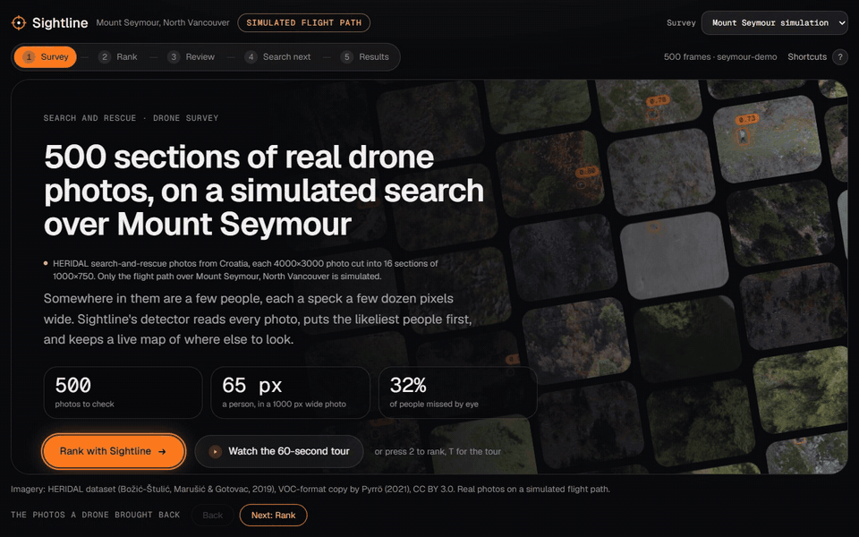
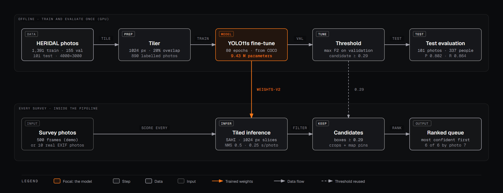

# Sightline

Sightline finds the hiker in hundreds of search-and-rescue drone photos, then shows the rescue team where to look next. A detector ranks the photos, each detection becomes a pin on a map, and a Bayesian probability map updates after every photo. It assists searchers; it never decides that an area is clear. Built for BCS Hackathon 2026.

**Live demo: https://sightline-iota-sandy.vercel.app**



*The five steps on the demo survey, 23 s (recorded from the local build; the flight path and the search evaluation are simulated).*


## What the demo shows

The site walks through one survey in five steps (keys 1 to 5):

1. **Survey**: 500 drone photos from a search over Mount Seymour.
2. **Rank**: the detector scans every photo, draws its boxes, and builds a queue with the likeliest people first. A side panel shows the network it runs and each photo's score against the flag threshold.
3. **Review**: a searcher answers each candidate (Person, Not a person, Unsure) while confirmed people are pinned on the map.
4. **Search next**: a probability map of where the person could still be. Photographed ground fades as the drone sees it; ground never photographed stays marked as not yet searched.
5. **Results**: the numbers below, with their sources.

A second survey, real HERIDAL photos at their recorded EXIF positions, is in the survey menu. The Mount Seymour flight path and the search evaluation are simulated, and the site labels them that way.

## Results

From `metrics.json` (the HERIDAL test set: 101 photos, 337 people, never used for training or tuning):

| | Sightline detector | Human baseline |
|---|---|---|
| Recall | **0.864** | 0.68 |
| Precision | **0.802** | 0.59 |
| AP50 | 0.868 | |
| Time per full 4000×3000 photo | 0.25 s (GPU) | 33 s |

Human baseline: Pyrrö, Naseri & Jung 2021, arXiv:2111.09406.

- **Ranking (demo survey):** all 6 photos with a person were in the first 7 photos of the review queue; the first one is photo 1.
- **Search map (simulated, 1,536 trials with the person in a photographed cell):** a ground team needs a median of 98 cells with Sightline's map, against 123 for a naive "photographed = cleared" map (seed 7, the best of the three seeds tried). In lane C's robustness check it was better in all 15 runs: 12–20% fewer cells at the default noise, 9–12% with noise matching the canopy estimate's measured error (docs/LANE_C_SEARCH.md).
- **Where it fails:** groups of people, clothing that matches pale or dark rock, people sitting or lying down. While analysing the misses we found 42 test labels squashed by a size bug in four photos; fixing it moved recall from 0.769 to 0.864. Details: [docs/DETECTOR_LIMITS.md](docs/DETECTOR_LIMITS.md).

## How the detector works



A person is about 70 px wide in a 4000×3000 photo, so shrinking the photo to the model's input loses them. YOLO11s (9.43 M parameters) is fine-tuned for 80 epochs on overlapping 1024 px tiles from 890 labelled HERIDAL photos, and runs the same way: SAHI slices each photo into 1024 px tiles and merges the boxes. The 0.29 threshold is chosen on validation by maximising F2, because a missed person costs more than a false alarm a searcher dismisses in seconds. Tiling is what makes fine-tuning pay off: without it the fine-tuned model's test recall is 0.234.

Both diagrams, with notes: [docs/architecture/sightline-architecture.html](docs/architecture/sightline-architecture.html). They are drawn to the [Diagram Design](https://github.com/cathrynlavery/diagram-design) rules by `docs/architecture/build_architecture.py`.

## Team and lanes

| Lane | Owns | Code |
|---|---|---|
| A · Detector | data prep, training, evaluation, metrics screen | `sightline/ml/`, `scripts/` |
| B · Geo | camera poses, footprints, pins, base map, real-GPS survey | `sightline/geo/`, `web/src/map/` |
| C · Search | probability map, simulation, Search next | `sightline/search/`, `web/src/map/heat/` |
| D · Pipeline | contract, pipeline, website shell, review queue | `sightline/pipeline/`, `web/src/shell/` |

The lanes meet at one contract (`docs/01_CONTRACT.md`): only the pipeline writes the cache, every cache file is validated against it, and the website only reads the cache.

## Quick start

```bash
uv sync                                      # Python dependencies
uv run pytest                                # all tests
uv run python -m sightline.pipeline sample   # regenerate the fake sample cache
cd web && pnpm install && pnpm dev           # the website (reads web/public/cache/sample)
```

## Reproduce the results

The data, weights and caches are GitHub releases, not git files:

```bash
gh release download data-v1    -R Drivera0/sightline -p heridal_test_split.zip   # unzip into data/heridal/yolo_full/
gh release download weights-v2 -R Drivera0/sightline -D data/weights/release_v2
uv sync --extra ml                                                               # torch, ultralytics, sahi (GPU)
uv run python scripts/evaluate_model.py --weights <weights-v2 .pt> --final tiled   # the detector numbers
uv run python scripts/analysis/detector_errors.py                                # the error analysis
```

`demo-cache` and `real-gps-cache` hold the two surveys the site shows; the Vercel build downloads both (`web/scripts/fetch-caches.sh`). `scripts/README.md` has the training runs and every ablation.

## Build the demo cache

```bash
uv run python -m sightline.pipeline run --stages all --layout blocks --out cache/demo
uv run python -m sightline.pipeline validate cache/demo
cd web && VITE_CACHE_DIR=demo pnpm dev
```

`run` has eight stages: frames, place, detect, georef, rank, map, metrics, export. Each stage reads
and writes `data/`, so you can run one alone (`python -m sightline.pipeline place`) or skip one
(`--skip detect` after copying `data/work/detect/` from the GPU desktop). The real-GPS survey is
built with `python -m sightline.pipeline real` (see `docs/LANE_B_GEO.md`).

If a lane's function is missing, its stage writes a labelled **placeholder** and says so in the
command output and in `manifest.json`. See `docs/LANE_INTERFACES.md` for what the pipeline calls in
lanes A, B and C.

## Upload API (optional)

```bash
uv run python -m sightline.pipeline serve --weights data/weights/best.pt
curl -F file=@photos.zip http://127.0.0.1:8000/survey      # returns an id; check GET /survey/<id>
```

A zip of JPEGs becomes `cache/upload-<id>/` (frames are resized to 1000×750). The API has no login:
keep it on `127.0.0.1` or a trusted network.

## Docs

- `docs/00_OVERVIEW.md`: the project, lanes and timeline. Read this first.
- `docs/01_CONTRACT.md`: the exact shape of every file the lanes exchange.
- `docs/LANE_A_ML.md`, `docs/LANE_B_GEO.md`, `docs/LANE_C_SEARCH.md`, `docs/LANE_D_PIPELINE.md`: one per lane.
- `docs/DETECTOR_LIMITS.md`: where the detector fails, with figures.
- `docs/LANE_INTERFACES.md`: the functions the pipeline calls in other lanes.
- `docs/05_FRONTEND_SHARED.md`: the shared website rules and look.
- `CLAUDE.md`: rules for Claude Code in this repo.

Every number on screen comes from `metrics.json` or a cited source. Anything simulated (the flight
path, the search-map evaluation, the 10 m position uncertainty) is labelled simulated.

## Attribution

Imagery from the HERIDAL dataset (Božić-Štulić, Marušić & Gotovac, 2019), VOC-format copy by Pyrrö (2021), CC BY 3.0.
