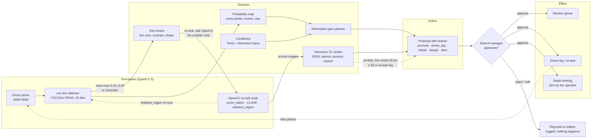
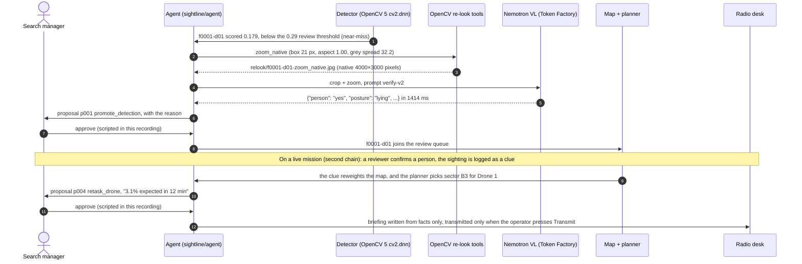

# The Sightline agent: Agentic Vision evidence

Sightline's agent turns what OpenCV 5 sees into proposals a person approves. This page holds the
evidence for the OpenCV **Agentic Vision Award**: the workflow, one real trace in which an
OpenCV 5 result changes a later decision, and how the agent is evaluated. Code: `sightline/agent/`
(lane A). Numbers: `docs/LANE_A_ML.md` §6.7–§6.8.


Drawn by `docs/architecture/build_architecture.py` (figure 3 of `sightline-architecture.html`).

## The workflow: perception → decision → action → human → effect



The re-look is the back-edge from decision to perception: when the detector is unsure, the verifier
chooses an OpenCV tool for that failure mode (`sightline/agent/verify.py:86-100`), the tool goes back
to the photo's native pixels (`sightline/agent/relook.py:81-170`), and the model decides from what
OpenCV produced. Every arrow out of the diamond needs a person: the agent never acts on its own
(`sightline/api/missions.py:441-442`, `POST /missions/{id}/proposals/{pid}/decide`).

## The showcase chain as a sequence

The first chain below (`av-chain/trace.jsonl`), and what an approval leads to on a live mission
(the second chain, `scripts/retask_chain.py`):



## The loop

| Step | What runs | Code |
|---|---|---|
| Perception | The detector, on OpenCV 5 `cv2.dnn` (parity with Torch: identical scores on test) | `sightline/ml/detect_cv.py`, `backend.py` |
| Second look | OpenCV 5 re-look tools chosen per failure mode: CLAHE for low contrast, a zoom from the original photo's native pixels for small people, the detector re-run on a native window and a 2× upscale for groups and people lying down | `sightline/agent/relook.py`, `verify.py` |
| Decision | Nemotron VL (Token Factory) answers from the crop and the re-look images in a JSON schema; lane C's information-gain planner proposes drone legs and team assignments | `verify.py`, `loop.py` |
| Action | A **proposal** with a reason, evidence and, for people in the field, a briefing written only from given facts: `promote_detection`, `drone_leg` / `retask_drone`, `assign_sector`, `alert` | `loop.py` |
| Human | The search manager approves, edits or rejects; nothing happens before that | lane E inbox, lane D API |
| Effect | Approved detections join the review queue; approved legs go to the fleet; approved briefings go to the radio | lane D |
| Tool choice (bulletin) | No lost-person category: Nemotron Nano decides whether to call `search_public_bulletin` and writes its query; Tavily search (trusted domains) → extract → profile with verbatim quotes, names redacted → one `Set subject profile` proposal; approval sets the category and the prior, then re-plans | `subject_tool.py`, `geo/subject.py` |

## One real chain: an OpenCV 5 result changes the decision

A **val** photo (`train_ZRI_2061`, HERIDAL; never used for training). The detector scored a person
lying on the ground **0.18**, below the 0.29 review threshold, so without the agent no reviewer
would ever see it. The re-look tool was chosen by heuristic (box 21 px in the 1000×750 frame:
small), and the zoom from the original photo's native pixels is what the VL model answered from.

| The review crop (from the 1000×750 frame) | OpenCV 5 `zoom_native` (from the 4000×3000 original) |
|---|---|
|  |  |

`scripts/trace_excerpt.py` prints the chain from the mission's `trace.jsonl` (`av-chain/trace.jsonl`):

```text
2026-10-21T00:33:23.627Z  pipeline note       detection f0001-d01 in train_ZRI_2061: confidence 0.179, below the 0.29 review threshold, so it is not in the review queue (near-miss)
2026-10-21T00:33:24.502Z  verifier tool_call  zoom_native on f0001-d01
    image: relook/f0001-d01-zoom_native.jpg  (0 ms)
    why this tool (heuristics): box 21 px, aspect 1.00, grey spread 32.2
2026-10-21T00:33:25.917Z  verifier model_call VL verdict for f0001-d01
    model nvidia/Nemotron-3.5-Super-VL · 1414 ms · 809 tokens in, 61 out · prompt verify-v2
    images sent: ['relook/f0001-d01-crop.jpg', 'relook/f0001-d01-zoom_native.jpg']
    reply: {"person": "yes", "posture": "lying", "group_size": 1, "clothing": "white top, dark pants", "reason": "A human shape with a head, torso, and limbs is visible lying on the ground."}
2026-10-21T00:33:25.918Z  verifier verdict    f0001-d01: person yes
    person yes · posture lying · group 1 · clothing white top, dark pants
    reason: A human shape with a head, torso, and limbs is visible lying on the ground.
2026-10-21T00:33:25.918Z  agent    proposal   p001 promote_detection: Add f0001-d01 to the review queue: second look says likely a person
    target {'detection': 'f0001-d01'}
    reason: Detector confidence 0.18 is below the review threshold 0.29; the second look (zoom_native) says: A human shape with a head, torso, and limbs is visible lying on the ground.
2026-10-21T00:33:25.928Z  human    decision   p001 approved by Search manager (scripted approval for this demo run)
    {'proposal': 'p001', 'status': 'approved', 'by': 'Search manager (scripted approval for this demo run)'}
```

The same six trace lines as a table (every value from `av-chain/trace.jsonl`, line n = span n):

| Span | Tool / model | Input (summary) | Output (summary) | ms | What it changed next |
|---|---|---|---|---|---|
| 1 `pipeline` note | the detector, OpenCV 5 `cv2.dnn` | photo `train_ZRI_2061`, box (1900, 2633)–(1982, 2717) in the original | confidence 0.179, below the 0.29 threshold: not in the review queue (near-miss) | — | the near-miss triggers the second look; without it no reviewer would see this person |
| 2 `verifier` tool_call | `zoom_native` (OpenCV 5, `relook.py:91`) | the box; heuristics: 21 px long side, aspect 1.00, grey spread 32.2 | `relook/f0001-d01-zoom_native.jpg`, cut from native pixels | 0 | the small box chose the zoom; the zoom is the image the model answers from |
| 3 `verifier` model_call | `nvidia/Nemotron-3.5-Super-VL`, prompt `verify-v2` | the review crop + the native zoom; 809 tokens in | `person: yes, posture: lying, group 1, white top, dark pants`; 61 tokens out | 1414 | a `yes` on a near-miss is the condition for a promotion |
| 4 `verifier` verdict | — | — | verdict `v0001`: person yes, tool `zoom_native` | 1488 (tool + model) | the verdict is stored on the detection and handed to the agent loop |
| 5 `agent` proposal | `loop.py:413` (`_on_detection`) | verdict `v0001` | `p001 promote_detection`, reason: "confidence 0.18 is below the review threshold 0.29; the second look (zoom_native) says…" | — | a pending proposal in the approval inbox; nothing changes until a person decides |
| 6 `human` decision | — | `p001` | approved, by "Search manager (scripted approval for this demo run)" | — | the detection joins the review queue |

**The approval in this showcase run was scripted**, and the trace says so in its own words (span 6).
When the video is recorded, the chain is run again with a real person approving in the inbox, and that
trace replaces this one (Dan's item). The second chain's human steps are scripted too, also labelled.

Reproduce: `uv run --extra ml python scripts/av_chain.py`, then the `trace_excerpt.py` command it
prints. Disclosures: the photo is from val and was picked from the verifier's val results as a
near-miss person it called `yes`; the mission is built in memory by the script in the same shape
as lane D's pipeline (the `pipeline` line is written by the script); and the approval is
**scripted** for this run and says so in the trace. Everything else is the production code path
(`loop.handle`, `verify`, the OpenCV tools, Token Factory).

## The bulletin tool: the model decides to search

Rule: when a mission has a last known point but no lost-person category, and no profile proposal is waiting,
`POST /missions/{id}/subject/search` asks the model, not code, whether to search. Nemotron Nano gets the
mission's facts and one tool, `search_public_bulletin(query)`. It calls the tool with a query it wrote, or
it declines and says why (a `replay` mission has no missing person). The tool runs Tavily search on police,
search-and-rescue and news domains, then extract, and a second Nano call returns each field with a verbatim
quote and its URL. The result is a proposal. Approving it (`decide`) sets the subject and the Koester prior,
and the agent re-plans the drones (`subject_set` event). Names are never stored (`docs/report/TAVILY.md`,
"The subject from a public bulletin"). The trace from the offline demo (synthetic bulletin, scripted model):

```text
agent  model_call  subject: the model chose to search: missing hiker Mount Seymour police bulletin
agent  tool_call   Tavily search (subject): missing hiker Mount Seymour police bulletin
agent  tool_call   Tavily extract: 1 page(s)
agent  model_call  subject profile extracted with quotes (names redacted)
agent  proposal    p001 alert: Set subject profile: hiker, 34, red jacket, black hiking pants and a grey backpack, last seen 3:30 p.m. at the Mount Seymour trailhead parking lot
human  decision    p001 approved by Search manager
agent  proposal    p002 drone_leg: Send Drone 1 to sector … (reason: "Subject profile p001 approved …")
```

Tests: `tests/agent/test_subject.py`, including the model declining (no Tavily call), the hour's cache, a
rejection, and no name in any file of the mission.

## End to end on a live mission

`scripts/agent_live.py` runs the agent on the real system: the mission API, OpenCV 5 `cv2.dnn`, lane C's live map,
the mission store, and Nemotron on Token Factory. It uploads six HERIDAL **validation** photos from one site and
acts as the search would: a reviewer answers "person", a clue comes in, a scripted search manager approves one
proposal (labelled in the trace). The fleet is two **simulated** drones until lane C's fleet sim lands.

Run of 2026-10-21 (`runs/agent_live/`): 9 candidates from 6 photos; the second look on all 9 (OpenCV re-look tools:
`zoom_native` on all 9, `enhance_contrast` on 2, `redetect_region` on 1); a confirmed person led to an `alert` to all
teams and an `assign_sector` for the nearest team on standby (approved: the task and the team became "assigned"); the
clue reweighted the map and led to a `drone_leg` from the planner (on 21 Oct still a stand-in, and its reason said so; the information-gain planner, C-P1, replaced it the next day and drives the re-task chain below).
12 model calls, about 8.5k tokens in. `validate_mission` passed after every step.

Two problems this run found, both fixed:

- **A briefing told teams to stand down.** Asked to add "no orders", Nemotron ended an alert for a confirmed sighting
  with "No further action is needed." Briefings saying a team should stop or that nothing is needed are now rejected
  in code (one retry, then the facts-only template), and the prompt says to state the facts and stop. A run-on
  without punctuation is rejected too: briefings are read aloud on the radio.
- **Briefing model calls were not in the trace.** Every attempt is now a `model_call` entry (facts in, text and
  tokens out, why it was rejected), and a fallback to the template is a `note`.

## A second chain: a VL sighting re-tasks a flying drone

`scripts/retask_chain.py` (live mission, real planner; the fleet is simulated and the human steps are scripted, as
the trace says). Excerpt (`scripts/trace_excerpt.py --proposal p004`):

```text
2026-10-22T01:48:41.458Z  verifier tool_call  zoom_native on f0005-d01
    image: relook/f0005-d01-zoom_native.jpg  (1 ms)
    why this tool (heuristics): box 20 px, aspect 1.33, grey spread 25.5
2026-10-22T01:48:42.772Z  verifier model_call VL verdict for f0005-d01
    model nvidia/Nemotron-3.5-Super-VL · 1312 ms · 809 tokens in, 63 out · prompt verify-v2
    images sent: ['crops/f0005-d01.jpg', 'relook/f0005-d01-zoom_native.jpg']
    reply: {"person": "yes", "posture": "sitting", "group_size": 1, "clothing": "blue jacket, dark head covering", "reason": "A human shape with a head, torso, and raised arms is visible at the centre."}
2026-10-22T01:48:42.774Z  verifier verdict    f0005-d01: person yes
    person yes · posture sitting · group 1 · clothing blue jacket, dark head covering
    reason: A human shape with a head, torso, and raised arms is visible at the centre.
2026-10-22T01:49:08.722Z  human    decision   Reviewer (scripted for this run): f0005-d01 is a person
    {'answer': 'person'}
2026-10-22T01:49:09.673Z  agent    model_call briefing
    model nvidia/NVIDIA-Nemotron-3-Nano-30B-A3B · 949 ms · 203 tokens in, 57 out · prompt None
    images sent: None
    reply: Team, a reviewer confirmed a person in a drone photo. The subject is an adult hiker. The person is wearing a blue jacket and a dark head covering. The posture is sitting. The photo is from sector B3. The photo identifier is f0005.
2026-10-22T01:49:34.480Z  human    note       Search manager (scripted for this run): logged the sighting as clue c001 (100 m, the default for a sighting)
2026-10-22T01:49:34.492Z  agent    proposal   p004 retask_drone: Re-task Drone 1 to sector B3 (3.1% expected)
    target {'drone': 'D1', 'leg': 'L002'}
    reason: After clue c001 (sighting, high reliability: person in photo f0005, confirmed by the reviewer) in sector B3, which now holds 6.9% of the probability. Sector B3: expected to rule out 3.1% of the probability in 12 min (0.26%/min) — 1.1× the next best for Drone 1 (sector B2). Within battery (95%).
2026-10-22T01:50:00.642Z  human    decision   p004 approved by Search manager (scripted approval for this run)
    {'proposal': 'p004'}
```

After the approval: Drone 1's leg L001 (sector A1) `cancelled`, L002 (sector B3) `approved`; `validate_mission` → `[]`.

## A third chain: an unclear verdict sends a drone lower

Under 60 px the VL model mostly answers `unclear` (on val, a decisive yes or no for 37 of 75 boxes under
60 px against 68 of 95 at 60 px and over; on test, `unclear` for 65 % of the small ones). Before this
change an `unclear` ended the chain. Now the agent asks for a better photo of the spot
(`sightline/agent/relook_leg.py`, called from `loop.py`):

- **Rule.** A second look that answers `unclear` (from the model, not a failed call), on a near-miss
  or on a reviewer's "unsure", with the box's long side under 60 px in original-photo pixels, from a
  photo taken above 26 m. The agent then proposes a `drone_leg` over the spot at 25 m. It is a
  `retask_drone` when the drone it picks is flying. The drone is the nearest idle one, else the
  nearest flying one.
- **The leg** (`planner.relook_leg`). The first waypoint is the spot, so the survey starts with a
  photo there. Then two lines 10 m apart over a 20 m square (one photo's width at 25 m). Its
  `expected_clearance` is Σ p · POD over the cells within 10 m. Its reason is in numbers: *"Second look
  at f0001-d01 was unclear: box 21 px, too small to verify; a pass at 25 m gives about 4× the pixels
  (50 m → 25 m). Drone 3 is 438 m away: 1.1 min there and over the spot, expected to rule out 0.010 %
  of the probability."* The factor is (altitude / 25)².
- **Approval.** The leg goes through the normal approval path. While it waits, re-plans leave that
  drone alone (`_replan` skips it).
- **The low pass.** The fleet sim flies it. Below 50 m a photo's crop follows the leg's altitude
  (`fleet.at_altitude`): half as wide on the ground at 25 m, resized to the same pixels, so the person
  is twice as large. Those pixels are resampled from the 50 m photo, so the sim reproduces the size of
  a lower pass, not its extra detail. The drone goes back to its survey altitude after the leg.
- **The pipeline again.** The new photo goes through detector → second look → verdict →
  `promote_detection`. A detection from a photo taken at 25 m within 10 m of the spot belongs to the
  chain. It is never re-looked again, even if still `unclear`.

Every step is a trace `note` with `output.type = "relook"`, and the chain id is in its output and
refs. `chain_id` is `relook-<detection id>`, and the Trace tab groups by shared refs:

| `output.step` | Fields (besides `type`, `chain_id`, `step`) |
|---|---|
| `unclear` | `detection`, `verdict`, `frame`, `box_long_px`, `altitude_m` (seen from), `target` {lat, lon}, `images` (crop and re-look images), `reason` |
| `leg` | `proposal`, `kind`, `leg`, `drone`, `altitude_m` (25), `pixel_factor`, `est_minutes`, `expected_clearance`, `target`, `from_altitude_m` |
| `photo` | `frame`, `file`, `altitude_m`, `detection` (or null: no detection near the spot), `conf`, `box_long_px` |
| `verdict` | `detection`, `verdict`, `person`, `reason`, `images` |
| `outcome` | `outcome`: `resolved` (yes or no), `unclear` (left to the reviewer), `not_redetected` (the leg was done, no detection within 10 m); `person`, `detection`, `proposals` (the promotion), `photos` |
| `skipped` | `why`: not flyable, no drone idle or flying, off the map |

The leg's proposal entry has the chain id in its refs. The detections, verdicts, frames, proposal and
leg are all named by id.

### The ledger: did the observation help

Active perception asks a system to compare the value it predicted for an observation with the
improvement it actually obtained (arXiv 2512.03687, §3.3.2). The agent writes one record per second
look and per flown leg (`sightline/agent/ledger.py`). Each record is a trace `note` with
`output.type = "ledger"`:

```text
{"type": "ledger", "chain_id": "relook-f0001-d01" | "leg-L002", "kind": "second_look" | "leg",
 "ref": "<detection or leg id>",
 "expected": {"cell_p", "sector": {"id", "poa", "expected_clearance"}, "map_seq", "gain", "gain_is", ...},
 "realised": {"cell_p", "sector": {...}, "gain", "gain_is", ...},
 "delta": realised.gain - expected.gain}
```

- **Second look.** It is written when the verdict is stored. `expected.gain` is the share of decisive
  verdicts on val for a box of that size: 0.493 under 60 px, 0.716 at 60 px and over (prompt
  verify-v2). `realised.gain` is 1 for yes or no and 0 for `unclear`. `cell_p` and the sector's share
  and `expected_clearance` are read before and after the verdict. A verdict moves no probability by
  itself (the map changes on photos and reviews), so they are normally equal: a second look's value is
  in the decision it allows.
- **Leg.** It is written when the leg is done. The expected side is taken when the leg is proposed and
  kept on the proposal's trace entry (`ledger_expected`). `expected.gain` is the leg's
  `expected_clearance` (the planner's POD, unknown canopy at 0.5). `realised.gain` is Σ p · POD on
  the map as it was when proposed, with the POD the leg's photos actually gave each cell: their frame
  steps in the map log, which cover coverage gaps, measured canopy, visibility and cells held for a
  candidate. Same prior, same units, so the delta is the prediction's error and not other drones'
  evidence. A recall (no sector) and a scripted leg (no expected side) have no record.

`uv run python scripts/relook_demo.py` runs the chain offline: the real API, store, worker, map, planner
and runner, with the fleet sim flying the leg. The detector is scripted, and the model is the fake-LLM
fixture (`SIGHTLINE_FAKE_LLM=1 SIGHTLINE_FAKE_VL=relook`: `unclear`, then `yes`). It prints:

```text
[   1.0 s] proposal p004 retask_drone: Re-look at f0001-d01 from 25 m: re-task Drone 3
           Second look at f0001-d01 was unclear: box 21 px, too small to verify; a pass at 25 m gives about 4× the pixels (50 m → 25 m). Drone 3 is 438 m away: 1.1 min there and over the spot, expected to rule out 0.010% of the probability.
[   2.0 s] L004 flown by D3 at 25 m: 5 photos, 1.08 sim min
[   2.0 s] proposal p005 promote_detection: Add f0002-d01 to the review queue: second look says likely a person

  relook-f0001-d01 unclear  detection=f0001-d01, verdict=v0001, frame=f0001, altitude_m=50.0, box_long_px=21
  relook-f0001-d01 leg      proposal=p004, leg=L004, altitude_m=25.0, pixel_factor=4.0
  relook-f0001-d01 photo    detection=f0002-d01, frame=f0002, altitude_m=25.0, box_long_px=43
  relook-f0001-d01 verdict  detection=f0002-d01, verdict=v0002
  relook-f0001-d01 outcome  detection=f0002-d01, outcome=resolved
  second_look f0001-d01  relook-f0001-d01   expected 0.493300 realised 0.000000 delta -0.493300
  second_look f0002-d01  relook-f0001-d01   expected 0.493300 realised 1.000000 delta +0.506700
  leg         L004       relook-f0001-d01   expected 0.000097 realised 0.000051 delta -0.000046
```

## Evaluation

**Task success.** On val (95 photos, 333 people) the second look on near-misses finds 11 more
people with prompt v1 and 9 with v2; on test, scored once with v2 and the rule fixed beforehand,
it finds 4 more of 337 (recall 0.864 → 0.875, 95 % CI of the gain [+0.003, +0.023]) for 15 more
false alarms to dismiss (precision 0.802 → 0.772). It is weakest on the smallest people: on boxes
under 60 px it mostly answers `unclear` rather than guess. Full tables: `docs/LANE_A_ML.md` §6.8.

**Failure handling.** Invalid JSON from the model gets one retry, then a verdict of `unclear`
that says why (none were needed in 461 calls: 170 val with v1, 170 val with v2, 121 test). A timeout, HTTP error or missing
key gives `unclear` naming the error, and no proposal. Without a model client the agent still
makes planner proposals with template briefings. A briefing that is over 60 words, says
"clear", or contains a number not in its facts is rewritten once, then replaced by the template.
A per-mission token budget stops model calls with one `mission.note`. One failing event is
logged and traced and never stops the agent or the pipeline (hooks only enqueue, < 5 ms).

**Observability.** Every tool call (image path, time, the heuristics that chose it), model call
(model, prompt version, ms, tokens, reply), verdict, proposal and decision is one line of
`trace.jsonl`. Images are stored by path, never base64; API keys are redacted (tested).

**Human control.** The agent only proposes. It never dismisses a detection (no
`dismiss_detection` in v1), never writes the fleet, and never transmits: approved briefings are
sent by the radio operator. A newer leg proposal for a drone supersedes the older pending one; a
team has at most one pending assignment. Every decision records who and when (contract §12.3-5,
checked by lane D's `validate_mission`).

**Tests** (no network, no keys): `tests/agent/` — verifier (LANE_A test 4), loop per trigger,
no dismissals, superseding, briefing checks, budget (test 5), hooks under 5 ms (test 6), no
secrets in the trace (test 7).

## The Agentic Vision rubric, line by line

- **Substantive OpenCV 5 and agent integration (30 %).** The detector the agent reacts to is OpenCV 5
  `cv2.dnn`, with identical scores to PyTorch on test and 363 of 363 boxes matched
  (`docs/report/OPENCV_REPORT.md:139-148`). The re-look tools are OpenCV 5 (`sightline/agent/relook.py`,
  report §3.5), and the model answers from OpenCV's images, so the visual evidence changes what the
  system does next: a 0.18 near-miss becomes a review-queue proposal (span 1 → span 5 above). An
  `unclear` on a box under 60 px sends a drone back at 25 m for about 4× the pixels, and the new
  photo goes through the same pipeline (the third chain above, `sightline/agent/relook_leg.py`).
- **Orchestration and appropriate autonomy (25 %).** Events go through hooks that only enqueue
  (`sightline/agent/hooks.py:36-72`) to one loop (`sightline/agent/loop.py:615`, `handle`) that turns
  each into proposals. Models are used where they add information (vision verdicts, briefings,
  conditions, radio); the planner and code decide the rest. Autonomy stops at the proposal: the
  diamond in the workflow diagram, enforced by the API (`sightline/api/missions.py:441`).
- **Task effectiveness and evaluation (20 %).** On test the second look finds 4 more of 337 people
  (recall 0.864 → 0.875, 95 % CI of the gain [+0.003, +0.023]) for 15 more false alarms; F2 does not
  change clearly (`docs/report/OPENCV_REPORT.md:537-539`). On the whole system, the agent evaluation
  (`scripts/agent_eval.py`, `docs/report/AGENT_EVAL.md`) sends the drone, the alert, the team and the
  promotion to the person's sector or detection in every run (6/6, 9/9, 9/9, 3/3), with fake models and
  a scripted detector, so it tests routing rather than perception. Planner and fleet are evaluated in
  simulation, with the flat-prior result stated as no gain (`docs/report/OPENCV_REPORT.md:662-729`).
  Rules are chosen on val and test is read once. The re-look leg and the ledger of expected against
  realised value per observation are measured in `docs/report/AGENT_EVAL.md` (re-look and ledger
  sections), including where the simulation cannot show the gain.
- **Failure handling, observability, security, human control (15 %).** The four paragraphs under
  Evaluation above, with their tests in `tests/agent/` (for example
  `test_loop.py::test_never_dismisses_and_never_says_clear`,
  `test_loop.py::test_budget_stops_model_calls_and_notes_it_once`, `test_trace.py`). Every span is in
  `trace.jsonl` with model, ms and tokens; keys are redacted. Injected failures (Token Factory down or
  slow, malformed replies, Tavily down, a photo with no GPS, repeated events) are handled and traced, and
  the approval-gate checks pass in 12 of 12 runs (`docs/report/AGENT_EVAL.md`).
- **UX, documentation, demonstration (10 %).** The approval inbox and command view
  (`docs/architecture/screens/approval-inbox.png`), this page, report §5 and two reproducible chains
  (`scripts/av_chain.py`, `scripts/retask_chain.py`). The Trace tab shows each chain in the product
  (`#m/<id>/trace`, `web/src/command/TraceView.tsx`; `#m/demo/trace` without a server). The gap we know
  about: the recorded approvals are scripted until the video run.
