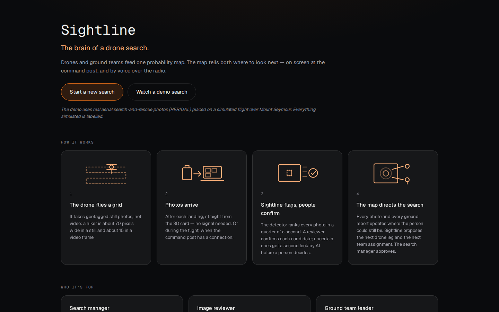

# Sightline: the brain of a drone search

**OpenCV AI Competition 2026 · technical report · DRAFT (freeze Sat Oct 25, 12:00)**

> **Status of this draft.** Every section is written from committed results. One item is open: the
> radio's word error rate on three human voices (§5.1, issue #49). Every number comes from a file in
> the repo or a cited source; anything simulated is labelled simulated. Lead: Dan (lane A).

Repository: https://github.com/Drivera0/sightline (tag `opencv-submit`) · Live demo:
https://sightline-iota-sandy.vercel.app (demo) · Live mission API on AWS: https://44-227-39-234.sslip.io
(started for demos and judging; `GET /health`).

---

## 1. Problem and users

When a hiker goes missing, search-and-rescue teams fly drones over the search area and come back
with hundreds of photos. A person is about 70 px wide in a 4000×3000 photo; a volunteer reviewing
them by eye takes about 33 s per photo (Pyrrö, Naseri & Jung 2021), so 500 photos is over four
hours, and humans in that study found 68 % of the people. Meanwhile the search manager has to
decide where to send drones and ground teams next.

Sightline is the brain of that search: **one brain, many eyes, every channel.** Drones and ground
teams feed one probability map, and the map directs both, on screen at the command post and by
voice over the radio. It assists searchers and **never declares an area clear**.

| User | Question | Where Sightline answers it |
|---|---|---|
| Search manager | Where do I send drones and teams next, and why? | Command view: map, proposals with reasons, approvals |
| Image reviewer | Show me the likeliest person first. | Review queue, with a second look on uncertain crops |
| Ground team leader | Where do I go, what am I looking for, what changed? | Assignment card, GPX, radio |


*The approval inbox on a live mission (real HERIDAL validation photos, OpenCV 5 `cv2.dnn`, Nemotron): after a
reviewer confirmed the person in the crop, the agent proposed an assignment for the nearest team and an alert,
each with its reason, evidence and a radio briefing. A person approves, edits or rejects (with a reason); an
approved briefing waits in the radio's outbound queue until the operator presses Transmit.*



*The front door, the default page: who it is for, how photos get in (after each landing from the SD card,
or during the flight), and that the demo's flight is simulated, before anything is clicked.*


*The command view on a live mission (HERIDAL validation photos at their site near Mostar; conditions from
Tavily; Nemotron): sectors move from proposed to searched with a POD (never "cleared"), each with its
probability on the live map and its drone coverage; the teams with their positions' age; the agent's
proposal waiting for approval; the clue log.*


*The live map above the command view (Mount Seymour test mission with synthetic drone photos): the heat is
rebuilt from the mission's map log and changes with each photo; grey cells have not been photographed; the
sectors show their probability now, with the last-known point, a clue and a team's position.*

## 2. What is new since BCS Hackathon 2026 (disclosure)

Sightline was first built in 36 hours at BCS Hackathon 2026 (Oct 16–17, tag `bcs-final-submission`):
the tiled detector, the review queue and the Bayesian search map, run as a batch over a demo survey.
The OpenCV organizers confirmed the existing project is eligible. Built for this competition, Oct 20–26:

- the detector running on **OpenCV 5 `cv2.dnn`**, with a parity table against the Torch path (§4.1);
- **OpenCV 5 re-look tools** and a Nemotron VL second look on uncertain detections (§4.2, §5);
- the **agent loop**: verdicts, planner legs, clues and conditions become proposals a person
  approves, every step traced (§5);
- the **radio desk**: ground teams talk to Sightline on a secondary channel; questions answered
  from the mission, clues reported by voice and logged only after a readback (§5.1);
- live missions: a search created in the browser, photos uploaded as each flight lands and
  processed as they arrive, with live updates over server-sent events (§3);
- the AWS deployment (§6);
- the live map (every photo, review, searched sector and clue updates it) and the information-gain
  planner that sends drones and teams where they rule out the most probability per minute (§5.2);
- conditions from live web search (Tavily): forecast, warnings and park alerts, each value kept only
  with a verbatim quote; they decide whether drones may fly, how much a photo can see, how exposed the
  person is, and what briefings say (`sightline/geo/conditions.py`);
- the front door, New search, and the live mission's command view: task board, teams, approval inbox,
  clue log, live map with the drones, teams and clues, and printable assignment cards with GPX/KML for
  the teams' handheld GPS (§1);
- a **simulated drone fleet** that flies approved legs and sends its photos through the same API, the
  creek scenario end to end (a team's clue re-tasks a drone; its photo shows the person), and the fleet
  evaluation (§7.4), all labelled simulated;
- the mission **debrief** from the log, and continuous integration (tests, the smoke test of the whole
  live loop, and the web build on every change).

Diff: `git diff bcs-final-submission..opencv-submit`.

## 3. Architecture


The figure shows the original batch pipeline (BCS). Live missions (contract v1.2, `sightline/mission/`,
`sightline/api/`) run the same stages per photo, while the search happens:


The `MissionStore` is the only writer of mission files and checks every write against the contract;
`validate_mission()` checks the invariants (no "clear", POD caps, decisions recorded, radio clues
confirmed). The search manager approves every move in the command view and sees each change over
server-sent events. Locally the queue is a thread in the API process; on AWS (§6) it is SQS and a
separate worker container, with the API keys in Secrets Manager.


The agent workflow (figure 3 in `docs/architecture/sightline-architecture.html`): perception
(detector on `cv2.dnn`) → OpenCV 5 re-look → decision (Nemotron VL verdict; the planner's legs) →
action (a proposal) → human approval → effect, with every step in the trace and new photos and
field reports starting the loop again.

## 4. OpenCV 5 implementation

### 4.1 The detector on `cv2.dnn`

The detector is YOLO11s fine-tuned on 1024 px tiles of HERIDAL drone photos (weights-v2; training
and ablations in `scripts/README.md`). For this competition it runs on **OpenCV 5.0 `cv2.dnn`**
from its ONNX export, with no PyTorch at run time (`sightline/ml/detect_cv.py`):

- **Tiling:** each 4000×3000 photo is cut into 20 overlapping 1024 px slices (SAHI's slice loop,
  20 % overlap), each letterboxed onto the model input, run through `net.forward()`, decoded, and
  suppressed per slice with `cv2.dnn.NMSBoxes`; the slices are merged with NMS at IoU 0.5 and
  boxes are rounded and clipped like the Torch path. The port follows the browser copy in
  `web/src/detect/tiling.ts` line for line, with its tests ported (`tests/ml/test_detect_cv.py`).
- **Frames smaller than the input:** Ultralytics pads a 1000×750 frame only to a multiple of 32
  (1024×768). A fixed-size ONNX needs the full 1024×1024 square, and the grey bands changed boxes
  near the frame's top and bottom edges. We export a variable-size ONNX (`scripts/export_onnx.py`);
  `CvDetector` detects that it accepts non-square input and pads the same way.
- **Backend switch:** `SIGHTLINE_BACKEND=cv2` (default) or `torch` through
  `sightline.ml.backend.make_detector()`, which the demo-cache build (`run_survey`) uses; the
  Nebius batch job runs `CvDetector` directly. The live pipeline and the AWS worker build theirs
  with `make_detector()` too, and `/health` reports which backend is running.

**Parity** (`scripts/parity_table.py`; the same weights, the same photos, the frozen threshold
0.29, the same scoring code; test read once, only to check agreement):

| Split | Backend | Device | VOC P / R / AP50 | SAR P / R | s per 4000×3000 photo |
|---|---|---|---|---|---|
| val (95 photos) | Torch (Ultralytics + SAHI) | RTX 4080 SUPER | 0.735 / 0.859 / 0.861 | 0.887 / 0.922 | 0.33 |
| val | **OpenCV 5 cv2.dnn** | Ryzen 9 9950X, 32 threads | 0.735 / 0.859 / 0.861 | 0.887 / 0.922 | 1.91 |
| test (101 photos, 337 people) | Torch | RTX 4080 SUPER | 0.802 / 0.864 / 0.868 | 0.898 / 0.896 | 0.30 |
| test | **OpenCV 5 cv2.dnn** | Ryzen 9 9950X | **0.802 / 0.864 / 0.868** | **0.898 / 0.896** | — |

Every score is identical to three decimals. At or above the threshold, 100 % of boxes match
one-to-one between backends at IoU ≥ 0.95 (363/363 on test, 389/389 on val), with a largest
confidence difference of 0.0015. Among all saved boxes (confidence ≥ 0.05) 99.8 % match; the rest
are low-confidence boxes that move slightly. **The demo cache re-detected on the cv2 path is
identical to the published one**: the same 36 boxes on 500 frames to the pixel, confidences to
three decimals, the same 14 review crops.

**Speed.** The pip OpenCV wheels have no CUDA, so `cv2.dnn` runs on the CPU: 1.9 s per full photo
(about 0.1 s per 1024 px slice) and 0.1 s per 1000×750 demo frame on a 16-core desktop. Engine
choice, measured per slice: OpenCV 5's default (new) engine 96 ms; the classic engine 105 ms (and
outputs differ by up to 0.003); classic with the FP16 CPU target 118 ms; the ONNX Runtime engine
inside OpenCV 99 ms; batching 4 slices 84 ms (not adopted). One pitfall worth sharing:
**importing `ultralytics` calls `cv2.setNumThreads(0)`**, which made `cv2.dnn` single-threaded and
5× slower in any process that also loads Torch; `CvDetector` now keeps and restores its own
thread count.

### 4.2 OpenCV 5 re-look tools

When the detector is unsure, OpenCV gives the next model a better look (`sightline/agent/relook.py`).
One tool per failure mode from our error analysis (`docs/DETECTOR_LIMITS.md`):

| Failure mode | Tool | OpenCV |
|---|---|---|
| Clothing that matches the ground (white on limestone, dark on dark rock) | `enhance_contrast` | CLAHE on the L channel in LAB, then a light unsharp mask (`cv2.createCLAHE`, `GaussianBlur`, `addWeighted`) |
| A person too small to read in the 1000×750 frame | `zoom_native` | a square around the box cut from the **original** photo's native pixels, `INTER_CUBIC` up to 384 px |
| Groups, people sitting or lying down | `redetect_region` | the `cv2.dnn` detector again on a 1024 px native window and on its centre upscaled 2×, boxes drawn back (`cv2.rectangle`) |

The tool is chosen per detection by labelled heuristics (box size, grey-level spread, box shape;
`sightline/agent/verify.py: choose_tools`). Tests: CLAHE keeps shape and type and raises local
contrast on a low-contrast fixture; the zoom reads the right native pixels for a frame downscaled
4× (`tests/agent/test_relook.py`).

### 4.3 OpenCV elsewhere

- **Canopy** (`sightline/search/canopy.py`): the local grey-level spread that separates tree cover
  from open ground is two `cv2.blur` box means (of the grey image and of its square) with mirrored
  borders, the standard deviation in a window without a Python loop.
- **Coverage** (`sightline/search/pod.py`): each photo's footprint is rasterised onto the canopy map
  with `cv2.fillPoly` at sub-pixel precision (`shift`), to read how much of it was under trees.
- **Choosing the re-look tool** (`sightline/agent/verify.py`): `cv2.cvtColor` to grey for the
  contrast measure; crops go to the model through `cv2.imencode`.

The live map, sectors and planner added this sprint reuse these (each photo's step is
`pod.frame_step`, with `cv2.fillPoly` and `cv2.blur` per photo); they add no new OpenCV calls.
Conditions add no OpenCV calls (text and arithmetic).

### 4.4 Where a pin goes

Each photo's position comes from the photo itself: EXIF GPS and the 35 mm focal length, and DJI XMP
relative altitude and gimbal yaw and pitch (`sightline/geo/pose.py`); oblique photos (pitch far from
straight down) and photos without a complete pose are refused with the reason. A detection's pixel is
projected to the ground on a flat-ground model through the photo's footprint
(`sightline/geo/project.py`). On the 28 nadir HERIDAL test photos with a full pose, the detector-box
part of that error is a **median of 0.05 m and a 90th percentile of 0.13 m** (92 matched people). That is
only the box's share: it leaves out GPS, altitude and terrain error, so pins keep a 10 m position
radius rather than claiming centimetres (`docs/LANE_B_GEO.md`). Clues entered by a team at their own
position use the team's last report and warn when it is more than 30 minutes old
(`sightline/geo/clues.py`).

## 5. The agent (Agentic Vision)

Full evidence: `docs/architecture/agent.md`. Summary:

**The loop** (`sightline/agent/loop.py`). Each event produces **proposals a person approves**; the
agent never acts and never dismisses a detection:

| Event | Proposal |
|---|---|
| A near-miss detection (0.15–0.29) the second look calls a person | `promote_detection`: add it to the review queue |
| A reviewer confirms a person | `alert` to all teams, and `assign_sector` for the nearest team on standby, with a briefing |
| A clue from the field, a finished drone leg, visibility dropping | `drone_leg` / `retask_drone` from the planner, with its numbers as the reason |
| Flying becomes unsafe | `alert`: recall the drones |
| Periodically | `assign_sector` for teams on standby |

**One real chain where an OpenCV 5 result changes the decision.** A val photo; the detector scored
a person lying on the ground **0.18**, below the 0.29 threshold, so no reviewer would have seen
it. The tool heuristic picked `zoom_native` (the box was 21 px in the frame). From the native
zoom, Nemotron VL answered `yes, lying, white top, dark pants`; the agent proposed
`promote_detection`; the proposal was approved (scripted for the recording, and labelled so in
the trace). The review crop is a blur; the OpenCV zoom shows the person:

| Review crop (1000×750 frame) | OpenCV 5 native zoom (4000×3000 original) |
|---|---|
|  |  |

The trace excerpt (`scripts/trace_excerpt.py`) is in `docs/architecture/agent.md`.

### 5.1 Every channel: the radio desk

Ground teams don't watch a screen. The radio desk puts Sightline on a **secondary voice channel
under the comms operator** (`sightline/radio/`, `web/src/radio/`): a team asks "say again the sector
boundary" or reports "found a blue backpack by the creek, our position", and Sightline answers by
voice from the same mission state the command view shows. Three NVIDIA models, one per step:
Parakeet TDT 0.6B v2 (speech to text, on the GPU desktop), Nemotron 3 Super with tools on Token
Factory (thinking off), Magpie TTS (text to speech, spoken sentence by sentence).

**Safety lives in code, not in the prompt.** Live runs found the model saying it had logged a clue
it never drafted, inventing the weather, describing a tool call instead of making it, and speaking
its own reasoning (`docs/feedback/radio.md`, findings 5–11). Each is now checked in code:

- a clue is **read back, built in code from the draft**, and posted only when the team answers
  "affirmative" (the turn id is stored as `confirmed_by_turn`); a report that wasn't drafted gets
  one retry, then "say again your report";
- conditions must come from `get_conditions` that turn, and "what are the conditions" is answered
  in sentences built from it;
- outbound, it **transmits only briefings the search manager approved**, and only when the
  operator presses Transmit; it never initiates orders;
- a reply that says "clear" becomes "standby"; one that names a tool or a placeholder is retried
  and never spoken.

**Measured** (RTX 4080 SUPER for speech, Token Factory for the model; text turns, so speech
recognition adds 45–153 ms): over 30 live turns, first sound p50 2.0 s and p90 3.0 s (a spoken
"standby" when the model takes over 3 s), 6 / 6 clue reports drafted, read back and committed, 6 / 6
conditions answers from the tool (`docs/evidence/radio-latency-20261020.json`). The demo script
(transmit the assignment, ask for the boundary, report a clue, confirm) ran **5 / 5 times as
scripted** with real voices (`scripts/radio_rehearse.py`). **TODO (lane E/A):** word error rate on
three human voices (`scripts/radio_wer.py`).

### 5.2 Re-tasking a drone

Recorded on a live mission (`scripts/retask_chain.py`; real server, `cv2.dnn`, live map, planner,
Nemotron; HERIDAL validation photos). Drone 1 (simulated fleet, labelled) is flying a leg over sector A1. A
photo comes in; the detector finds a person-sized box at 0.83, 20 px wide in the 1000×750 frame, so the tool
heuristic picks `zoom_native`; from the native-pixel zoom, Nemotron VL answers *yes, sitting, blue jacket,
dark head covering*. A reviewer confirms it and the search manager logs the sighting as a clue (both scripted,
and labelled so in the trace). The clue doubles sector B3's share of the probability (3.2 % → 6.9 %); the
agent re-plans and the planner proposes **`retask_drone`**: *"Re-task Drone 1 to sector B3: expected to rule out
3.1 % of the probability in 12 min (0.26 %/min), 1.1× the next best (sector B2). Within battery (95 %)."*
On approval Drone 1's leg over A1 is cancelled and the new leg approved; `validate_mission` passes.

| Review crop (1000×750 frame) | OpenCV 5 native zoom |
|---|---|
|  |  |

The trace excerpt, from detection to the drone's new leg, is in `docs/architecture/agent.md`.

## 6. AWS deployment

The live pipeline runs on AWS (us-west-2), set up and torn down by scripts in `deploy/aws/`:

| Piece | What it does |
|---|---|
| **EC2** (c7i.xlarge, 4 vCPU; Amazon Linux 2023) | one Docker image, three containers: the API, the photo **worker** running OpenCV 5 `cv2.dnn` (no PyTorch in the image), and Caddy for HTTPS |
| **SQS** (FIFO + dead-letter queue) | photo jobs, one message group per mission so each mission's photos are processed in upload order; a job is deleted only after success and goes to the dead-letter queue after 3 failures; duplicate deliveries are skipped |
| **S3** | the original photos (`missions/<id>/orig/`), private, deleted after 30 days |
| **EBS** | the mission files, shared by the API and worker containers; the API's event stream also reads events the worker writes |
| **CloudWatch** | container logs; metrics `PhotoLatencyMs` (per pipeline step), `DetectionsPerPhoto`, `AgentModelCalls`; a dashboard with the queue depth and dead letters |
| **Secrets Manager** | the Nebius and Tavily API keys, read at container start; never in the image, the repo or the logs |
| **IAM** | the instance role can only reach the bucket's `missions/` prefix, the one queue, its log group, the one secret, and `PutMetricData` in the `Sightline` namespace; no SSH port is open (administration through SSM) |

**Measured** (one real HERIDAL validation photo, 4000×3000, uploaded through the API; `scripts/remote_check.py`):

| Instance | vCPU | In the worker | of which `cv2.dnn` | Upload to "processed" |
|---|---|---|---|---|
| c7i.xlarge | 4 | 10.0 s | 9.6 s | 11.5 s |
| c7i.4xlarge | 16 | 3.5 s | 3.1 s | 4.9 s |

`cv2.dnn` needs about 30 CPU-seconds per full photo, so time falls roughly with the core count. The
same checks pass after stopping and starting the instance (same address, missions kept), so the
instance is stopped between demos. Cost while running: about $0.18 an hour on c7i.xlarge (~$0.71 on
c7i.4xlarge, used only for the demo recording); a $20 monthly budget alarm covers the account.
`teardown.sh` deletes everything.

**A longer run** (22 Oct, the instance rebuilt from `main`): 20 HERIDAL validation photos uploaded in two
batches of 10 were all processed in 4 min, 11.9 s each (median; `cv2.dnn` 11.3 s, the slowest 13.1 s); the
agent's second look ran on all 23 candidates (23 Nemotron calls). From CloudWatch:


The queue peaked at 15 photos waiting and drained at the worker's pace; the detector is nearly all of
the time per photo, so a bigger instance or a second worker shortens it directly.

## 7. Evaluation

### 7.1 Detector (HERIDAL test set, 101 photos, 337 people)

| Scoring | Recall | Precision | AP50 | Time per photo |
|---|---|---|---|---|
| SAR-APD, as in the human study | **0.896** | **0.898** | — | 0.25 s (GPU) |
| Human baseline (Pyrrö et al. 2021) | 0.68 | 0.59 | — | 33 s |
| VOC (one box per person, IoU ≥ 0.5) | 0.864 | 0.802 | 0.868 | 1.9 s (cv2.dnn, CPU) |

Threshold 0.29 chosen on validation by maximising F2 (a missed person costs more than a false
alarm). On the demo survey, all 6 photos with a person are in the first 7 of the review queue.
Ablations (tiling vs shrinking vs native-resolution single pass, whole-photo training, mirror
TTA): `scripts/README.md`.

### 7.2 Second look (verifier)

`scripts/eval_verifier.py`; Nemotron-3.5-Super-VL on Token Factory, thinking off. Rule chosen on
val among a fixed set by F2; prompt v2 chosen over v1 on val; **test scored once** with both fixed.

| | Precision | Recall | F2 |
|---|---|---|---|
| Val: threshold only | 0.735 | 0.859 | 0.831 |
| Val: + promote near-misses the verifier calls `yes` (prompt v2) | 0.699 | 0.886 | 0.841 |
| Test: threshold only | 0.802 | 0.864 | 0.850 |
| **Test: + promote near-misses called `yes`** | 0.772 | **0.875** | 0.853 |

On test the second look finds 4 more of the 337 people (recall +0.012, 95 % CI [+0.003, +0.023],
paired bootstrap over photos) for 15 more false alarms to dismiss; F2 does not change clearly.
The gain is smaller than on val (+0.027): on test the model answered `unclear` for most
near-misses and for 65 % of crops where the person is under 60 px. Test also contains four sites
that are in neither training nor validation (114 of the 337 people, `docs/DETECTOR_LIMITS.md` §5),
which may explain part of the gap. Cost: about 890 tokens in and 67 out, p50 1.35 s and p90
1.65 s per detection, about 0.00033 per detection at Token Factory's catalog prices (0.30 / 0.90
per million tokens in / out); 461 of 461 replies were valid JSON.

### 7.3 Agent: failure handling, observability, human control

- **Failure handling:** invalid JSON → one retry → `unclear` with the reason; timeouts, HTTP errors
  or a missing key → `unclear` naming the error, no proposal; without a model, planner proposals
  continue with template briefings; briefings that are over 60 words, say "clear", or contain a
  number not in their facts are rewritten once, then replaced by a template; a per-mission token
  budget stops model calls with one notice; hooks only enqueue (< 5 ms) and a failing event never
  stops the pipeline.
- **Observability:** every tool call (image path, time, the heuristics that chose it), model call
  (model, prompt version, latency, tokens, reply), verdict, proposal and decision is a line in the
  mission's `trace.jsonl`; images by path, never base64; API keys redacted (tested).
- **Human control:** proposals only; no dismissals; the fleet and the radio act only on approved
  proposals; every decision records who and when.
- **Tests:** `uv run pytest tests/ml tests/agent tests/radio`, no network or keys needed.

### 7.4 Search map and planner

All results in this section are **simulated**.

**The map** (sprint 1, `sightline/search/sim.py`; 5 m cells, 1,341 trials with the person in a
photographed cell): a ground team checks a median of 1,213 cells with Sightline's canopy-aware map
against 1,743 with a naive "photographed = cleared" map. Across 3 seeds × 5 noise levels it was
better every time: 28–30 % fewer cells at the default noise, 19–23 % with noise matching the canopy
estimate's measured error (README; `docs/LANE_C_SEARCH.md`).

**The planner** (`scripts/planner_eval.py`, `sightline/search/planner_sim.py`): on the demo mission's
map (1 km around the last known position, 5 m cells, the labelled placeholder prior, canopy measured
by its photos for 10 % of cells, 0.5 assumed elsewhere), one drone from the last known position flies
lawnmower legs for 2 hours, either in a fixed serpentine sector order or as the planner chooses
before every leg. The person's cell is drawn from the map; each pass over it finds them with
probability recall × visibility. 3 seeds × 3,200 trials per row:

| Scenario | Strategy | Median | P90 | Found within 30 min | Found within 2 h |
|---|---|---|---|---|---|
| No clue (flat prior) | fixed order | > 2 h | > 2 h | 6.8 % | 28.3 % |
| | planner | > 2 h | > 2 h | 6.9 % | 27.8 % |
| A clue at the start (100 m, medium reliability), each of the 16 sectors in turn | fixed order | > 2 h | > 2 h | 6.3 % | 27.7 % |
| | **planner** | > 2 h | > 2 h | **10.7 %** | **29.9 %** |

(Visibility noise 0.15; 0 and 0.30 move each number by at most 0.6 points.) **With a flat prior the
planner is no better than a sensible fixed order**, as expected: every sector is worth the same, so
there is nothing to choose. **With a clue it flies there first** and finds the person within 30 min
about 1.7× as often. The medians are beyond 2 hours for both, because one drone covers about 10 of
the 16 sectors in that time and each pass finds a person under typical cover only about 4 times in
10; more drones and real canopy maps are what move those numbers. An earlier version of this
evaluation counted finds on a leg that started before the 2-hour mark but ended after it, which
flattered the fixed order; it was fixed before these numbers.

**The fleet** (`scripts/fleet_eval.py`, `planner_sim.plan_fleet`; same map, visibility noise 0.15,
2,000 trials × 3 seeds per row, 2 hours): whichever drone is free first takes its next leg, either
from one shared expected map (**coordinated**), from its own map unaware of the others (**each
planning alone**), or from a fixed third of the serpentine order (**split**, as a team would cut the
area up by hand).

| Scenario | Strategy | Median | P90 | Found within 30 min | Found within 2 h |
|---|---|---|---|---|---|
| No clue | 1 drone, planner | > 2 h | > 2 h | 6.8 % | 26.7 % |
| | 3 drones, fixed order split in three | 84 min | > 2 h | 20.0 % | 61.3 % |
| | 3 drones, each planning alone | > 2 h | > 2 h | 12.1 % | 48.3 % |
| | 3 drones, coordinated | 82 min | > 2 h | 20.9 % | 62.6 % |
| A clue at the start, each sector in turn | 1 drone, planner | > 2 h | > 2 h | 10.4 % | 28.2 % |
| | 3 drones, fixed order split in three | 87 min | > 2 h | 19.8 % | 61.0 % |
| | 3 drones, each planning alone | > 2 h | > 2 h | 15.9 % | 49.2 % |
| | **3 drones, coordinated** | **81 min** | > 2 h | **23.0 %** | **62.3 %** |

Three drones find the person within 30 minutes about **3× as often** as one. Coordination is what makes
three planners worth flying: planning alone, they all take the same best sector. **Against a sensible
hand split it is only a small edge** (+3 points within 30 min with a clue, +1 without), because with a
flat prior a split is already close to the best order. (The single-drone rows differ slightly from the
table above: a different run, 2,000 rather than 3,200 trials per seed.)

### 7.5 End to end

Per photo through the live pipeline (upload → detections on screen): **2.1 s** on the GPU desktop
(16 cores, `cv2.dnn` 1.8 s), **11.5 s** on AWS c7i.xlarge and **4.9 s** on c7i.4xlarge (§6). The map
step (the live map's update for the photo, canopy from its own pixels) takes 46 ms of that for a full
HERIDAL photo covering 142 cells.

## 8. Limitations and failure cases

- **Where the detector misses** (`docs/DETECTOR_LIMITS.md`): groups of people, clothing that
  matches pale or dark rock, people sitting or lying down; two sites (MED, CAB) hold 28 of the 46
  misses. Figures: `docs/figures/limits/`.
- **Validation and test sites differ:** validation shares sites with training; four test sites
  are new. Validation numbers are an optimistic guide to new terrain.
- **The second look is weak on the smallest people:** under 60 px it mostly abstains, and with a
  neutral prompt it called many false alarms a person. It is advice that a person approves, never
  a decision.
- **What the second look gets wrong**, from the early prompt benchmark (val crops, "strict" prompt,
  `docs/evidence/verifier-bench-20261020.csv`, before the final prompt and the re-look images): of 150
  crops it called 7 real people "not a person": people in deep shade, small figures on dark grass (top
  row below; the first looks like bare rock even to us). It called 5 crops labelled "no person" a
  person, and **all 5 do show people** (bottom row): those crops were mined as hard negatives from
  regions without a label, and HERIDAL's labels miss some people. So the measured false-alarm rate of
  the second look is pessimistic, and the hard-negative set itself contains people (the hard-negative
  fine-tune was dropped for other reasons, §10).

  

- **cv2.dnn on CPU:** 1.9 s per full photo on 16 cores, slower than the GPU Torch path (0.3 s).
- **The radio desk** understands English only; Magpie speaks at about 0.66× real time on our GPU,
  so long replies are spoken sentence by sentence and the first sound depends on the model's time;
  if the model fails or times out, the team hears "say again" and nothing changes. Its numbers so
  far use typed team lines (§5.1).
- **Simulated parts:** the demo flight path over Mount Seymour, the search-map evaluation and the
  fleet are simulated and labelled so on screen; in the live AV chains (§5) the drones are simulated and
  the human steps scripted, both labelled in the trace. The search prior is a labelled placeholder
  (uniform, half outside the 1 km grid) until a cited lost-person prior; the clue and shelter factors of
  the live map are heuristics, labelled in `sightline/search/live.py`.
- **Positions assume flat ground** under each photo; on steep terrain a pin can be further off than
  its 10 m radius. The measured error covers the detector box only (§4.4).
- **Conditions are only as good as what the web says:** a value is used only when the model quotes it
  verbatim from a page and it is in range, so a forecast phrased unusually leaves the field empty rather
  than guessed; offline, the last values are shown as stale with their time, or nothing. The visibility
  factor and the exposure band (and the shelter shift it triggers) are planning heuristics, labelled so
  in the command view.

## 9. Responsible use

- **Never "clear":** no text the system writes says an area is clear or cleared; searched sectors
  say how well they were searched ("searched at POD 60 %"). Lane A's tests check every verdict,
  proposal and briefing for it (`test_the_word_clear_never_reaches_the_mission`,
  `test_never_dismisses_and_never_says_clear`); the radio replaces a spoken "clear" with "standby"
  (`tests/radio/test_turn_api.py::test_postcheck`) and its screen copy is checked for the word
  (`web/src/radio/RadioDesk.test.tsx`); `validate_mission()` flags
  it in any summary, reason, briefing or note of a mission (`tests/pipeline/test_mission.py`, "cleared in a reason");
  a searched sector's POD is capped at 0.9, so searching never rules a sector out
  (`tests/search/test_live.py::test_a_searched_sector_is_never_cleared`, and the task rule in
  `tests/pipeline/test_mission.py`).
- **Every action is approved by a person and logged** with who and when.
- **Conditions show their sources:** every Tavily call, page and extracted value with its quote is in
  the mission's trace; stale values are labelled with their time; the heuristics say they are
  heuristics on screen.
- **The web app is scanned for the word** too: every visible string in `web/src` that contains
  "clear"/"cleared" must be on a reviewed list of negations (`web/src/noClear.test.ts`).
- **No secrets in the browser, the repo or the trace**; keys come from environment variables
  and, on AWS, Secrets Manager (§6).
- **Honest evaluation:** thresholds and rules are chosen on validation; test is scored once per
  decision. Choices that saw test results are disclosed (§10).
- **Imagery:** HERIDAL (Božić-Štulić, Marušić & Gotovac, 2019), CC BY 3.0; no real search data.

## 10. Disclosures

1. **Existing project:** started at BCS Hackathon 2026 (§2); eligibility confirmed by the organizers.
2. **Test-seen choices (sprint 1):** keeping training run 2 over run 1, and dropping the
   hard-negative fine-tune, were made with test scores in view; the mirror-TTA setting was
   scored on test and not adopted (README). Test numbers are therefore slightly optimistic.
3. **Verifier benchmark:** two early 20-crop prompt runs used test photos; they were superseded by
   val runs and played no part in the final choice (`docs/LANE_A_ML.md` §6.7).
4. **This sprint:** the parity check and the verifier rule each read test once, after every
   choice was fixed on val.
5. **The human steps in both AV chains are scripted** for the recording (the review, logging the sighting as
   a clue, the approvals), and the trace says so; the fleet in the re-task chain is simulated (lane C's fleet
   simulator, `sightline/search/fleet.py`, came later and was not used for this recording), and labelled.
6. **Radio measurements** use typed team lines (and, for full voice turns, team lines spoken by
   Magpie); they were taken on a fixture mission. The desk now also runs on live missions (the Radio tab).
7. **AI assistance:** parts of the code and docs were written with an AI coding assistant; the
   agent described in §5 is Sightline's own runtime agent.

## 11. Reproduce

```bash
uv sync --extra ml                                        # Python, with the Torch path for parity
gh release download weights-v2   -R Drivera0/sightline -D data/weights/release_v2
gh release download model-onnx-v2 -R Drivera0/sightline -D data/weights/release_v2
uv run pytest tests/ml tests/agent tests/radio             # no GPU, network or keys needed
uv run --extra ml python scripts/parity_table.py           # §4.1 (needs the HERIDAL data, scripts/README.md)
uv run --extra ml python scripts/eval_verifier.py          # §7.2 (needs NEBIUS_API_KEY)
uv run --extra ml python scripts/av_chain.py               # §5 chain, then scripts/trace_excerpt.py
uv run python scripts/radio_rehearse.py --runs 5           # §5.1, against a running radio server
```

The radio server needs the NeMo environment for real voices (`sightline/radio/README.md`).

Live missions, locally and on AWS:

```bash
uv run python -m sightline.pipeline serve --radio text      # the API with a local worker (cv2 by default)
cd web && VITE_API_URL=http://127.0.0.1:8000 pnpm dev        # then open #new: start a search, drop photos in
bash scripts/smoke.sh                                       # the whole loop in ~11 s, no network or model files
bash deploy/aws/setup.sh                                     # AWS (deploy/aws/README.md); teardown.sh removes it
uv run python scripts/remote_check.py --api https://<address>   # is the deployment working right now?
```
