# Sightline: the brain of a drone search

**OpenCV AI Competition 2026 · technical report · code freeze Sat Oct 25, 12:00 PT**

> Every number comes from a file in the repo or a cited source; anything simulated is labelled
> simulated, and what we could not verify is marked. Lead: Dan (lane A). Every claim, its file and line, and how to regenerate it: [`EVIDENCE_INDEX.md`](EVIDENCE_INDEX.md).

Repository: https://github.com/Drivera0/sightline (tag `opencv-submit`) · Live demo:
https://sightline-iota-sandy.vercel.app (the console on a demo mission at t0; **Follow the search** plays it, and the Debrief's list for judges is `#m/demo?t=5&judges`, where the old `#judges` redirects) · Live
mission API on AWS: https://44-227-39-234.sslip.io (started for demos and judging; `GET /health`).

| § | Section | Rubric line it answers |
|---|---|---|
| 1 | Problem and users | Real-world impact |
| 2 | Architecture | Technical execution (architecture) |
| 3 | OpenCV 5 implementation | Technical execution (OpenCV 5 depth); Agentic Vision: OpenCV 5 integration |
| 4 | AWS deployment | Cloud delivery, observability, security |
| 5 | Agent (Agentic Vision) | Agentic Vision: integration, orchestration and autonomy, task effectiveness, failure handling and human control |
| 6 | Search map and planner | Innovation; Real-world impact |
| 7 | Conditions (Tavily) | Innovation |
| 8 | Radio desk | UX; Real-world impact |
| 9 | Evaluation summary | Technical execution (evaluation); Agentic Vision: task effectiveness and evaluation |
| 10 | Limitations and failure cases | Technical execution (reliability); responsible operation |
| 11 | Responsible use | Responsible operation and security |
| 12 | Reproducibility | Repeatability; documentation |
| 13 | What changed since BCS | Eligibility disclosure |

---

## 1. Problem and users

When a hiker goes missing, search-and-rescue teams fly drones over the search area and come back
with hundreds of photos. A person is about 70 px wide in a 4000×3000 photo; a volunteer reviewing
them by eye takes about 33 s per photo, so 500 photos is over four hours, and finds about 68 % of the
people (figures quoted by Pyrrö, Naseri & Jung 2021 under their loose SAR-APD scoring; what that baseline
did and did not measure is in §3.9). Meanwhile the search manager has to
decide where to send drones and ground teams next.

Sightline is the brain of that search: **one brain, many eyes, every channel.** Drones and ground
teams feed one probability map, and the map directs both, on screen at the command post and by
voice over the radio. It assists searchers and **never declares an area clear**.

| User | Question | Where Sightline answers it |
|---|---|---|
| Search manager | Where do I send drones and teams next, and why? | The console: map, proposals with reasons, approvals |
| Image reviewer | Show me the likeliest person first. | Review queue, with a second look on uncertain crops |
| Ground team leader | Where do I go, what am I looking for, what changed? | Assignment card, GPX, radio |

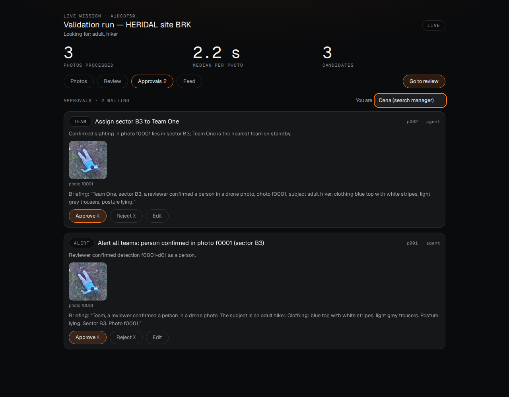

*The approval inbox on a live mission (real HERIDAL validation photos, OpenCV 5 `cv2.dnn`, Nemotron): after a
reviewer confirmed the person in the crop, the agent proposed an assignment for the nearest team and an alert,
each with its reason, evidence and a radio briefing. A person approves, edits or rejects (with a reason); an
approved briefing waits in the radio's outbound queue until the operator presses Transmit.*

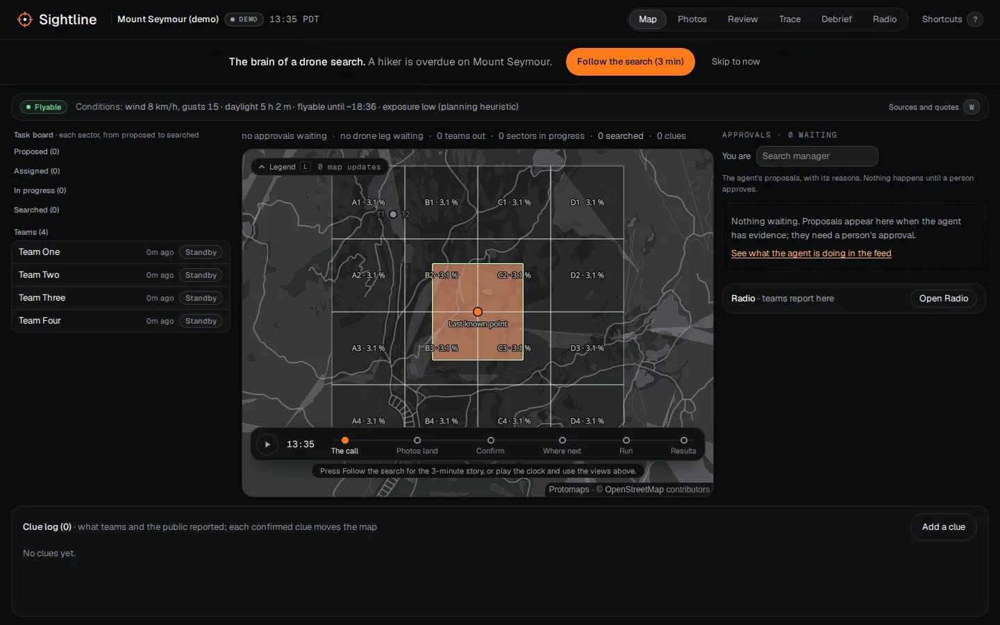

*The landing (`#`): the console on the demo mission at t0, the call, with the pitch and Follow the search, Koester's rings
around the last known point; the Demo and "Simulation on real aerial photographs" chips say what is simulated.*

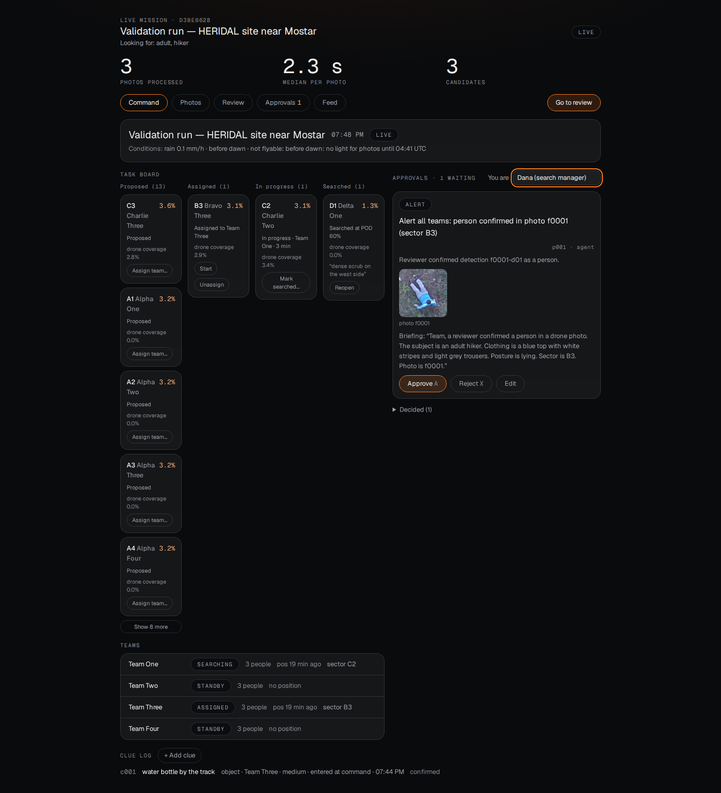

*The console's map on a live mission, before the one-console bar of #171 (HERIDAL validation photos at their site near Mostar; conditions from
Tavily; Nemotron): sectors move from proposed to searched with a POD (never "cleared"), each with its
probability on the live map and its drone coverage; the teams with their positions' age; the agent's
proposal waiting for approval; the clue log.*

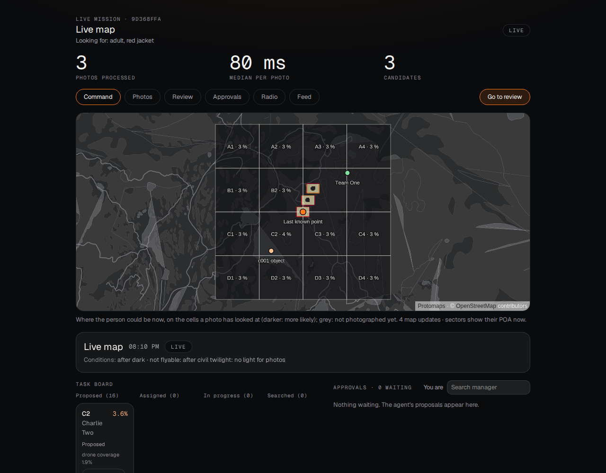

*The live map in the console (Mount Seymour test mission with synthetic drone photos): the heat is
rebuilt from the mission's map log and changes with each photo; grey cells have not been photographed; the
sectors show their probability now, with the last-known point, a clue and a team's position.*

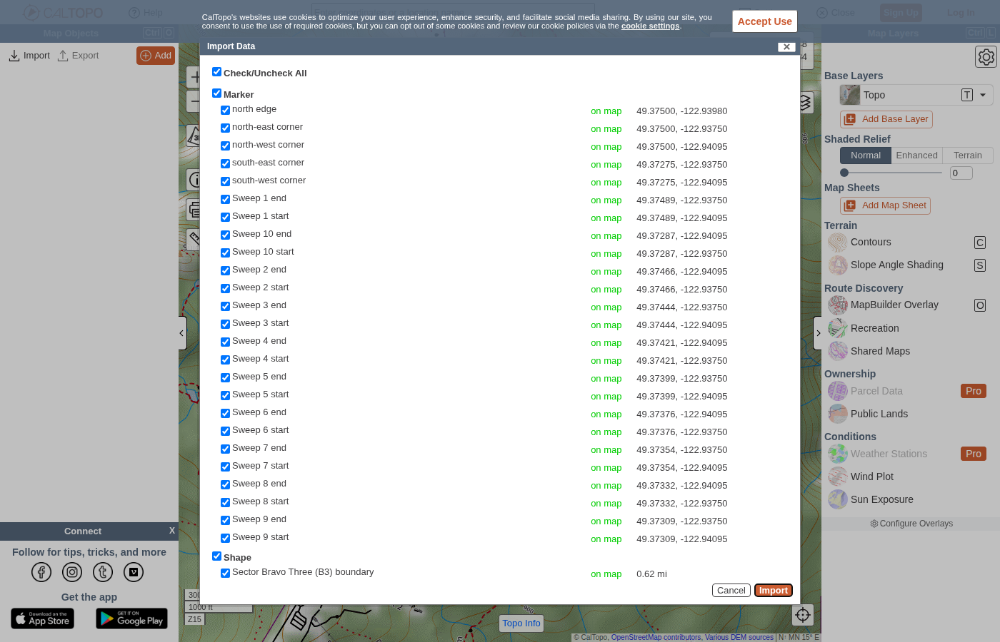

*A team's assignment card as GPX, opened in CalTopo (the mapping tool BC search teams use): every waypoint
(entry, corners, 25 m sweep lines) lands at its coordinates and the sector boundary comes in as a shape
(`scripts/make_card_fixture.py`, sector B3 at Mount Seymour; CalTopo's import preview).*

### 1.1 Where Sightline sits

**Everyone detects; nobody closes the loop.** The tools a search team can buy or download today stop at a
flagged pixel or a map of assignments; none we found turns photos, negative sweeps and field reports into
one updated probability map that proposes the next move. Checked on 22 Oct from each product's own page
unless marked:

| System | What it does | Probability map | Field teams as sensors | Voice | Approval gate |
|---|---|---|---|---|---|
| [DJI FlightHub 2 AI Copilot](https://enterprise-insights.dji.com/blog/dji-flighthub-2-latest-update-ai-copilot-2026) (Apr 2026) | an agent that runs drone missions from text or voice; routes from plain language (Aug 2026) | no | no | yes, to control drones | high-risk actions confirmed by the operator (trade press, not DJI's page) |
| [Skydio X10](https://www.skydio.com/x10) | autonomous flight, NightSense zero-light navigation, FLIR Boson+ thermal | no | no | no | n/a |
| [Eagle Eyes Search](https://www.eagleeyessearch.com/) (Squamish, BC) | flags colour and motion anomalies live on the controller; a shared operating picture; syncs with CalTopo; North Shore Rescue is testing it ([DroneXL 2025](https://dronexl.co/2025/04/22/drones-ai-thermal-transform-search-and-rescue)) | no | no | no | no |
| [Loc8](https://www.casara.ca/news/remotely-piloted-aircraft-systems-loc8-software-highlight) (CASARA) | compares pixel colours with a target palette, offline | no | no | no | no |
| [SARUAV](https://scienceinpoland.pl/en/node/78720) (Univ. of Wrocław) | automatic detection in UAV photos, plus models that narrow the search area; real finds reported in 2021 and 2024 (not verified) | area models | no | no | no |
| CalTopo / SARTopo | maps, assignments, clues, resources, ICS forms (from CalTopo's blog; training pages not opened) | no | assignments and clues | no | no |
| **Sightline** | detector on OpenCV 5, second look, planner, radio desk | Bayesian, updated per photo, sweep and clue | POD-weighted searched sectors and clues | Parakeet, Nemotron, Magpie on the radio | every proposal, logged with who and when |

## 2. Architecture

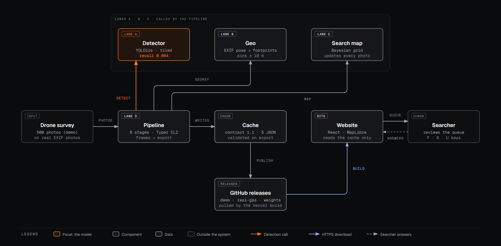

The figure shows the original batch pipeline (BCS). Live missions (contract v1.2, `sightline/mission/`,
`sightline/api/`) run the same stages per photo, while the search happens:

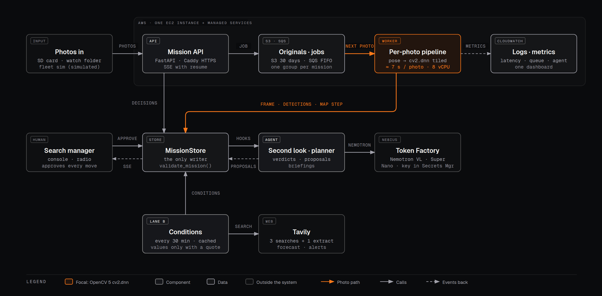

The `MissionStore` is the only writer of mission files and checks every write against the contract;
`validate_mission()` checks the invariants (no "clear", POD caps, decisions recorded, radio clues
confirmed). The search manager approves every move in the console and sees each change over
server-sent events. Locally the queue is a thread in the API process; on AWS (§4) it is SQS and a
separate worker container, with the API keys in Secrets Manager. The agent's own workflow
(perception → decision → action → human approval → effect) is figure 3, in §5.1. All four figures, with
notes: `docs/architecture/sightline-architecture.html`.

## 3. OpenCV 5 implementation

### 3.1 The detector on `cv2.dnn`

The detector is YOLO11s fine-tuned on 1024 px tiles of HERIDAL drone photos (weights-v2; training
and ablations in `scripts/README.md`). For this competition it runs on **OpenCV 5.0 `cv2.dnn`**
from its ONNX export, with no PyTorch at run time (`sightline/ml/detect_cv.py`):

- **Tiling:** each 4000×3000 photo is cut into 20 overlapping 1024 px slices (SAHI's slice loop,
  20 % overlap), each letterboxed onto the model input, run through `net.forward()`, decoded, and
  suppressed per slice with `cv2.dnn.NMSBoxes`; the slices are merged with NMS at IoU 0.5 and
  boxes are rounded and clipped like the Torch path. The port follows the browser copy in
  `web/src/detect/tiling.ts` line for line, with its tests ported (`tests/ml/test_detect_cv.py`).
- **Frames smaller than the input:** Ultralytics pads a 1000×750 frame only to a multiple of 32
  (1024×768). A fixed-size ONNX needs the full 1024×1024 square, and the grey bands changed boxes
  near the frame's top and bottom edges. We export a variable-size ONNX (`scripts/export_onnx.py`);
  `CvDetector` detects that it accepts non-square input and pads the same way.
- **Backend switch:** `SIGHTLINE_BACKEND=cv2` (default) or `torch` through
  `sightline.ml.backend.make_detector()`, which the demo-cache build (`run_survey`) uses; the
  Nebius batch job runs `CvDetector` directly. The live pipeline and the AWS worker build theirs
  with `make_detector()` too, and `/health` reports which backend is running.

**Parity** (`scripts/parity_table.py`; the same weights, the same photos, the frozen threshold
0.29, the same scoring code; test read once, only to check agreement):

| Split | Backend | Device | VOC P / R / AP50 | SAR P / R | s per 4000×3000 photo |
|---|---|---|---|---|---|
| val (95 photos) | Torch (Ultralytics + SAHI) | RTX 4080 SUPER | 0.735 / 0.859 / 0.861 | 0.887 / 0.922 | 0.33 |
| val | **OpenCV 5 cv2.dnn** | Ryzen 9 9950X, 32 threads | 0.735 / 0.859 / 0.861 | 0.887 / 0.922 | 1.91 |
| test (101 photos, 337 people) | Torch | RTX 4080 SUPER | 0.802 / 0.864 / 0.868 | 0.898 / 0.896 | 0.30 |
| test | **OpenCV 5 cv2.dnn** | Ryzen 9 9950X | **0.802 / 0.864 / 0.868** | **0.898 / 0.896** | — |

The Torch times are from this parity run; the evaluation run on the same GPU (`detector_metrics.json`, §3.9) measured 0.25 s per test photo, which is the GPU time quoted elsewhere. Every score is identical to three decimals. At or above the threshold, 100 % of boxes match
one-to-one between backends at IoU ≥ 0.95 (363/363 on test, 389/389 on val), with a largest
confidence difference of 0.0015. Among all saved boxes (confidence ≥ 0.05) 99.8 % match; the rest
are low-confidence boxes that move slightly. **The demo cache re-detected on the cv2 path is
identical to the published one**: the same 36 boxes on 500 frames to the pixel, confidences to
three decimals, the same 14 review crops.

**Speed.** The pip OpenCV wheels have no CUDA, so `cv2.dnn` runs on the CPU: 1.9 s per full photo
(about 0.1 s per 1024 px slice) and 0.1 s per 1000×750 demo frame on a 16-core desktop. Engine
choice, measured per slice: OpenCV 5's default (new) engine 96 ms; the classic engine 105 ms (and
outputs differ by up to 0.003); classic with the FP16 CPU target 118 ms; the ONNX Runtime engine
inside OpenCV 99 ms; batching 4 slices 84 ms (not adopted). One pitfall worth sharing:
**importing `ultralytics` calls `cv2.setNumThreads(0)`**, which made `cv2.dnn` single-threaded and
5× slower in any process that also loads Torch; `CvDetector` now keeps and restores its own
thread count.

### 3.2 The OpenCV 5 engine, stated precisely

Checked on 22 Oct against the
[OpenCV 5 wiki](https://github.com/opencv/opencv/wiki/OpenCV-5), the
[4 → 5 migration guide](https://github.com/opencv/opencv/wiki/OpenCV-4-to-5-migration) and
[`dnn.hpp` at the 5.0.0 tag](https://github.com/opencv/opencv/blob/5.0.0/modules/dnn/include/opencv2/dnn/dnn.hpp):

- OpenCV 5.0 adds a new graph-based DNN engine beside the classic one. `readNet`, `readNetFromONNX` and
  the other loaders take `engine=` with `ENGINE_CLASSIC` (1), `ENGINE_NEW` (2), `ENGINE_AUTO` (3, the
  default: "Try to use the new engine and then fall back to the classic version") or `ENGINE_ORT` (4,
  ONNX Runtime inside OpenCV). The environment variable **`OPENCV_FORCE_DNN_ENGINE`** (same numbers)
  overrides it for a process. Sightline calls `cv2.dnn.readNetFromONNX` with the default, and the new
  engine loads our YOLO11s graph without falling back.
- **The new engine runs on the CPU only in 5.0.** The wiki: "GPU support will be added in subsequent
  releases. In the meantime, users who need GPU acceleration can either force the classic engine or
  build OpenCV with ORT and NVIDIA execution providers." With the pip wheels (no CUDA) that is why our
  `cv2.dnn` numbers are CPU numbers.
- **ONNX coverage:** the wiki says the new engine covers "over 64% of the ONNX specification", against
  under 13 % for 4.x. OpenCV's announcement is reported to say "over 80%" (we could not open opencv.org
  to quote it; the engine doc on today's `5.x` branch says about 75–80 % of the operator specification).
- **QDQ** (quantize/dequantize) graphs: the new engine fuses them (`fuseQDQ` in the `5.x` source), and
  OpenCV's benchmark has a ResNet50 QDQ row. We quantized Sightline's detector and measured it (§3.3).
- The `5.x` branch has since renamed the engines (`ENGINE_AUTO` 0, `ENGINE_OPENCV` 1, `ENGINE_ORT` 2);
  Sightline pins `opencv-python==5.0.0.93`, where the names above apply.

**Against OpenCV's own benchmark.** The [OpenCV 5 DNN benchmarks](https://github.com/opencv/opencv/wiki/OpenCV-5-DNN-Benchmarks)
list YOLOv8 on an Intel i9 at **12.42 ms with the new engine against 12.98 ms with ONNX Runtime 1.25.1**
(4 % faster). Our measurement, YOLO11s on one 1024 px slice on a Ryzen 9 9950X, is **96 ms with the new
engine against 99 ms with `ENGINE_ORT`** (3 % faster): the same direction and about the same margin, on a
different model, input size and CPU.

### 3.3 INT8 QDQ: a negative result

Full write-up: [`INT8_ENGINE.md`](INT8_ENGINE.md) (val only; the test split was never read). The detector
quantized to INT8 QDQ with ONNX Runtime's static quantizer (64 val tiles for calibration, the Detect head
kept in float) **loads and runs in OpenCV 5's new engine without errors, but is slower and slightly less
accurate**:

| Val, 95 photos, threshold 0.29 | ms per 1024 px tile | s per photo | VOC P / R / AP50 | Model size |
|---|---|---|---|---|
| FP32 (shipped), `ENGINE_NEW` | 92.0 ± 3.0 | 1.99 ± 0.09 | 0.735 / 0.859 / 0.861 | 36.4 MB |
| INT8 QDQ, head float, `ENGINE_NEW` | 132.4 ± 3.5 | 2.77 ± 0.07 | 0.728 / 0.853 / 0.842 | 12.0 MB |

Two findings worth sharing: quantizing the whole graph finds nobody (ONNX Runtime gives the same all-zero
scores, so the cause is the quantization of YOLO11's concatenated box-and-score output, not OpenCV), and
ONNX Runtime runs the same INT8 file 1.5× faster than FP32 while OpenCV 5 runs it 1.44× slower. FP32 on
`ENGINE_NEW` stays the default. The timings were taken on a busy machine (caveats in the write-up).

### 3.4 `cv2.dnn` on CUDA

Full write-up: [`CV2_CUDA.md`](CV2_CUDA.md). The pinned pip wheel has no CUDA, so we built OpenCV 5.0.0
with CUDA 12.9 and cuDNN 9.10 (toolkit from conda-forge) and ran the detector through the **classic** engine
with `DNN_BACKEND_CUDA` (the new engine is CPU-only in 5.0, §3.2), on the RTX 4080 SUPER:

| Path | ms per 1024 px slice | s per 4000×3000 photo | Test VOC P / R / AP50 |
|---|---|---|---|
| `cv2.dnn`, CUDA FP32, classic engine | 10.5 ± 0.4 | 0.303 ± 0.012 | 0.802 / 0.864 / 0.868 |
| `cv2.dnn`, CPU, new engine (pip wheel) | 95.8 ± 0.1 | 1.973 ± 0.005 | 0.802 / 0.864 / 0.868 |
| Torch (Ultralytics + SAHI), `detector_metrics.json` | — | 0.25 | 0.802 / 0.864 / 0.868 |

The FP32 boxes are the CPU boxes to the pixel (363 of 363 at 0.29). That is 6.5× faster per photo than
the CPU path and about 20 % slower than Torch: the forward passes are about 0.21 s of a photo, the rest is
reading the JPEG and the Python tiling and NMS. FP16 is no faster here and moves a few boxes. This is a
custom build, not the shipped path: `uv sync` installs the CPU wheel, and the judge path stays on the CPU
(`SIGHTLINE_CV_BACKEND=cuda` selects it in `sightline/ml/detect_cv.py`).

### 3.5 OpenCV 5 re-look tools

When the detector is unsure, OpenCV gives the next model a better look (`sightline/agent/relook.py`).
One tool per failure mode from our error analysis (`docs/DETECTOR_LIMITS.md`):

| Failure mode | Tool | OpenCV |
|---|---|---|
| Clothing that matches the ground (white on limestone, dark on dark rock) | `enhance_contrast` | CLAHE on the L channel in LAB, then a light unsharp mask (`cv2.createCLAHE`, `GaussianBlur`, `addWeighted`) |
| A person too small to read in the 1000×750 frame | `zoom_native` | a square around the box cut from the **original** photo's native pixels, `INTER_CUBIC` up to 384 px |
| Groups, people sitting or lying down | `redetect_region` | the `cv2.dnn` detector again on a 1024 px native window and on its centre upscaled 2×, boxes drawn back (`cv2.rectangle`) |

The tool is chosen per detection by labelled heuristics (box size, grey-level spread, box shape;
`sightline/agent/verify.py: choose_tools`). Tests: CLAHE keeps shape and type and raises local
contrast on a low-contrast fixture; the zoom reads the right native pixels for a frame downscaled
4× (`tests/agent/test_relook.py`).

### 3.6 OpenCV elsewhere

- **Canopy** (`sightline/search/canopy.py`): the local grey-level spread that separates tree cover
  from open ground is two `cv2.blur` box means (of the grey image and of its square) with mirrored
  borders, the standard deviation in a window without a Python loop.
- **Coverage** (`sightline/search/pod.py`): each photo's footprint is rasterised onto the canopy map
  with `cv2.fillPoly` at sub-pixel precision (`shift`), to read how much of it was under trees.
- **Choosing the re-look tool** (`sightline/agent/verify.py`): `cv2.cvtColor` to grey for the
  contrast measure; crops go to the model through `cv2.imencode`.

The live map, sectors and planner added this sprint reuse these (each photo's step is
`pod.frame_step`, with `cv2.fillPoly` and `cv2.blur` per photo); they add no new OpenCV calls.
Conditions add no OpenCV calls (text and arithmetic).

### 3.7 Where a pin goes

Each photo's position comes from the photo itself: EXIF GPS and the 35 mm focal length, and DJI XMP
relative altitude and gimbal yaw and pitch (`sightline/geo/pose.py`); oblique photos (pitch far from
straight down) and photos without a complete pose are refused with the reason. A detection's pixel is
projected to the ground on a flat-ground model through the photo's footprint
(`sightline/geo/project.py`). On the 28 nadir HERIDAL test photos with a full pose, the detector-box
part of that error is a **median of 0.05 m and a 90th percentile of 0.13 m** (92 matched people). That is
only the box's share: it leaves out GPS, altitude and terrain error, so pins keep a 10 m position
radius rather than claiming centimetres (`docs/LANE_B_GEO.md`). Clues entered by a team at their own
position use the team's last report and warn when it is more than 30 minutes old
(`sightline/geo/clues.py`).

### 3.8 Every OpenCV call Sightline makes

From `grep -rn "cv2\." sightline/` (all in five files; the scripts add only evaluation and figures):

| Call | Where | Why |
|---|---|---|
| `cv2.dnn.readNetFromONNX` (default `ENGINE_AUTO` → new engine) | `ml/detect_cv.py` `CvDetector` | load the detector's ONNX export; no PyTorch at run time |
| `cv2.dnn.blobFromImage`, `net.setInput`, `net.forward` | `ml/detect_cv.py` | one letterboxed 1024 px slice → NCHW blob (1/255, BGR → RGB) → raw boxes |
| `cv2.dnn.NMSBoxes` | `ml/detect_cv.py` | suppress per slice, then merge the 20 slices at IoU 0.5 |
| `cv2.imread`, `cv2.resize` (`INTER_LINEAR`) | `ml/detect_cv.py` | read the photo; resize each slice like Ultralytics' letterbox |
| `cv2.getNumThreads`, `cv2.setNumThreads` | `ml/detect_cv.py` | keep and restore OpenCV's thread count (importing `ultralytics` sets it to 0) |
| `cv2.createCLAHE`, `cv2.cvtColor` (BGR ↔ LAB), `cv2.split`, `cv2.merge`, `cv2.GaussianBlur`, `cv2.addWeighted` | `agent/relook.py` `enhance_contrast` | CLAHE on the L channel and a light unsharp mask, for clothing that matches the ground |
| `cv2.resize` (`INTER_CUBIC` up, `INTER_AREA` down) | `agent/relook.py` `zoom_native`, `redetect_region` | native-pixel zoom of the box from the original photo; the 2× centre re-detection window |
| `cv2.rectangle` | `agent/relook.py` `redetect_region` | draw the re-detected boxes for the model to see |
| `cv2.imencode` (JPEG q92), `cv2.imdecode` | `agent/relook.py`, `agent/verify.py` | crops and re-look images to and from bytes for the store and the model call |
| `cv2.cvtColor` (BGR → grey) | `agent/verify.py` `choose_tools` | grey-level spread, one of the heuristics that picks the re-look tool |
| `cv2.blur` (`BORDER_REFLECT`) | `search/canopy.py` | local standard deviation as two box means: tree cover vs open ground |
| `cv2.fillPoly` (`LINE_8`, sub-pixel `shift`) | `search/pod.py` | rasterise each photo's footprint onto the map to read its canopy and step its POD |

### 3.9 Detector accuracy (HERIDAL test set, 101 photos, 337 people)

| Scoring | Recall | Precision | AP50 | Time per photo |
|---|---|---|---|---|
| SAR-APD, as in the human figures | 0.896 | 0.898 | — | 0.25 s (GPU) |
| Human reference (quoted by Pyrrö et al. 2021; not a matched study) | 0.68 | 0.59 | — | 33 s |
| VOC (one box per person, IoU ≥ 0.5) | 0.864 | 0.802 | 0.868 | 1.9 s (cv2.dnn, CPU) |

**What the human figures are.** Pyrrö, Naseri & Jung (2021, arXiv:2111.09406, §5) write: "According to
Pyrrö et al. [35], the average human achieves roughly the following metrics in SAR-APD: 59% PRC, 68% RCL and
33 s ATI, with less than around 200 images to inspect", where [35] is Pyrrö's 2021 Aalto master's thesis;
they add that human performance drops with the number of images because of fatigue. The paper does not say
who the people were, how they marked people, or whether they saw these 101 test photos, so 0.896 against
0.68 is a reference point, not a head-to-head result. SAR-APD (their §2.3) is deliberately loose: one box
may cover several people (a box over a group of five counts five hits) and a box needs an IoU of only
0.0025 with a person; the authors note that SAR-APD results "cannot be directly compared to other work".
That is why every other number in this report uses the strict VOC scoring.

**Test-set disclosure, beside the numbers it affects.** The threshold and every inference setting were
chosen on validation, but two model choices were made with these test scores in view: keeping training
run 2 over run 1, and dropping the hard-negative fine-tune (test F2 0.840 vs 0.850). A later check on
validation could not have made either call (run 2 vs run 1 ΔF2 +0.002, 95 % CI [−0.028, +0.031];
`scripts/README.md`). **Best estimate of true test recall (VOC): about 0.86, the reported 0.864 or slightly below**, since the
alternatives differed by less than validation can resolve and the dropped model had the higher test recall
(0.869); on terrain the model has never seen, expect lower: recall is 0.825 on the 114 people at the four
test sites that are in neither training nor validation (`docs/DETECTOR_LIMITS.md` §5).

Threshold 0.29 chosen on validation by maximising F2 (a missed person costs more than a false
alarm). On the demo survey, all 6 photos with a person are in the first 7 of the review queue.
Ablations (tiling vs shrinking vs native-resolution single pass, whole-photo training, mirror
TTA): `scripts/README.md`.

### 3.10 Published results on HERIDAL, side by side

Precision, recall and AP in per cent, on the HERIDAL test set as each source states it.

| Method | Precision | Recall | AP | Source |
|---|---|---|---|---|
| Saliency-guided VGG16 (Božić-Štulić, Marušić & Gotovac, IJCV 2019) | 34.8 | 88.9 | — | the paper's authors, as quoted by AIR [a] |
| Faster R-CNN (Marušić et al., SpliTech 2018) | 67.3 | 88.3 | 86.1 | the paper's authors, as quoted by AIR [a] |
| SSD (as reported by Kundid Vasić & Papić, Electronics 2020) | 4.3 | 94.4 | — | the paper's authors, as quoted by AIR [a] |
| Two-stage multimodel CNN (Kundid Vasić & Papić, Electronics 2020) | 68.9 | 94.7 | — | the paper's authors, as quoted by AIR [a] [b] |
| AIR with NMS (Accenture) | 90.1 | 86.1 | 84.6 | self-reported [a]; scoring protocol not stated on the page |
| **Sightline, strict VOC (one box per person, IoU ≥ 0.5)** | **80.2** | **86.4** | **86.8** | §3.9; `scripts/reproduce_cv2.py` |
| Sightline, SAR-APD (scored like the human study) | 89.8 | 89.6 | — | §3.9; `scripts/parity_table.py` |

[a] The "Results on HERIDAL test set" table in the AIR README, https://github.com/Accenture/AIR (read
2026-10-22), which adds: "We did not test any of the other methods ourselves." [b] The paper's abstract gives
precision 68.89 % and recall 94.65 % (https://www.mdpi.com/2079-9292/9/9/1459); mdpi.com refused our
fetch of the full text (HTTP 403), so its split, matching rule and the SSD row are taken from AIR's table
unchecked.

**Why the rows are not strictly comparable.** None of the published rows states its matching rule on
the page we read, so an IoU of 0.5, a looser overlap or SAR-APD's one-box-per-group rule could each be
behind a row; our own two rows differ by up to 9.6 points between strict VOC and SAR-APD on the same
boxes (§3.9). Each row is also one operating point: precision and recall trade off with the threshold
(ours is 0.29, chosen on validation), and only three rows report a threshold-free AP. Every row says
"HERIDAL test set", but we have not checked that the earlier papers scored the same 101 photos with the
same labels; our own converter squashed 42 test labels in four photos until we fixed it
(`docs/DETECTOR_LIMITS.md` §1). Read the table as context, not a ranking: our strict row has AIR's
recall at lower precision and the highest AP printed here. It is also the only row we can check from a
clean checkout in about 5 minutes on a CPU: `scripts/reproduce_cv2.py` re-scores the test set on
`cv2.dnn` and exits 1 if any number differs (§12.1). AIR ships an evaluation script (`evaluate.sh`) for
its SAR-APD setting; for the paper rows we quote the published numbers only.

## 4. AWS deployment

The live pipeline runs on AWS (us-west-2), set up and torn down by scripts in `deploy/aws/`:

| Piece | What it does |
|---|---|
| **EC2** (c7i.2xlarge, 8 vCPU; Amazon Linux 2023) | one Docker image, three containers: the API, the photo **worker** running OpenCV 5 `cv2.dnn` (no PyTorch in the image), and Caddy for HTTPS |
| **SQS** (FIFO + dead-letter queue) | photo jobs, one message group per mission so each mission's photos are processed in upload order; a job is deleted only after success and goes to the dead-letter queue after 3 failures; duplicate deliveries are skipped |
| **S3** | the original photos (`missions/<id>/orig/`), private, deleted after 30 days |
| **EBS** | the mission files, shared by the API and worker containers; the API's event stream also reads events the worker writes |
| **CloudWatch** | container logs; metrics `PhotoLatencyMs` (per pipeline step), `DetectionsPerPhoto`, `AgentModelCalls`; a dashboard with the queue depth and dead letters |
| **Secrets Manager** | the Nebius and Tavily API keys, read at container start; never in the image, the repo or the logs |
| **IAM** | the instance role can only reach the bucket's `missions/` prefix, the one queue, its log group, the one secret, and `PutMetricData` in the `Sightline` namespace; no SSH port is open (administration through SSM) |

**Measured** (one real HERIDAL validation photo, 4000×3000, uploaded through the API; `scripts/remote_check.py`):

| Instance | vCPU | In the worker | of which `cv2.dnn` | Upload to "processed" |
|---|---|---|---|---|
| c7i.xlarge | 4 | 10.0 s | 9.6 s | 11.5 s |
| **c7i.2xlarge (default since Oct 22)** | 8 | 5.1 s | 4.7 s | **7.1 s** |
| c7i.4xlarge | 16 | 3.5 s | 3.1 s | 4.9 s |

`cv2.dnn` needs about 30 CPU-seconds per full photo, so time falls roughly with the core count. The
same checks pass after stopping and starting the instance (same address, missions kept), so the
instance is stopped between demos. c7i.xlarge missed the plan's 10 s per photo, and batching the slices,
OpenCV 5's FP16 target and its ORT engine made no difference (all ~0.146 s per slice, identical output), so the
default became c7i.2xlarge. Cost while running: about $0.36 an hour on c7i.2xlarge (~$0.71 on c7i.4xlarge,
used only for the demo recording); a $20 monthly budget alarm covers the account.
`teardown.sh` deletes everything.

**End to end**, per photo through the live pipeline (upload → detections on screen): **2.1 s** on the GPU desktop
(16 cores, `cv2.dnn` 1.8 s), **7.1 s** on AWS c7i.2xlarge (the default; 11.5 s on c7i.xlarge) and **4.9 s** on
c7i.4xlarge. The map step (the live map's update for the photo, canopy from its own pixels) takes 46 ms of that
for a full HERIDAL photo covering 142 cells.

**A longer run** (21 Oct, the instance rebuilt from `main`, on c7i.xlarge, the default size then): 20 HERIDAL validation photos uploaded in two
batches of 10 were all processed in 4 min, 11.9 s each (median; `cv2.dnn` 11.3 s, the slowest 13.1 s); the
agent's second look ran on all 23 candidates (23 Nemotron calls). From CloudWatch:

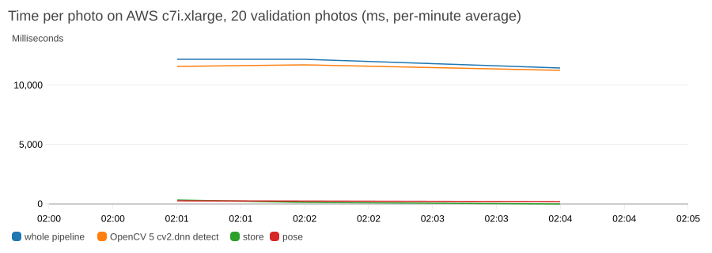
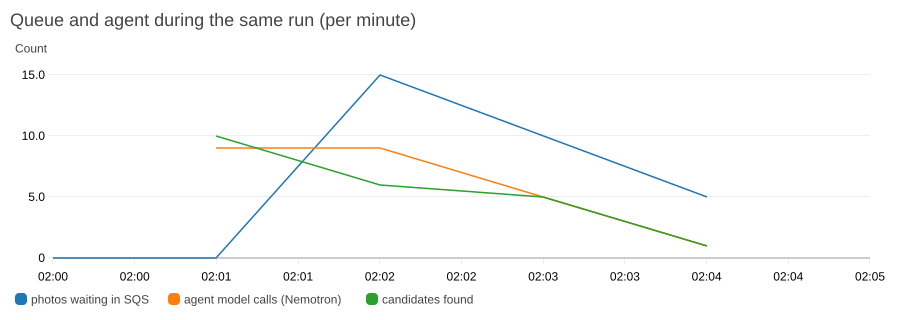

The queue peaked at 15 photos waiting and drained at the worker's pace; the detector is nearly all of
the time per photo, so a bigger instance or a second worker shortens it directly.

**Limits, token and uptime check** (details: `docs/SECURITY.md`, `deploy/aws/README.md`):

- **Limits on what a client can send** (`sightline/api/limits.py`, tests in `tests/pipeline/test_api_hardening.py`):
  one photo 28 MB and 100 MP, decoded and re-saved by Pillow before anything reads it; a batch 1–50 files and
  400 MB; JSON writes 1 MB; file names are labels, never paths; writes per client IP 600 per 60 s by default
  (`SIGHTLINE_RATE_LIMIT`), answered with 429 and `Retry-After`.
- **Write token:** with `SIGHTLINE_API_TOKEN` set, every POST, PUT, PATCH and DELETE needs
  `Authorization: Bearer <token>`; reads, `/health` and the event stream stay open, so the public site can show
  a mission but not change one (`sightline/api/auth.py`). It is optional, so judges can create a mission
  without an account; how to turn it on during judging is in `deploy/aws/README.md`.
- **Uptime check:** `.github/workflows/judging-check.yml` runs `scripts/remote_check.py --read-only` every 6
  hours (health, CORS, an earlier mission and its event stream, a 404) and opens an issue when a check fails;
  the full `remote_check.py` (one photo through upload → SQS → worker → `photo.processed`) is run by hand
  before a demo, and passed all 7 checks before and after a stop/start on 22 Oct.

### 4.1 Cost and energy of one mission

**A 500-photo mission's compute costs under a dollar: about $0.67 on the AWS path, about $0.49 with
detection as a Nebius Serverless Job.** Every input is a measured number from this repo, except the Tavily
credit price and the per-vCPU wattage, which are cited. Prices in US dollars, list or catalog prices.

| Item | Inputs (source) | 500 photos |
|---|---|---|
| Detector, `cv2.dnn` on AWS c7i.2xlarge | 5.1 s per photo in the worker (`docs/report/OPENCV_REPORT.md:374`) × 500 = 2,550 s = 0.71 h, at about $0.36 an hour (`:381`) | $0.26 |
| Second look, Nemotron VL on Token Factory | 170 calls on 95 HERIDAL val photos (`docs/LANE_A_ML.md:273`, `:183`), so about 895 calls for 500 photos, × about $0.00033 per call (`docs/feedback/nebius.md:75`) | $0.30 |
| Conditions, Tavily | one lookup per area per clock hour, at most 4 calls (`docs/report/TAVILY.md:15`): 3 advanced searches at 2 credits and 1 basic extract at 1 credit (`:17`, `:20`; `sightline/geo/conditions.py:540`, `:575`), so 7 credits an hour at $0.008 per credit ([Tavily API credits](https://docs.tavily.com/documentation/api-credits)); for a 2-hour mission (our assumption) | $0.11 |
| **Total, AWS path** | | **$0.67** |
| Instead of the AWS detector row: a Nebius Serverless Job | 0.68 s per photo inside the job plus about 3 min of VM start (677 s − 483 s), at $0.53 an hour (`docs/feedback/nebius.md:175-178`): (500 × 0.68 s + 194 s) = 534 s | $0.08 |
| Instead of the CPU detector: `cv2.dnn` on a GPU | 0.303 s per photo on an RTX 4080 SUPER (`docs/report/CV2_CUDA.md:143`) × 500 = 152 s, about 2.5 min | time only; no GPU price is recorded in the repo |

The second-look row is an upper bound for a real survey: HERIDAL photos were chosen because they contain
people, so most of a search's photos would give no near-miss to check (100 calls would be $0.03). The
Tavily row falls inside Tavily's 1,000 free credits a month for about 140 mission-hours (70 two-hour missions). Not counted: the
instance's idle hours between missions (it is stopped, §4), S3 storage, and the mission-length Token Factory
calls for briefings and radio turns, which are not metered per mission in the repo.

**Energy, an estimate.** `cv2.dnn` needs about 30 CPU-seconds per photo (`docs/report/OPENCV_REPORT.md:377`),
so 500 photos take about 15,000 vCPU-seconds (4.2 vCPU-hours). At Cloud Carbon Footprint's AWS average
of 3.5 W per vCPU at full load and a PUE of 1.135 ([methodology, Appendix I](https://www.cloudcarbonfootprint.org/docs/methodology)),
that is about 4.2 × 3.5 × 1.135 ≈ **17 Wh for the detector on a 500-photo mission**. It is a coefficient-based
estimate, not a meter reading, and leaves out memory, storage, network and the model calls.

## 5. Agent (Agentic Vision)

Full evidence: `docs/architecture/agent.md` (workflow and sequence diagrams, the trace tables, the rubric
line by line). Evaluation: [`AGENT_EVAL.md`](AGENT_EVAL.md).

### 5.1 Perception → decision → action, with a person at the gate

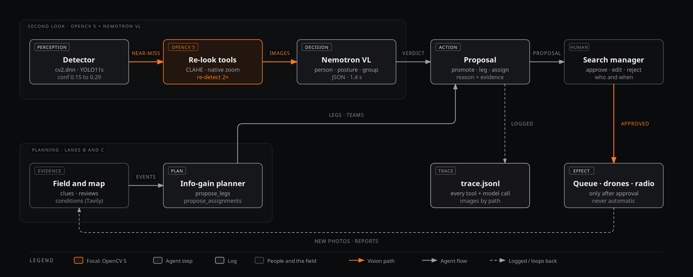

The agent workflow (figure 3 in `docs/architecture/sightline-architecture.html`; the same as a Mermaid
flowchart with the approval diamond in `docs/architecture/agent.md`): perception
(detector on `cv2.dnn`) → OpenCV 5 re-look → decision (Nemotron VL verdict; the planner's legs) →
action (a proposal) → human approval → effect, with every step in the trace and new photos and
field reports starting the loop again.

**The loop** (`sightline/agent/loop.py`). Each event produces **proposals a person approves**; the
agent never acts and never dismisses a detection. The gate is a design choice with outside support: in
a simulated disaster search with an LLM-driven drone swarm, Ji et al. (arXiv
[2511.04042](https://arxiv.org/abs/2511.04042), 2025) report that human feedback on the plan raised mission
success from 62.0 % to 94.0 % (their system re-planned in 97 % of the cases a person flagged). Their humans
corrected plans rather than approving each action, so this supports keeping a person in the loop, not our
exact gate.

| Event | Proposal |
|---|---|
| A near-miss detection (0.15–0.29) the second look calls a person | `promote_detection`: add it to the review queue |
| A reviewer confirms a person | `alert` to all teams, and `assign_sector` for the nearest team on standby, with a briefing |
| A clue from the field, a finished drone leg, visibility dropping, a sector searched at a POD, a team's new position | `drone_leg` / `retask_drone` from the planner, with its numbers as the reason |
| The fleet joins | an opening `drone_leg` for every idle drone |
| Flying becomes unsafe | `alert`: recall the drones |
| Periodically | `assign_sector` for teams on standby |

### 5.2 One real chain where an OpenCV 5 result changes the decision

A val photo; the detector scored
a person lying on the ground **0.18**, below the 0.29 threshold, so no reviewer would have seen
it. The tool heuristic picked `zoom_native` (the box was 21 px in the frame). From the native
zoom, Nemotron VL answered `yes, lying, white top, dark pants`; the agent proposed
`promote_detection`; the proposal was approved (scripted for the recording, and labelled so in
the trace). The review crop is a blur; the OpenCV zoom shows the person:

| Review crop (1000×750 frame) | OpenCV 5 native zoom (4000×3000 original) |
|---|---|
| 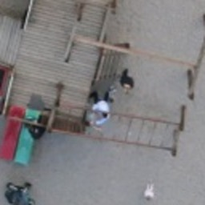 | 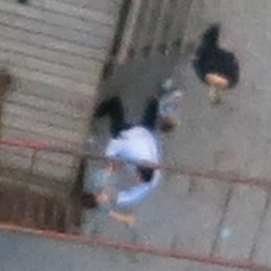 |

The trace, span by span (every value from `docs/architecture/av-chain/trace.jsonl`; the full excerpt,
printed by `scripts/trace_excerpt.py`, is in `docs/architecture/agent.md`):

| Span | Tool / model | Output | ms | What it changed next |
|---|---|---|---|---|
| 1 `pipeline` note | the detector, OpenCV 5 `cv2.dnn` | confidence 0.179, below 0.29: not in the review queue | — | the near-miss triggers the second look |
| 2 `verifier` tool_call | `zoom_native` (box 21 px, aspect 1.00, grey spread 32.2) | a zoom cut from native pixels | 0 | the zoom is the image the model answers from |
| 3 `verifier` model_call | `nvidia/Nemotron-3.5-Super-VL`, prompt `verify-v2` | person yes, lying, white top, dark pants (809 tokens in, 61 out) | 1414 | a `yes` on a near-miss is the condition for a promotion |
| 4 `verifier` verdict | — | `v0001`: person yes, tool `zoom_native` | 1488 | stored on the detection, handed to the loop |
| 5 `agent` proposal | `loop.py` `_on_detection` | `p001 promote_detection`, with the reason | — | pending in the approval inbox |
| 6 `human` decision | — | approved (scripted for this run, and the trace says so) | — | the detection joins the review queue |

**The Trace view.** The same chains are in the product: on any mission's console, `#m/<id>/trace`
(`web/src/command/TraceView.tsx`) polls `GET /missions/{id}/trace` and groups the entries into chains by
the ids they share (perception → decision → action → approval), one line per step (span type, tool or
model, input, output, ms), each opening to its full input, output and images, with the proposal each
chain led to and who decided it, and a strip counting model calls per model. The demo mission
(`#m/demo/trace`, no server) shows the chain above and a live conditions lookup, labelled Recorded.

### 5.3 Re-tasking a drone

Recorded on a live mission (`scripts/retask_chain.py`; real server, `cv2.dnn`, live map, planner,
Nemotron; HERIDAL validation photos). Drone 1 (simulated fleet, labelled) is flying a leg over sector A1. A
photo comes in; the detector finds a person-sized box at 0.83, 20 px wide in the 1000×750 frame, so the tool
heuristic picks `zoom_native`; from the native-pixel zoom, Nemotron VL answers *yes, sitting, blue jacket,
dark head covering*. A reviewer confirms it and the search manager logs the sighting as a clue (both scripted,
and labelled so in the trace). The clue doubles sector B3's share of the probability (3.2 % → 6.9 %); the
agent re-plans and the planner proposes **`retask_drone`**: *"Re-task Drone 1 to sector B3: expected to lower the
remaining probability by 3.1 % in 12 min (0.26 %/min), 1.1× the next best (sector B2). Within battery (95 %)."*
On approval Drone 1's leg over A1 is cancelled and the new leg approved; `validate_mission` passes.

| Review crop (1000×750 frame) | OpenCV 5 native zoom |
|---|---|
| 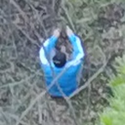 | 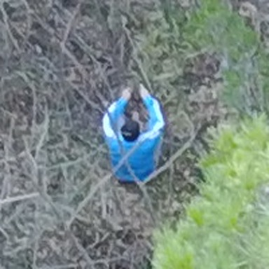 |

The trace excerpt, from detection to the drone's new leg, is in `docs/architecture/agent.md`.

### 5.4 Task effectiveness

**The second look on real photos** (`scripts/eval_verifier.py`; Nemotron-3.5-Super-VL on Token Factory,
thinking off). Rule chosen on val among a fixed set by F2; prompt v2 chosen over v1 on val; **test scored
once** with both fixed.

| | Precision | Recall | F2 |
|---|---|---|---|
| Val: threshold only | 0.735 | 0.859 | 0.831 |
| Val: + promote near-misses the verifier calls `yes` (prompt v2) | 0.699 | 0.886 | 0.841 |
| Test: threshold only | 0.802 | 0.864 | 0.850 |
| **Test: + promote near-misses called `yes`** | 0.772 | **0.875** | 0.853 |

On test the second look finds 4 more of the 337 people (recall +0.012, 95 % CI [+0.003, +0.023],
paired bootstrap over photos) for 15 more false alarms to dismiss; F2 does not change clearly.
The gain is smaller than on val (+0.027): on test the model answered `unclear` for most
near-misses and for 65 % of crops where the person is under 60 px. Test also contains four sites
that are in neither training nor validation (114 of the 337 people, `docs/DETECTOR_LIMITS.md` §5),
which may explain part of the gap. Cost: about 890 tokens in and 67 out (mean of all 461 calls; the val and test runs alone differ by a few per cent, `docs/LANE_A_ML.md` §6.8), p50 1.35 s and p90
1.65 s per detection, about 0.00033 per detection at Token Factory's catalog prices (0.30 / 0.90
per million tokens in / out); 461 of 461 replies were valid JSON. A second verifier on NVIDIA's hosted
API (val only, `COSMOS_VERIFIER.md`): Cosmos Reason is listed but answers 404, so Nemotron 3 Nano Omni ran in its place; on the 98 crops it answered (2 server errors cost the other 72) it called 20 of 21 people `yes` but 43 of 77 false alarms too (`yes` precision 0.317 against 0.390 for the VL model on the same crops) at 10.8 s per verdict, so Nemotron-3.5-Super-VL stays and no number above changes.

**The agent's routing on the whole system** (`scripts/agent_eval.py`, [`AGENT_EVAL.md`](AGENT_EVAL.md)): the
real mission API, worker, live map, planner and agent run under uvicorn and are driven over HTTP through
the creek scenario and three variants (clue, no clue, clue before the drones fly, near-miss only), 3 runs
each, with fake models and a scripted detector, so it tests where the agent sends things, not perception.
Every check with a ground truth passed in every run:

| Check | Correct |
|---|---|
| Clue: a drone is over or proposed toward the person's sector | 6/6 |
| Review: the alert names the person's sector | 9/9 |
| Review: a standby team is assigned to the person's sector | 9/9 |
| Near miss: the person's detection is promoted to the review queue | 3/3 |

The agent's own overhead from evidence to proposal (fake models): clue → `drone_leg` p50 135 ms, p90 152 ms;
review → `alert` p50 33 ms; near-miss detection → `promote_detection`, second look included, p50 23 ms. Live,
add the model time (the VL verdict above).

### 5.5 Failure handling, observability, human control

- **Failure handling:** invalid JSON → one retry → `unclear` with the reason; timeouts, HTTP errors
  or a missing key → `unclear` naming the error, no proposal; without a model, planner proposals
  continue with template briefings; briefings that are over 60 words, say "clear", or contain a
  number not in their facts are rewritten once, then replaced by a template; a per-mission token
  budget stops model calls with one notice; hooks only enqueue (< 5 ms) and a failing event never
  stops the pipeline.
- **Failures injected, before and after the fixes** (`AGENT_EVAL.md`, #140 → #142; each fix has a test that
  failed before it):

  | Case | Before | After |
  |---|---|---|
  | Token Factory down (every attempt hangs) | about 4 min per call with the 60 s timeout (a calculation) | 4 attempts in all, then a circuit breaker fails calls fast for 60 s: about 82 s with the agent's 20 s timeout |
  | A photo with no GPS reaches the worker | the job failed and the next good photo was not processed | recorded as `photo.failed`, and the next photo is processed |
  | The same near-miss or review delivered twice | 2 verdicts and 2 proposals | 1 of each; the repeat is a trace note |
  | Retries, Tavily down, a photo refused at upload | not in the trace | each one a trace note |

  Nothing crashed in any run, and the runner traced no failed event.
- **Approval gate**, computed from the final mission state, passed in 12 of 12 runs: every leg in the fleet
  comes from an approved proposal; no pending, rejected or superseded leg is in the fleet; every assigned team
  and sector task has an approved `assign_sector`; every promotion follows an approved `promote_detection`;
  no approval precedes its proposal in the event log; every decision records who and when and is made by a
  person; every rejection has a reason; no proposal or verdict says "clear"; `validate_mission` passes.
- **Observability:** every tool call (image path, time, the heuristics that chose it), model call
  (model, prompt version, latency, tokens, reply, retries), verdict, proposal and decision is a line in the
  mission's `trace.jsonl`, shown in the Trace view (§5.2); images by path, never base64; API keys redacted (tested).
- **Human control:** proposals only; no dismissals; the fleet and the radio act only on approved
  proposals; every decision records who and when.
- **Tests:** `uv run pytest tests/ml tests/agent tests/radio`, no network or keys needed.

## 6. Search map and planner

All results in this section are **simulated**.

### 6.1 The search theory behind the map and the planner

Sightline uses the standard quantities of search
theory as US and international SAR planning defines them:

- **Probability of success: POS = POC × POD** (the chance the person is in a cell, times the chance the
  search would have found them there; USCG/Soza, *The Theory of Search: A Simplified Explanation*, 1996,
  eq. 2-3, [PDF](https://navcen.uscg.gov/sites/default/files/pdf/Theory_of_Search.pdf); the IAMSAR Manual
  Vol. II covers the same in its search-planning chapter, which we have not read in IAMSAR's own text).
  The map holds POC per cell (we call it the cell's probability); each photo's POD per cell is
  `recall × (1 − canopy) × overlap`, times the conditions' visibility factor on a live mission, capped at
  0.95 (`sightline/search/pod.py`, `live.py`), and the map is updated by Bayes' rule
  (p ← p·(1 − POD), renormalised; the after-photo probability never reaches zero).
- The planner's **expected clearance** of a leg (`expected_clearance` in `sightline/search/planner.py`) is
  **Σ POC × POD over the leg's cells, the POS of that leg**, and legs are ranked by POS per minute.
- **Koopman's random-search law**, POD = 1 − e^(−C) with coverage C = W·L / A (sweep width W, track length
  L, area A; Koopman, "The Theory of Search II: Target Detection", *Operations Research* 4(5), 1956;
  USCG/Soza 1996 eq. 5-5 to 5-7), is the continuous limit of what the map does when a cell is seen many
  times: repeated independent looks compound to 1 − Π(1 − POD_k). Sightline does not use sweep widths: a
  photo's POD comes from the detector's measured recall and the canopy measured in that photo, so each
  photo's footprint is a "definite" look rather than a random-search glimpse.
- **Team PODs are the weak input.** Ground teams report "searched at POD x"; field-estimated PODs are
  "very subjective and often times unreliable" (Ferguson, *Search Strategy and Tactics*, ASRC/MARG slides,
  2012, [PDF](https://www.archive.asrc.net/ASRC-Operations/2012-08-30-Sweep-Width-POD-Effect-Ferguson.pdf)),
  which is one reason a team's reported POD is capped at 0.9 and a sector is never ruled out.
- **The prior** is Koester's distance-from-IPP rings when the subject category is set, else uniform
  within the search area (§6.4; the planner v1 and fleet evaluations were run with the uniform prior).
  Koester's rings are the median and quartile distances from the initial planning point for each subject
  category (Koester, *Lost Person Behavior*, dbS Productions, 2008); Sava, Twardy, Koester & Sonwalkar
  ("Evaluating Lost Person Behavior Models", *Transactions in GIS* 20(1), 2016, online 2015) found the
  Euclidean-distance model scored **0.78 (95 % CI 0.74–0.82) on 376 cases**, on a scale where a random map
  scores 0 and a perfect one 1.
- **Planning as Bayesian search** follows Bourgault, Furukawa & Durrant-Whyte ("Optimal Search for a Lost
  Target in a Bayesian World", Field and Service Robotics 2003; and "Coordinated Decentralized Search for a
  Lost Target in a Bayesian World", IROS 2003, for several vehicles), and Lin & Goodrich ("UAV Intelligent
  Path Planning for Wilderness Search and Rescue", IROS 2009). The closest recent work to our fleet
  planner is Ge, Jiang & Coombes, "Multi-UAV Search and Rescue in Wilderness Using Smart Agent-Based
  Probability Models" (arXiv [2411.10148](https://arxiv.org/abs/2411.10148), 2024): an agent-based
  lost-person prior driving a distributed multi-UAV search. Ours is greedier (one leg at a time on a shared
  expected map) and adds what those papers leave out: the detector's measured recall in the POD, ground
  teams and clues as sensors, and a person approving each move.
- **Why drones miss people** in real searches is documented by the Norwegian Police drone unit's white
  paper on drone search techniques in SAR (Nilsen, NPUAS); **not verified**: the PDF did not open from
  here, and secondary reports credit it with lower flight altitude, camera angle and speed changes, and a
  "bike wheel" search pattern.

### 6.2 The map

Sprint 1, `sightline/search/sim.py`; 5 m cells, 1,341 trials with the person in a
photographed cell (seed 7, the best of the three seeds): a ground team checks a median of 1,213 cells with Sightline's canopy-aware map
against 1,743 with a naive map that treats every photographed cell as searched for certain. Across 3 seeds × 5 noise levels it was
better every time: 28–30 % fewer cells at the default noise, 19–23 % with noise matching the canopy
estimate's measured error (README; `docs/LANE_C_SEARCH.md`).

### 6.3 The planner

`scripts/planner_eval.py`, `sightline/search/planner_sim.py`: on the demo mission's
map (1 km around the last known position, 5 m cells, the uniform placeholder prior, canopy measured
by its photos for 10 % of cells, 0.5 assumed elsewhere), one drone from the last known position flies
lawnmower legs for 2 hours, either in a fixed serpentine sector order or as the planner chooses
before every leg. The person's cell is drawn from the map; each pass over it finds them with
probability recall × visibility. 3 seeds × 3,200 trials per row:

| Scenario | Strategy | Median | P90 | Found within 30 min | Found within 2 h |
|---|---|---|---|---|---|
| No clue (flat prior) | fixed order | > 2 h | > 2 h | 6.8 % | 28.3 % |
| | planner | > 2 h | > 2 h | 6.9 % | 27.8 % |
| A clue at the start (100 m, medium reliability), each of the 16 sectors in turn | fixed order | > 2 h | > 2 h | 6.3 % | 27.7 % |
| | **planner** | > 2 h | > 2 h | **10.7 %** | **29.9 %** |

(Visibility noise 0.15; 0 and 0.30 move each number by at most 0.6 points.) **With a flat prior the
planner is no better than a sensible fixed order**, as expected: every sector is worth the same, so
there is nothing to choose. **With a clue it flies there first** and finds the person within 30 min
about 1.7× as often. The medians are beyond 2 hours for both, because one drone covers about 10 of
the 16 sectors in that time and each pass finds a person under typical cover only about 4 times in
10; more drones and real canopy maps are what move those numbers. An earlier version of this
evaluation counted finds on a leg that started before the 2-hour mark but ended after it, which
flattered the fixed order; it was fixed before these numbers.

### 6.4 Planner v2: lost-person prior, ground teams, re-plans

Full write-up: [`PLANNER_V2.md`](PLANNER_V2.md) (`scripts/planner_v2_eval.py`; val canopy only; 5 seeds ×
2,000 trials per row; seed range in brackets). Three changes, each measured:

- **Koester lost-person prior** (`sightline/search/prior.py`): distance rings from the IPP per subject
  category, blended 0.8 with uniform (a hand-chosen hedge, not tuned). With 3 drones and the person drawn
  from the dementia rings, finds within 30 min rise from **22.1 % (uniform) to 52.8 %** (52.0–53.2); with
  1 drone from 9.9 % to 18.7 %. The hiker rings gain nothing on a 1 km grid (the 25 % ring is 0.7 km), which
  argues for a larger grid on hiker missions. With the category wrong, finds fall from 21.9 % to 15.7 %.
- **Ground teams in the planner:** a sector a team holds is worth less to a drone, and assignments weigh the
  team's walking time (3 km/h and 60 min per sector are assumptions). On the val canopy finds within 30 min
  rise about 1 point (24.1 % → 25.3 %, seed ranges just separate); on a synthetic canopy there is **no
  measurable gain**.
- **Re-plans on team evidence, and opening legs:** a re-plan proposes a leg for every idle drone. Without
  opening legs this doubles finds within 30 min (**13.5 % → 27.1 %**); once the agent proposes opening legs
  when the fleet joins, both rules give identical results (27.1 %).

### 6.5 The fleet under realistic conditions

Full write-up: [`FLEET_V2.md`](FLEET_V2.md) (`scripts/fleet_eval.py`; three simulated drones on the demo
mission's 1 km grid, canopy unknown (0.5) and the uniform prior; 2,000 trials per row and seed, seeds 1–5;
time to find is when the finding photo reaches the mission). Strategies: **coordinated** (one expected map
shared by the fleet, Sightline's design), **hand-split** (the serpentine order cut in three), **independent**
(each drone plans on its own map). Realism presets change how the same plans are flown:

| Preset | Wind | Battery (DJI Mavic 3 Enterprise, 20 % reserve) | GPS σ | Photo upload loss | Link outages |
|---|---|---|---|---|---|
| ideal | none | not limited | 0 | 0 | none |
| realistic | 6 m/s | 36 min, 6 min swap | 2.5 m | 2 % | 1 per hour per drone, 3 min |
| harsh | 10 m/s | 32 min, 6 min swap | 6 m | 10 % | 2 per hour per drone, 8 min |

Endurance and the wind limit are DJI's published numbers; wind, GPS, loss and outage values are assumptions.

| Found within 30 min (seed range) | ideal | realistic | harsh |
|---|---|---|---|
| A clue at the start, coordinated | **22.7 %** (22.3–23.3) | **15.9 %** (14.2–17.7) | **13.5 %** (12.4–14.5) |
| A clue at the start, hand-split | 20.0 % (18.8–21.5) | 11.5 % (10.6–12.5) | 10.0 % (8.5–11.5) |
| A clue at the start, independent | 15.1 % | 11.5 % | 10.7 % |
| No clue, coordinated | 20.3 % | 14.5 % | 12.2 % |
| No clue, hand-split | 19.6 % | 14.5 % | 12.5 % |
| No clue, independent | 12.9 % | 9.1 % | 8.2 % |

**With a clue, coordination keeps its lead as conditions get worse**, and the seed ranges do not overlap in
the realistic and harsh rows: a shared map sends the next free drone to where the clue put the probability.
**With no clue, coordinated and hand-split are level** in every preset; we do not claim a gain there.
Planning without sharing is the worst option every time. Realism costs about a third of the early finds
(ideal → realistic, no clue: 20 % → 14.5 %). The plans are made for calm air and flown in the preset's
conditions, so a planner that re-plans around wind and swaps would do better than shown. The v1 fleet
evaluation (`docs/evidence/fleet_eval/v1-20261021/result.json`: coordinated 20.9 %, hand-split 20.0 %, independent 12.1 %, one drone 6.8 %
within 30 min, no clue) used the demo cache's canopy, which comes from HERIDAL test photos; v2 replaces it.

### 6.6 One brain, many eyes: the simulated fleet

The brain stays central: the agent and the planner propose legs, a person approves them, and the
`MissionStore` is the only place a leg becomes approved. The eyes are distributed
(`sightline/search/fleet.py`, `python -m sightline.search.fleet run`; all simulated and labelled):

- **One OS process per drone**, each with its own state, battery and HTTP client, following the mission's
  event stream for the legs approved for it and posting its own photos through the real `POST /photos`; a
  ground station sends the fleet's telemetry in one `PUT /fleet` per tick (`--single` keeps one loop for tests).
- **A simulated DJI Mavic 3 Enterprise:** 45 min flight at 9 m/s, 38 min hover, 12 m/s wind limit (DJI's spec
  page); ground speed is airspeed plus or minus the mission's wind, and a drone leaves its leg for home when
  the battery left would not bring it back with the planner's 20 % reserve.
- **Degraded links** (a simulated link model, not a radio measurement): a drone's link is connected, degraded
  or lost. A lost drone flies the leg it has, hears no re-task, keeps its photos on board and syncs them
  through `POST /photos` when the link is back; `GET /missions/{id}/fleet/links` shows each drone's state and
  last-heard time (`tests/search/test_fleet_links.py`).
- **Relay for cut-off teams:** a team marked without signal is heard by a drone within relay range, which
  passes its position on at once, through a neighbouring drone, or when its own link is back; the map moves
  the team with the time it was heard and says so ("Team Two heard via D3, 40 s old (simulated relay)";
  `tests/search/test_fleet_relay.py`).
- Each photo is a crop of a HERIDAL **validation** photo with EXIF and DJI XMP written for its simulated pose;
  the hidden person decides only which crop a photo gets. `scripts/creek_run.py` runs the whole story: a
  team's clue → the agent re-tasks a drone → its photo shows the person → review → alert.

## 7. Conditions (Tavily)

Full write-up, with a live run's trace: [`TAVILY.md`](TAVILY.md). Each mission's conditions come from live web
search at run time (`sightline/geo/conditions.py`): three Tavily searches (forecast, weather warnings, park
and trail alerts for the area) and one Tavily extract, checked every 30 minutes for each active mission and
cached per area and clock hour (at most four Tavily calls per area per hour). Nemotron reads the pages and
returns each value **with the sentence it came from**; a value is kept only if that quote is found verbatim
in the page, contains the number and names the field, and is in a sane range. Everything else stays empty
rather than guessed. Sunset and civil twilight are computed locally.

What it changes, each with its test (`docs/report/TAVILY.md`, "What the conditions change"):

- **Flying:** the planner proposes no drone leg when gusts exceed the drones' limit, rain is 1 mm/h or more,
  or it is after civil twilight, and the agent proposes recalling drones that are in the air, once
  (`tests/agent/test_loop.py::test_unflyable_conditions_recall_each_flying_drone_once`).
- **What a photo can see:** fog or haze in a warning lowers the visibility factor, so each photo rules out less
  of the map, and a drop replans the drones.
- **Where people shelter:** when exposure rises to high or severe, probability shifts toward tree cover (a
  labelled planning heuristic).
- **What teams hear:** briefings carry daylight left, wind and gusts, and alerts by name.

**Live, Mount Seymour, 21 Oct 22:31 PDT** (`docs/evidence/conditions-live-20261021/`): wind 20 km/h gusting
40 (quoted "NW 20", "gusts 40"), no fog or haze in any warning (visibility factor 1.0), not flyable ("after
civil twilight"), so the planner proposed no legs. An earlier run that evening also found a fog advisory
(visibility factor 0.6) and gave the same values on two runs (`sightline/geo/README.md`). Neither mission had
a fleet in the air, so the recall itself is shown by the test above, not by a live run. Every Tavily call and every extracted value with its quote and source URL is in
the mission trace (`actor="conditions"`) and in the Trace view. Conditions add no OpenCV calls.

## 8. Radio desk

Ground teams don't watch a screen. The radio desk puts Sightline on a **secondary voice channel
under the comms operator** (`sightline/radio/`, `web/src/radio/`): a team asks "say again the sector
boundary" or reports "found a blue backpack by the creek, our position", and Sightline answers by
voice from the same mission state the console shows. Three NVIDIA models, one per step:
Parakeet TDT 0.6B v2 (speech to text, on the GPU desktop), Nemotron 3 Super with tools on Token
Factory (thinking off), Magpie TTS (text to speech, spoken sentence by sentence).

**Safety lives in code, not in the prompt.** Live runs found the model saying it had logged a clue
it never drafted, inventing the weather, describing a tool call instead of making it, and speaking
its own reasoning (`docs/feedback/radio.md`, findings 5–11). Each is now checked in code:

- a clue is **read back, built in code from the draft**, and posted only when the team answers
  "affirmative" (the turn id is stored as `confirmed_by_turn`); a report that wasn't drafted gets
  one retry, then "say again your report";
- conditions must come from `get_conditions` that turn, and "what are the conditions" is answered
  in sentences built from it;
- outbound, it **transmits only briefings the search manager approved**, and only when the
  operator presses Transmit; it never initiates orders;
- a reply that says "clear" becomes "standby"; one that names a tool or a placeholder is retried
  and never spoken.

**Measured** (RTX 4080 SUPER for speech, Token Factory for the model; text turns, so speech
recognition adds 45–153 ms): over 30 live turns, first sound p50 2.0 s and p90 3.0 s with typed team
lines, and 2.5 s p50 (p90 3.0 s) with the replies spoken by Magpie (team lines still text) over the 18 turns of the demo script (a spoken
"standby" when the model takes over 3 s), 6 / 6 clue reports drafted, read back and committed, 6 / 6
conditions answers from the tool (`docs/evidence/radio-latency-20261020.json`). The demo script
(transmit the assignment, ask for the boundary, report a clue, confirm) ran **5 / 5 times as
scripted** with spoken replies (`scripts/radio_rehearse.py`; team lines go in as text). **WER** (`scripts/radio_wer.py`, Parakeet after `protocol.normalize`), one human voice so far, 20 phrases, 162 words:
**0.086** with 0 / 2 coordinates exact, **0.025** with 2 / 2 after one fix: Parakeet writes the radio word "niner" as "49er" or "nine or", which `normalize` now reads as 9. Two more voices to come (#49; `docs/evidence/radio_wer/`).

## 9. Evaluation summary

Every headline number in one place, with the file it comes from. Simulated results are marked (sim).

| Claim | Number | Source |
|---|---|---|
| Detector, HERIDAL test, VOC P / R / AP50 | 0.802 / 0.864 / 0.868 | `detector_metrics.json` (release `weights-v2`); §3.9; `scripts/reproduce_cv2.py` |
| Detector, HERIDAL test, SAR-APD P / R | 0.898 / 0.896 (people by eye: 0.59 / 0.68, a reference, not a matched study) | §3.9; Pyrrö, Naseri & Jung 2021 |
| Best estimate of true test recall; at the four unseen test sites | about 0.86; 0.825 | §3.9; `docs/DETECTOR_LIMITS.md` §5 |
| OpenCV 5 `cv2.dnn` vs PyTorch | identical to three decimals; 363 / 363 boxes match at IoU ≥ 0.95 | §3.1; `scripts/parity_table.py`; `docs/evidence/raw-parity-20261022.json` |
| Time per 4000×3000 photo | 0.25 s (GPU, Torch); 1.9 s (CPU, `cv2.dnn`, 16 cores) | `detector_metrics.json`; §3.1 |
| `cv2.dnn` on CUDA (custom OpenCV 5.0.0 build, classic engine, FP32) | 0.303 s per photo, 10.5 ms per slice; boxes identical to the CPU path (363 / 363) | `docs/report/CV2_CUDA.md`; §3.4 |
| New engine vs ORT engine inside OpenCV, per 1024 px slice | 96 ms vs 99 ms | §3.1, §3.2 |
| INT8 QDQ vs FP32 on `ENGINE_NEW` (val) | 132.4 vs 92.0 ms per tile; AP50 0.842 vs 0.861 | `docs/report/INT8_ENGINE.md` |
| AWS, upload → processed, c7i.2xlarge | 7.1 s (4.9 s on c7i.4xlarge) | §4; `scripts/remote_check.py` |
| Live pipeline per photo, GPU desktop | 2.1 s | §4 |
| Pin error from the detector box (28 nadir test photos) | median 0.05 m, P90 0.13 m | §3.7; `docs/LANE_B_GEO.md` |
| Second look on test (scored once) | recall 0.864 → 0.875 (+4 of 337, 95 % CI [+0.003, +0.023]) for 15 more false alarms | §5.4; `scripts/eval_verifier.py`; `docs/LANE_A_ML.md` §6.8 |
| VL verdict latency; valid JSON | p50 1.35 s, p90 1.65 s; 461 / 461 | §5.4; `docs/feedback/nebius.md` §2 |
| Agent routing to the right sector, team, detection | 6/6, 9/9, 9/9, 3/3 runs | `docs/report/AGENT_EVAL.md`; `scripts/agent_eval.py` |
| Approval gate checks | 12 of 12 runs | `docs/report/AGENT_EVAL.md` |
| Token Factory fully down, cost to the agent | 4 attempts, about 82 s, then fail fast (was about 4 min per call) | `docs/report/AGENT_EVAL.md` |
| Map vs naive map (sim) | median 1,213 vs 1,743 cells checked | §6.2; `docs/LANE_C_SEARCH.md` |
| Planner with a clue, 1 drone (sim) | 10.7 % vs 6.3 % found within 30 min (flat prior: 6.9 % vs 6.8 %) | §6.3; `scripts/planner_eval.py` |
| Koester prior, dementia, 3 drones (sim) | 52.8 % vs 22.1 % found within 30 min | `docs/report/PLANNER_V2.md`; `scripts/planner_v2_eval.py` |
| Re-plan for every idle drone, no opening legs (sim) | 27.1 % vs 13.5 % found within 30 min | `docs/report/PLANNER_V2.md` |
| Fleet, clue at the start, coordinated vs hand-split (sim) | 22.7 % vs 20.0 % (ideal); 15.9 % vs 11.5 % (realistic); 13.5 % vs 10.0 % (harsh) | `docs/report/FLEET_V2.md`; `scripts/fleet_eval.py` |
| Fleet, no clue (sim) | coordinated and hand-split level in every preset | `docs/report/FLEET_V2.md` |
| Radio, first sound | p50 2.0 s typed (30 turns); 2.5 s with replies spoken by Magpie, team lines typed (18 turns); p90 3.0 s | §8; `docs/evidence/radio-latency-20261020.json` |
| Radio clue reports read back and confirmed before logging | 6 / 6; demo script 5 / 5 as scripted | §8; `scripts/radio_rehearse.py` |
| Conditions, Tavily calls | at most 4 per area per hour; the same values on two runs | §7; `docs/report/TAVILY.md` |
| Nebius Serverless Job, the fleet's photos on `cv2.dnn` | 711 photos in 483 s on 16 vCPUs, about $0.10 | `docs/feedback/nebius.md` §5 |
| Compute cost of a 500-photo mission | about $0.67 (AWS detector, second look, Tavily); about $0.49 with detection on a Nebius Serverless Job; detector energy about 17 Wh (estimate) | §4.1 |
| Reproduce the test table, `cv2.dnn` only, CPU | 4 min 58 s (about 5 min 10 s end to end) | §12.1; `scripts/reproduce_cv2.py` |
| Reproduce with both backends, CPU | 12 min 48 s (about 14 min end to end) | §12.2; `README.md` |
| Docker dress run from nothing | 492 s (8.2 min); pytest 1373 passed, 14 skipped | §12.3; `deploy/dressrun/README.md` |

## 10. Limitations and failure cases

- **Where the detector misses** (`docs/DETECTOR_LIMITS.md`): groups of people, clothing that
  matches pale or dark rock, people sitting or lying down; two sites (MED, CAB) hold 28 of the 46
  misses. Figures: `docs/figures/limits/`.
- **Data for the roadmap, not used:** SARD (actors sitting and lying down, with fog and snow variants:
  our lying-down failure mode), WiSARD (RGB-thermal pairs: the night and shade roadmap), HIT-UAV (thermal
  at altitude) and SeaDronesSee (open water; CC0) would each target a gap above; nothing has been
  retrained on them. Details and terms: `docs/DETECTOR_LIMITS.md` §6; survey: arXiv 2511.17674.
- **Validation and test sites differ:** validation shares sites with training; four test sites
  are new. Validation numbers are an optimistic guide to new terrain.
- **The second look is weak on the smallest people:** under 60 px it mostly abstains, and with a
  neutral prompt it called many false alarms a person. It is advice that a person approves, never
  a decision.
- **What the second look gets wrong**, from the early prompt benchmark (val crops, "strict" prompt,
  `docs/evidence/verifier-bench-20261020.csv`, before the final prompt and the re-look images): of 150
  crops it called 7 real people "not a person": people in deep shade, small figures on dark grass (top
  row below; the first looks like bare rock even to us). It called 5 crops labelled "no person" a
  person, and **all 5 do show people** (bottom row): those crops were mined as hard negatives from
  regions without a label, and HERIDAL's labels miss some people. So the measured false-alarm rate of
  the second look is pessimistic, and the hard-negative set itself contains people (the hard-negative
  fine-tune was dropped for other reasons, §11.4).

  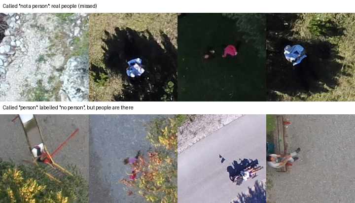

- **cv2.dnn on CPU:** 1.9 s per full photo on 16 cores, slower than the GPU Torch path (0.25 s), and
  INT8 does not help on this CPU (§3.3). On the GPU it needs a custom OpenCV build (0.30 s per photo, §3.4).
- **The agent evaluation uses fake models and a scripted detector:** it tests routing, the gate and
  failure handling, not perception; `--live` has been run once on the four creek scenarios (9/9 targets, 44/44 gate checks, 8 of 19 briefings fell back to the template; with the v2 briefing prompt, replayed on the same 19, none did) and once on the re-look scenario (`AGENT_EVAL.md`).
- **The radio desk** understands English only; Magpie speaks at about 0.66× real time on our GPU,
  so long replies are spoken sentence by sentence and the first sound depends on the model's time;
  if the model fails or times out, the team hears "say again" and nothing changes. Its numbers use
  typed team lines and team lines spoken by Magpie (§8); WER is measured on one human voice so far (0.025, §8), two more to come.
- **Simulated parts:** the demo flight path over Mount Seymour, the search-map, planner and fleet
  evaluations and the fleet are simulated and labelled so on screen; in the live AV chains (§5) the drones are simulated and
  the human steps scripted, both labelled in the trace. The search prior is Koester's distance-from-IPP
  rings when the subject category is set, else uniform within the search area (the planner v1 and fleet
  evaluations in §6 used the uniform one); the team pace, team search time and team POD in planner v2 and
  the wind, GPS, loss and outage values of the fleet presets are assumptions; the clue and shelter factors of
  the live map are heuristics, labelled in `sightline/search/live.py`.
- **Positions assume flat ground** under each photo; on steep terrain a pin can be further off than
  its 10 m radius. The measured error covers the detector box only (§3.7).
- **Conditions are only as good as what the web says:** a value is used only when the model quotes it
  verbatim from a page and it is in range, so a forecast phrased unusually leaves the field empty rather
  than guessed; offline, the last values are shown as stale with their time, or nothing. The visibility
  factor and the exposure band (and the shelter shift it triggers) are planning heuristics, labelled so
  in the console.
- **Detection falls with person size and image quality** (`docs/report/POD.md`, val, frozen threshold
  0.29, `cv2.dnn`): recall is 0.64 for a person about 18 px across, 0.74 at 22 px, 0.81 at 27 px and
  0.87–0.89 from 37 px up; under 20 px it found 38 of 61 people. One degradation at a time, recall goes
  from 0.859 to 0.823 at half the pixels per person, 0.616 in 60 % fog, 0.559 with 15 px motion blur,
  0.694 at dusk (gamma 2.5, −40 %, where precision also falls to 0.419) and 0.721 at JPEG q30. The live
  map now takes each photo's recall from this size curve at the original photo's GSD (a 0.8 m person:
  0.87 at 2 cm per pixel), not the constant 0.864, so a high pass counts for less. The curve is measured
  on val with downscaling standing in for altitude, and below its smallest point (14.5 px) falls to 0 at 4 px, a floor rather than a measurement. On LADD, 1,365 photos the model never saw (snow, winter, other drones), recall is 0.516 (`docs/report/LADD.md`).

## 11. Responsible use

- **Never "clear":** no text the system writes says an area is clear or cleared; searched sectors
  say how well they were searched ("searched at POD 60 %"). Lane A's tests check every verdict,
  proposal and briefing for it (`test_the_word_clear_never_reaches_the_mission`,
  `test_never_dismisses_and_never_says_clear`); the radio replaces a spoken "clear" with "standby"
  (`tests/radio/test_turn_api.py::test_postcheck`) and its screen copy is checked for the word
  (`web/src/radio/RadioDesk.test.tsx`); `validate_mission()` flags
  it in any summary, reason, briefing or note of a mission (`tests/pipeline/test_mission.py`, "cleared in a reason");
  a searched sector's POD is capped at 0.9, so searching never rules a sector out
  (`tests/search/test_live.py::test_a_searched_sector_is_never_cleared`, and the task rule in
  `tests/pipeline/test_mission.py`).
- **Every action is approved by a person and logged** with who and when.
- **Conditions show their sources:** every Tavily call, page and extracted value with its quote is in
  the mission's trace; stale values are labelled with their time; the heuristics say they are
  heuristics on screen.
- **The web app is scanned for the word** too: every visible string in `web/src` that contains
  "clear", "clears", "cleared" or "clearing" must be on a reviewed list of negations (`web/src/noClear.test.ts`).
- **No secrets in the browser, the repo or the trace**; keys come from environment variables
  and, on AWS, Secrets Manager (§4).
- **Honest evaluation:** thresholds and rules are chosen on validation; test is scored once per
  decision. Choices that saw test results are disclosed (§11.4).
- **Imagery:** HERIDAL (Božić-Štulić, Marušić & Gotovac, 2019), from a CC BY 3.0 copy (§11.2); no real
  search data.

### 11.1 Privacy and data handling

Sightline handles photos of real people in distress, so what happens to them is part of the design:

- **Who sees the photos.** Everyone who can reach the mission API: it has **no login**. `GET /missions` lists
  the missions, and `GET /missions/{id}/files/...` serves their frames, crops and trace. Locally the API
  listens on `127.0.0.1`. The AWS deployment is a demo for judges, who need to click through without an
  account; it holds only HERIDAL validation photos and synthetic drone photos, and it is stopped between
  demos. The optional write token (§4) stops strangers from changing missions but not from reading them. A
  search team deploying it must put the API on its own network or VPN, or add authentication (not built).
- **CORS** allows the deployed website's origin (`SIGHTLINE_CORS_ORIGINS`, the Vercel site on AWS) and
  `localhost`/`127.0.0.1` on any port, for `GET`, `POST`, `PATCH` and `PUT`, with no cookies or credentials
  (`sightline/api/app.py`). CORS only limits which web pages may call the API from a browser; it is not
  access control.
- **Where photos are kept.** On AWS the original photos go to a private S3 bucket (`missions/<id>/orig/`,
  no public access) and are **deleted after 30 days** by a lifecycle rule (`deploy/aws/setup.sh`); the
  instance role can reach only that prefix. The mission files (frames, crops, trace) stay on the instance's
  disk until `deploy/aws/teardown.sh` deletes everything; container logs are kept 14 days and contain no
  images.
- **What leaves for a model.** For every detection at confidence 0.15 or more, the crop and at most two
  OpenCV re-look images (JPEG) go to **Nebius Token Factory**, model `nvidia/Nemotron-3.5-Super-VL`, with
  the verifier prompt; no full photo, no GPS and no EXIF. Briefings and radio answers send mission text
  (sectors, clues, conditions) to the Nemotron text models on Token Factory. Radio speech is transcribed
  and spoken on our own GPU (Parakeet, Magpie); only text goes to Token Factory. We have not reviewed Token
  Factory's data-retention terms for real search data; a team should before using it on a live search.
  Tavily receives only the search area's name in its queries.
- **No faces, no identity.** Sightline runs no face detection or recognition and stores no identity data.
  At survey altitude a person is about 70 px across, and the system only asks whether a crop shows a
  person, their posture and clothing colour.
- **Keys** live in environment variables and AWS Secrets Manager, never in the browser, the repo, the logs
  or the trace (§4, §5.5).

### 11.2 Licences

- **Code: AGPL-3.0-or-later** (`LICENSE`), because the detector is trained with Ultralytics YOLO, which is
  AGPL-3.0. Ultralytics states that "All Ultralytics YOLO trained models fall under the AGPL-3.0 License by
  default" and that the licence "covers the training code and the models produced by that training code"
  ([ultralytics.com/license](https://www.ultralytics.com/license)). We therefore treat our weights
  (`weights-v2`) and their **ONNX export** (`model-onnx-v2`), which `cv2.dnn` runs with no Ultralytics code,
  as a derivative under the same licence; Ultralytics' pages do not mention exported formats, so that is
  our reading, not a statement from them.
- **What a search organisation must do to deploy it**, as we read the licences (not legal advice): it may
  run and change Sightline freely; if it lets people use a modified version over a network (the mission
  API for its members), or ships it on a device such as a Jetson field kit, it must offer those users the
  complete corresponding source of that version, and per Ultralytics the model weights where applicable;
  Ultralytics says this applies even to internal and private deployments. The alternatives are an
  Ultralytics Enterprise licence, which lets code and models be embedded "in commercial products" without
  the AGPL terms, or retraining the detector with a permissively licensed framework (not done).
- **HERIDAL imagery.** The photos are from HERIDAL (Božić-Štulić, Marušić & Gotovac, "Deep Learning
  Approach in Aerial Imagery for Supporting Land Search and Rescue Missions", IJCV 127(9), 2019). We use
  Pyrrö's copy on Zenodo ([record 5662351](https://zenodo.org/records/5662351), "HERIDAL dataset in
  keras-retinanet PASCAL VOC format"), whose licence field is **CC BY 3.0** and which describes itself as a
  "Modified version of the HERIDAL dataset". **The original dataset's own terms are not verified:** the IJCV
  paper's metadata states none that we could find, and the original site (`ipsar.fesb.unist.hr`) did not
  answer on 22 Oct. The public demo shows HERIDAL photos under the Zenodo copy's CC BY 3.0 with attribution
  to both; before any commercial use we would ask the original authors.

### 11.3 Security

`docs/SECURITY.md` covers what the public demo exposes and why, the write token, the limits on what a
client can send (§4), data retention, and how to report a problem. On 2026-10-22 all of git history (every
branch) was searched for API keys, tokens, private keys and committed `.env` files; **no secret was found**.

### 11.4 Disclosures

1. **Existing project:** started at BCS Hackathon 2026 (§13); eligibility confirmed by the organizers.
2. **Test-seen choices (sprint 1):** keeping training run 2 over run 1, and dropping the
   hard-negative fine-tune, were made with test scores in view; the mirror-TTA setting was
   scored on test and not adopted (README). Test numbers are therefore slightly optimistic; the best
   estimate of true test recall is beside the table in §3.9.
3. **Verifier benchmark:** two early 20-crop prompt runs used test photos; they were superseded by
   val runs and played no part in the final choice (`docs/LANE_A_ML.md` §6.7).
4. **This sprint:** the parity check and the verifier rule each read test once, after every
   choice was fixed on val. The INT8, Cosmos, planner v2 and fleet v2 experiments used val data or
   simulation only.
5. **The human steps in both AV chains are scripted** for the recording (the review, logging the sighting as
   a clue, the approvals), and the trace says so; the fleet in the re-task chain is simulated (lane C's fleet
   simulator, `sightline/search/fleet.py`, came later and was not used for this recording), and labelled.
   The agent evaluation's search manager and reviewer are scripted too, and each decision says so.
6. **Radio measurements** use typed team lines (and, for full voice turns, team lines spoken by
   Magpie); they were taken on a fixture mission. The desk now also runs on live missions (the Radio view).
7. **AI assistance:** parts of the code and docs were written with an AI coding assistant; the
   agent described in §5 is Sightline's own runtime agent.

## 12. Reproducibility

The data and weights are GitHub releases, not repository files. Wall times below were measured on
2026-10-22 on a Ryzen 9 9950X (16 cores, 32 threads); the commands with their setup are in `README.md`
("Reproduce the results").

### 12.1 The test table with `cv2.dnn` only, about 5 minutes

```bash
uv sync                                                                              # no torch
gh release download data-v1       -R Drivera0/sightline -p heridal_test_split.zip
gh release download weights-v2    -R Drivera0/sightline -D data/weights/release_v2 -p detector_metrics.json
gh release download model-onnx-v2 -R Drivera0/sightline -D data/weights/release_v2 -p sightline-detector-v2.onnx
mkdir -p data/heridal/yolo_full && unzip -q heridal_test_split.zip -d data/heridal/yolo_full
CUDA_VISIBLE_DEVICES= uv run python scripts/reproduce_cv2.py                         # 4 min 58 s
```

About 5 minutes 10 seconds end to end, GPU hidden: the 101 test photos through OpenCV 5 `cv2.dnn` only,
scored with the VOC code of `evaluate_model.py` at the frozen threshold, and compared with
`detector_metrics.json` (VOC 0.802 / 0.864 / 0.868; the script exits 1 on a mismatch beyond 0.005).

### 12.2 Both backends, about 14 minutes

```bash
uv sync --extra ml --extra conditions
# the same three release downloads without -p filters, and the unzip
CUDA_VISIBLE_DEVICES= uv run --extra ml python scripts/parity_table.py --splits test --device cpu \
  --pt data/weights/release_v2/yolo11s_tiles_run1_best.pt \
  --onnx data/weights/release_v2/sightline-detector-v2.onnx                         # 12 min 48 s
```

Torch on the CPU (5.0 s per photo) and OpenCV 5 `cv2.dnn` (3.0 s per photo in this run), the table in §3.1:
identical scores, 363 of 363 boxes matching one to one.

### 12.3 The Docker dress run, from nothing

`bash deploy/dressrun/run.sh` (needs Docker and git) builds a clean image from what a fresh clone has, with
no GPU, keys or HERIDAL download, runs the tests, the smoke test of the live loop, the demo cache's contract
check (with the ICS 204, ICS 214 and CalTopo exports and the subject bulletin search), the mission API with the
`cv2.dnn` detector and `remote_check.py` against it, the same with the detector behind HTTP
(`SIGHTLINE_DETECT_URL`), the web build and a check of the built one-console site, and writes
`runs/dressrun/<timestamp>/times.md` (`deploy/dressrun/README.md`). Measured on commit `de32e70` (`docs/evidence/dressrun/20261022-192933/times.md`):

| Stage | Seconds |
|---|---:|
| install-python-deps (from `uv.lock`) | 139.3 |
| install-web-deps, fetch-model, fetch-caches, install-project | 17.4 |
| pytest (1373 passed, 14 skipped) | 90.3 |
| smoke (exports and subject search included) | 12.5 |
| validate-demo-cache, demo-cache-metrics | 0.5 |
| api-remote-check | 2.3 |
| api-remote-detector | 3.3 |
| web-build, web-dist-check | 2.1 |
| **end to end** (build 367.5, run 124.8) | **492.4** (8.2 min) |

### 12.4 The judge's 10-minute path

No Docker, no torch, no training: `uv sync --extra conditions`, `uv run pytest -q`, the published demo cache
and its contract check, the README's detector numbers from its `metrics.json`, the smoke test, the mission
API on the ONNX detector with one photo through `remote_check.py`, and the site on the demo survey. About 3
minutes on the machine above once the packages are downloaded; the commands are in
`deploy/dressrun/README.md` ("Judge's 10-minute path").

### 12.5 Every other result

```bash
uv run pytest tests/ml tests/agent tests/radio             # no GPU, network or keys needed
uv run --extra ml python scripts/parity_table.py           # §3.1 val and test (needs the HERIDAL data, scripts/README.md)
uv run --extra ml python scripts/eval_verifier.py          # §5.4 (needs NEBIUS_API_KEY)
uv run --extra ml python scripts/av_chain.py               # §5.2 chain, then scripts/trace_excerpt.py
uv run python scripts/agent_eval.py                        # §5.4–5.5, fake models, about 6 min
uv run python scripts/planner_eval.py                      # §6.3
uv run python scripts/planner_v2_eval.py                   # §6.4, 353 s
uv run python scripts/fleet_eval.py                        # §6.5, about 2 min
uv run python scripts/radio_rehearse.py --runs 5           # §8, against a running radio server
uv sync --extra ml --extra quant && uv run python scripts/quantize_onnx.py quantize --exclude-head   # §3.3, then its bench (INT8_ENGINE.md)
```

The radio server needs the NeMo environment for real voices (`sightline/radio/README.md`).

Live missions, locally and on AWS:

```bash
uv run python -m sightline.pipeline serve --radio text      # the API with a local worker (cv2 by default)
cd web && VITE_API_URL=http://127.0.0.1:8000 pnpm dev        # then open #new: start a search, drop photos in
bash scripts/smoke.sh                                       # the whole loop in ~11 s, no network or model files
bash deploy/aws/setup.sh                                     # AWS (deploy/aws/README.md); teardown.sh removes it
uv run python scripts/remote_check.py --api https://<address>   # is the deployment working right now?
```

## 13. What changed since BCS

Sightline was first built in 36 hours at BCS Hackathon 2026 (Oct 16–17, tag `bcs-final-submission`):
the tiled detector, the review queue and the Bayesian search map, run as a batch over a demo survey.
The OpenCV organizers confirmed the existing project is eligible. Built for this competition between Oct 20 and the code freeze on Sat Oct 25, 12:00 PT:

- the detector running on **OpenCV 5 `cv2.dnn`**, with a parity table against the Torch path (§3.1), and
  the INT8 QDQ experiment (§3.3);
- **OpenCV 5 re-look tools** and a Nemotron VL second look on uncertain detections (§3.5, §5);
- the **agent loop**: verdicts, planner legs, clues and conditions become proposals a person
  approves, every step traced and shown in the Trace view (§5); its evaluation, and the reliability fixes it
  led to (§5.4, §5.5);
- the **radio desk**: ground teams talk to Sightline on a secondary channel; questions answered
  from the mission, clues reported by voice and logged only after a readback (§8);
- live missions: a search created in the browser, photos uploaded as each flight lands and
  processed as they arrive, with live updates over server-sent events (§2);
- the AWS deployment, with upload limits, an optional write token and a judging uptime check (§4);
- the live map (every photo, review, searched sector and clue updates it) and the information-gain
  planner that sends drones and teams where they rule out the most probability per minute, with the Koester
  prior, ground teams and re-plans of planner v2 (§6);
- conditions from live web search (Tavily): forecast, warnings and park alerts, each value kept only
  with a verbatim quote; they decide whether drones may fly, how much a photo can see, how exposed the
  person is, and what briefings say (§7);
- one console (the demo's story at `#m/demo?t=0..5`, the About sheet, New search at `#new`, and the live mission's views): task board, teams, approval inbox,
  clue log, live map with the drones, teams and clues, and printable assignment cards with GPX/KML for
  the teams' handheld GPS (§1);
- a **simulated drone fleet**, one process per drone, that flies approved legs and sends its photos through
  the same API, with DJI Mavic 3 Enterprise endurance, degraded links and relay for cut-off teams; the creek
  scenario end to end (a team's clue re-tasks a drone; its photo shows the person), and the fleet
  evaluation (§6.5, §6.6), all labelled simulated;
- the mission **debrief** from the log, continuous integration (tests, the smoke test of the whole
  live loop, and the web build on every change), and the Docker dress run (§12.3);
- the measured **POD curve** (recall by person size, read at each photo's GSD for a 0.8 m person) and a
  terrain factor, and the frozen detector scored once on **LADD**, a dataset it never saw (recall 0.516)
  (`docs/report/POD.md`, `docs/report/LADD.md`, §10);
- published HERIDAL results beside ours (§3.10), the cost and energy of a 500-photo mission (§4.1), and
  what breaks first (`docs/submission/WHAT_BREAKS_FIRST.md`);
- the **re-look leg** (an `unclear` second look on a small box proposes a 25 m pass) and the **ledger** of
  expected against realised value, with the negative result: 0 of 25 val near-misses resolved in
  simulation (`docs/report/AGENT_EVAL.md`);
- the ICS 204 and ICS 214 forms and a CalTopo GeoJSON from a live mission (`docs/EXPORTS.md`), and
  real-footage intake through the live API (`docs/REAL_FLIGHT.md`).

Diff: `git diff bcs-final-submission..opencv-submit`.
