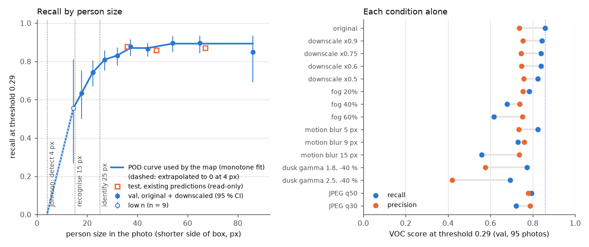

# Probability of detection by person size, and a stress test

Measured 22 Oct 2026 on the validation split. Evidence: `docs/evidence/pod/20261022-110620/pod.json` and
`pod.md` (same detections as the first run, `docs/evidence/pod/20261022-104502/`, read from the cache; this
run adds the low-n point, the box size in metres and the width sensitivity). Script:
`scripts/analysis/stress_test.py`. Figure: `docs/report/figures/pod_curve.png`.

**Result.** At the frozen threshold 0.29 the detector finds a person whose shorter side spans about 18 px
**63 % of the time**, one of 22 px 74 %, one of 27 px 81 %, and one of 37 px or more 87 to 89 %. Under 20 px
it found 38 of 61 people (62 %); under 15 px, 5 of 9 (a low-n point). The map used to credit every photo
with the test recall 0.864. It now reads the recall off this curve at the photo's ground sampling distance
(GSD), in the live mission and in the batch (demo) map alike, so a photo taken too high to show a person
well counts for less. A person is taken to span 0.8 m, the measured median shorter side of a labelled val
box (below): at 2 cm per pixel that is 40 px and the look is worth 0.87; at 3 cm per pixel 27 px and 0.81;
at 5 cm per pixel 16 px and 0.59. Below the smallest measured size the curve falls to 0 at 4 px.

Of the degradations, motion blur, fog, dusk and heavy JPEG cost the most recall; downscaling alone (half the
pixels per person in each direction) cost 3.6 points.



## Method

- **Data.** The 95 annotated val photos (4000×3000, 333 people), as `evaluate_model.py` loads them
  (`annotated_only=True`; the Zenodo copy has 60 empty annotation stubs). The test split was not run.
- **Detector.** The frozen `cv2.dnn` path, `CvDetector.detect_tiled`: 1024 px SAHI slices, 0.2 overlap,
  merge NMS at IoU 0.5, VOC matching at IoU 0.5 and threshold 0.29. Nothing was tuned. Run on the GPU
  with the CUDA build of OpenCV 5.0.0 (`docs/report/CV2_CUDA.md`; its boxes are the CPU boxes to the
  pixel). The baseline reproduces the val numbers of `scripts/parity_table.py` exactly
  (P / R / AP50 0.735 / 0.859 / 0.861).
- **Conditions**, one at a time on the full-resolution photo:
  - downscale ×0.9 / 0.75 / 0.6 / 0.5: `INTER_AREA` down, `INTER_LINEAR` back up. This simulates a higher
    flight (fewer pixels per person) with the same photo size and tiling;
  - fog 20 / 40 / 60 %: alpha blend with light grey (192);
  - motion blur 5 / 9 / 15 px: a horizontal line kernel;
  - dusk: gamma 1.8 or 2.5 on 0..1, then brightness ×0.6 (−40 %);
  - JPEG re-encoded at quality 50 or 30.
- **Person size** is the shorter side of the labelled box in pixels. The original val boxes run from 25 to
  115 px, so the size curve pools the original photos with the four downscales, each box's size multiplied
  by the downscale factor (1,665 person-looks, 12 to 115 px). Bins with 20 people or more are curve
  points. A bin below all of them with at least 5 people is added as a **low-n point** (labelled `low_n`
  with its `people` in `pod.json`, listed in `low_n_px` in `pod_curve.json`): here the 9 people under
  15 px, found 5 times (0.556, 95 % CI 0.27–0.81). Other bins under 20 people (the 4 over 100 px) are
  reported but not used. The points are made non-decreasing in size (pool-adjacent-violators weighted by
  people), which only merges 37–44 px and 54–86 px.
- **Box size in metres.** For each val photo whose EXIF gives a pose (`sightline.geo.pose.read_pose`,
  70 of 95 photos, 121 boxes), the shorter side of each labelled box times the photo's GSD: median
  **0.808 m** (interquartile range 0.673–0.961 m; 53 px at a median 1.41 cm/px). Recorded as
  `box_size_m` in `pod.json`.
- **Test, read-only.** The per-box test predictions already on disk (`data/work/analysis/preds.json`,
  written by `scripts/analysis/detector_errors.py` from the published model at 0.29) were rebinned by the
  same size measure. They give the published recall, 0.864 (291 / 337). Nothing was chosen from them.
- **Wall time** 342 s (5.7 min) for the first run (`20261022-104502`), with the baseline and 37 of the
  ×0.9 photos read from the per-condition cache of an interrupted earlier run (about 25 s per condition of
  95 photos on the GPU; other jobs shared the machine). The rerun (`20261022-110620`) read every condition
  from the cache and took under a second; its detections and scores are identical.

## Conditions at threshold 0.29 (val, 95 photos, 333 people)

| Condition | Recall | Precision | AP50 | Found |
|---|---:|---:|---:|---:|
| original | 0.859 | 0.735 | 0.861 | 286 |
| downscale ×0.9 | 0.844 | 0.753 | 0.869 | 281 |
| downscale ×0.75 | 0.838 | 0.744 | 0.852 | 279 |
| downscale ×0.6 | 0.838 | 0.746 | 0.840 | 279 |
| downscale ×0.5 | 0.823 | 0.757 | 0.828 | 274 |
| fog 20 % | 0.784 | 0.752 | 0.795 | 261 |
| fog 40 % | 0.679 | 0.739 | 0.711 | 226 |
| fog 60 % | 0.616 | 0.751 | 0.623 | 205 |
| motion blur 5 px | 0.823 | 0.735 | 0.835 | 274 |
| motion blur 9 px | 0.730 | 0.759 | 0.755 | 243 |
| motion blur 15 px | 0.559 | 0.735 | 0.598 | 186 |
| dusk, gamma 1.8, −40 % | 0.772 | 0.576 | 0.757 | 257 |
| dusk, gamma 2.5, −40 % | 0.694 | 0.419 | 0.601 | 231 |
| JPEG q50 | 0.793 | 0.779 | 0.845 | 264 |
| JPEG q30 | 0.721 | 0.787 | 0.781 | 240 |

Dusk is the only condition that also raises false alarms (446 and 551 boxes kept against 389): the detector fires on
more of the darkened ground. Fog, blur and JPEG lose people but keep precision.

## Recall by person size

On the original val boxes (baseline), and the test rebinning for comparison:

| Shorter side | Val people | Val recall (95 % CI) | Test people | Test recall |
|---|---:|---|---:|---:|
| < 20 px | 0 | n/a | 0 | n/a |
| 20–40 px | 42 | 0.762 (0.61–0.87) | 81 | 0.876 |
| 40–60 px | 177 | 0.876 (0.82–0.92) | 184 | 0.859 |
| 60–100 px | 111 | 0.874 (0.80–0.92) | 70 | 0.871 |
| > 100 px | 3 | 0.667 | 2 | 0.500 |

The POD curve (original + downscales, size × factor):

| Shorter side | People | Recall | 95 % CI | Median px | Curve value |
|---|---:|---:|---|---:|---:|
| < 15 px | 9 | 0.556 | 0.27–0.81 | 14.5 | 0.556 (low n) |
| 15–20 px | 52 | 0.635 | 0.50–0.75 | 17.8 | 0.635 |
| 20–25 px | 159 | 0.742 | 0.67–0.80 | 22.2 | 0.742 |
| 25–30 px | 210 | 0.809 | 0.75–0.86 | 27.0 | 0.809 |
| 30–35 px | 243 | 0.831 | 0.78–0.87 | 32.0 | 0.831 |
| 35–40 px | 220 | 0.877 | 0.83–0.91 | 37.2 | 0.870 |
| 40–50 px | 357 | 0.866 | 0.83–0.90 | 44.2 | 0.870 |
| 50–60 px | 213 | 0.897 | 0.85–0.93 | 54.0 | 0.893 |
| 60–80 px | 165 | 0.897 | 0.84–0.93 | 64.8 | 0.893 |
| 80–100 px | 33 | 0.849 | 0.69–0.93 | 86.0 | 0.893 |
| > 100 px | 4 | 0.500 | 0.15–0.85 | 104.8 | (not used) |

## What the map does with it

`sightline/search/pod.py` loads `sightline/search/pod_curve.json` (written by
`stress_test.py --write-curve`; its `source` key names the evidence file). For each photo,
`frame_recall` takes the GSD of the pixels the detector saw (`FrameInput.detector_gsd_m`), turns the
assumed person width `PERSON_WIDTH_M` = 0.8 m into pixels (`PERSON_WIDTH_M / gsd`), reads the curve,
and multiplies by the terrain factor (below). That recall, times the conditions' visibility factor,
goes into the existing per-cell POD (`recall × (1 − canopy) × overlap`, capped at 0.95). Without a GSD
for the detector's pixels, or without the curve file, the constant 0.864 (times the terrain factor) is
used as before.

**Where the GSD comes from.** In the live mission (`sightline/mission/pipeline.py`) it is the uploaded
photo's EXIF GSD: the detector runs on the original, not on the 1000×750 display frame. In the batch
pipeline (`sightline/pipeline/`, which builds the demo and real-GPS caches through `search.build_map`)
the `place` stage now records `detector_gsd_m` per frame in `work/place/poses.json`: the source photo's
EXIF GSD, because the simulated survey's frames are 1:1 crops of the real photo (the simulated flight's
2 cm/px is where the frame is drawn on the map, not how large people are in its pixels), and the
real-GPS survey's detector runs on the original. A photo with no EXIF pose keeps the constant.

**Lookup rule.** Linear between points; above the largest point (86 px) the last value is held; below
the smallest measured point (14.5 px, the low-n point) the recall falls linearly to **0 at 4 px** and is
0 below that. 4 px is the size DJI's Drone SAR Altitude Guide gives for detection by Johnson's criteria
(Context below): a floor, not a measurement. Before this change the curve held 0.635 everywhere under
17.8 px; now it gives 0.59 at 16 px, 0.42 at 12 px, 0.32 at 10 px and 0.05 at 5 px.

| GSD (m per px) | 0.8 m person | Recall used (heridal_like) |
|---:|---:|---:|
| 0.010 | 80 px | 0.893 |
| 0.015 | 53 px | 0.891 |
| 0.020 | 40 px | 0.870 |
| 0.025 | 32 px | 0.831 |
| 0.030 | 27 px | 0.805 |
| 0.040 | 20 px | 0.688 |
| 0.050 | 16 px | 0.592 |
| 0.080 | 10 px | 0.317 |

A person under 20 px is found about 62 % of the time (38 of 61 here), against 86 % over the whole val
split; the map discounts those cells accordingly, so after a high pass they keep more of their
probability than a full look would leave them, and the planner reads that probability.

**Effect on the shipped caches** (the map rebuilt from each cache's frames with `build_map`, before
and after; the caches themselves are not regenerated in this change). Demo: 240 of 500 frames come from
the 33 of 68 source photos with an EXIF pose (GSD median 2.18 cm/px, 1.36–3.91), and their recall is
0.866 median (0.699–0.893) against the constant 0.864; the summed step POD moves +0.2 %. Real-GPS:
10 of 10 frames (GSD 2.16–2.45 cm/px), recall 0.836–0.868, summed step POD −0.7 %. With the old 0.5 m
width the demo's median frame would have read about 0.75.

### Person width: why 0.8 m, and how much it matters

The curve's x axis is the shorter side of a HERIDAL label box, so the width the map converts must be the
same thing in metres: a box with its margin around the body, for people standing, sitting or lying, not
a shoulder width. The measured median over the val photos with an EXIF pose is 0.808 m (121 boxes,
IQR 0.67–0.96 m); `PERSON_WIDTH_M` is 0.8. The EXIF GSD uses the drone's altitude above take-off, not
above the ground under the person, so this number carries that error; the live map's GSD comes from the
same EXIF field, so the two errors partly cancel.

Map recall (heridal_like) at 2 and 3 cm/px by assumed width (`sensitivity` in `pod.json`):

| Width | 2 cm/px | 3 cm/px |
|---|---:|---:|
| 0.4 m | 0.688 (20 px) | 0.494 (13 px) |
| 0.5 m (before) | 0.781 (25 px) | 0.607 (17 px) |
| 0.6 m | 0.823 (30 px) | 0.688 (20 px) |
| 0.7 m | 0.854 (35 px) | 0.758 (23 px) |
| **0.8 m (used, measured)** | **0.870 (40 px)** | **0.805 (27 px)** |

(The 0.5 m row at 3 cm/px was 0.635 before this change, when the curve was held flat below 17.8 px.)

### What the map assumes about terrain

The curve and the constant were measured on HERIDAL: summer, Croatian karst and scrub. On LADD, an
unseen dataset with snow and winter terrain (`docs/report/LADD.md`), the same frozen detector at 0.29
finds 0.516 of people overall: **0.436 on photos with snow cover** (1,185 people) and **0.543 on the
rest** (3,548), against 0.859 on HERIDAL val (`by_snow_cover_proxy` in
`docs/evidence/ladd/20261022T174430Z/breakdown.json`). LADD's recall hardly changes with person size
(0.53–0.54 from under 40 to 90 px, square root of box area), so the loss is the terrain, not the pixels,
and one factor multiplies the whole curve:

| `terrain` | Factor | Source | 2 cm/px | 3 cm/px | Constant 0.864 |
|---|---:|---|---:|---:|---:|
| `heridal_like` (default) | 1.000 | HERIDAL val | 0.870 | 0.805 | 0.864 |
| `winter_other` | 0.632 | LADD no snow 0.543 / 0.859 | 0.550 | 0.509 | 0.546 |
| `snow` | 0.508 | LADD snow 0.436 / 0.859 | 0.442 | 0.409 | 0.439 |

It is chosen per deployment by the `SIGHTLINE_TERRAIN` environment variable (`heridal_like`, `snow`,
`winter_other`; an unknown name is an error, not a silent 1.0). The contract's `Mission` has no field for
it yet, so it is not per mission; a TODO in `docs/01_CONTRACT.md` §12.2 proposes `Mission.terrain`. The
factors are LADD's own numbers: LADD's snow flag is a proxy (`LADD.md`), and other unfamiliar terrain
(desert, dense forest floor) has no measured factor, so `heridal_like` there is an assumption.

## Limits

- **Val, not test, and val shares sites with training.** On new terrain expect lower numbers throughout
  (0.825 at the four unseen test sites, `docs/DETECTOR_LIMITS.md` §5).
- **Downscaling is a simulation of altitude.** A real higher flight also changes the viewing angle, haze
  and the camera's own processing.
- **0.8 m is a median from 121 boxes on 70 photos, at EXIF GSDs.** The spread is wide (IQR 0.67–0.96 m)
  and a subject lying down or half hidden spans less; the width table above shows what a different
  number would do.
- **Below 17.8 px the curve rests on 9 people and a floor.** The low-n point (14.5 px, 5 of 9, 95 % CI
  0.27–0.81) is the only measurement under 15 px; between it and 4 px the line to 0 is a rule, not data.
- **Terrain factors come from one other dataset.** See "What the map assumes about terrain".
- **One degradation at a time.** Real dusk with fog and motion blur together will be worse than any row.
- **Small bins are wide.** The 95 % intervals in the size table span 10 to 25 points; the curve is a
  measured trend, not a calibrated probability per pixel.

## Context

- **Johnson's criteria, as applied by DJI to drone SAR.** DJI's Drone SAR Altitude Guide (results page,
  https://enterprise-insights.dji.com/saraltitudeguideresult32) states that, by Johnson's criteria, the
  length of an object on screen needed for a 79 % probability is 4 px to detect it, 15 px to recognise it and
  25 px to identify it as the person searched for. The detector here sits near those marks: about 0.64 at
  18 px and 0.78 at 25 px. The map takes the 4 px detection mark as the size at which its recall reaches
  0. The two numbers are not the same measure (a person watching a screen against a
  detector at a fixed threshold), so the comparison is context, not validation.
- **Recall by GSD as the sensing function of a search.** Dumenčić, Lanča, Jakac and Ivić (2025),
  "Experimental validation of UAV search and detection system in real wilderness environment",
  https://arxiv.org/abs/2502.17372, use a YOLOv8 detector's recall per GSD group as the sensing function of
  their search planner, measured on their own initial flights (0.95 to 0.98 at the lowest GSD groups,
  0.88 at the highest); in the field missions recall fell as GSD rose, as here.

## Reproduce

```bash
# CPU (pip OpenCV): about 1.9 s per photo, so roughly 45 min for the 15 conditions:
uv run python scripts/analysis/stress_test.py --write-curve
# GPU, with the CUDA build of OpenCV (docs/report/CV2_CUDA.md):
PYTHONPATH=<dir with the built cv2/> uv run python scripts/analysis/stress_test.py --backend cuda --write-curve
```

Reruns read `runs/pod/cache/<onnx>/<condition>.jsonl` and only run what is missing.
