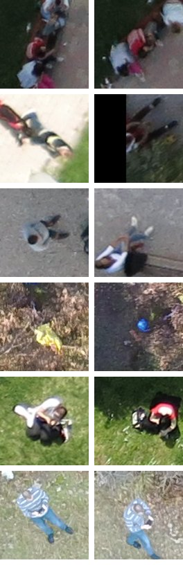

# Photos like this crop: NVIDIA embeddings after a confirmed sighting

When a reviewer confirms a person, or the second look says `yes`, the agent asks one question:
are there more crops like this one in the flight that nobody is going to look at? The flight's
detection crops are embedded once with a hosted NVIDIA model. The agent takes the nearest ones by
cosine similarity and proposes the near-misses among them for review. A person approves each
proposal; nothing is promoted on its own.

Code: `sightline/ml/similar.py` (embeddings, cache, top-k), `sightline/agent/similar_tool.py` (the
agent's `find_similar`), `sightline/api/similar.py` (`GET /missions/{id}/similar`). Measurement:
`scripts/eval_similar.py`. Evidence: `docs/evidence/similar/20261022/`.

## Which NVIDIA model is live

Checked on 2026-10-22 with the key in `NVIDIA_API_KEY`: `GET https://integrate.api.nvidia.com/v1/models`,
then one embedding call each.

| Model | Listed | Result |
|---|---|---|
| `nvidia/nvclip` (NV-CLIP) | yes | 404 `Function '3072eebf-…': Not found for account` |
| `nv-dinov2` (`ai.api.nvidia.com/v1/cv/nvidia/nv-dinov2`) | no | 404, the same message |
| `nvidia/llama-3.2-nemoretriever-1b-vlm-embed-v1` | yes | 404, the same message |
| `nvidia/llama-nemotron-embed-vl-1b-v2` | yes | **200**: 2048-d vectors, text and images |

So Sightline uses **Llama Nemotron Embed VL 1B v2**. Two catalogue entries better suited to
photo-to-photo search (NV-DINOv2, NV-CLIP) are not reachable with this key. The model card
describes this one as a retriever (a text query over text or image documents). Crop-to-crop
similarity is not its documented use, and the results below show the effect.

The request that works: each image is a `data:image/jpeg;base64,…` URL in `input`, with
`"modality": ["image", …]` (one entry per input) and `"input_type": "passage"`; a text query is
`"input_type": "query"`. Without `modality`, an image request hangs until the gateway gives up at
120 s.

## Method

- **Crops.** Every detection at confidence 0.15 or more (the second look's band: near-misses
  0.15–0.29 and the review queue at 0.29 and over). Each crop matches the review crop: 128 px of the
  original photo around the box, scaled to 256 px. A detection with no stored crop has one cut from
  `frames/orig/` and saved under `similar/crops/`.
- **Embeddings.** 16 crops per request, requests at least 1.6 s apart (the trial's 40 requests a
  minute). The vectors are cached per mission in `similar/<model>.npz`, so each crop is paid for
  once.
- **Search.** Cosine similarity of unit vectors, top k, at or above a threshold. A text query is
  embedded as a query. Crop plus text is the mean of the two unit vectors, renormalised.
- **The agent's rule** (`find_similar`). It runs only after a confirmed sighting. It takes the top
  5 crops from the flight's **other photos** at similarity 0.92 or more, skipping crops a reviewer
  has answered and detections already proposed or promoted. Each match below the review threshold
  (0.29) gets a `promote_detection` proposal, at most 3. Matches already in the queue are named in
  the tool call and in a feed note. The tool runs once per detection.

## Measured on val

95 annotated val photos (333 people), the frozen detector (weights-v2, tiled). That gives 476
crops at 0.15 or more: 298 are people by the VOC rule (IoU ≥ 0.5, one box per person) and 178 are
not. Each person crop is a query, and the rest of its flight (HERIDAL site) is the gallery. No
test photo was used. Run: `docs/evidence/similar/20261022/val-20261022-163145.json`.

**All crops of the flight, other photos.** Precision@5 and recall@5 over 294 person queries:

| Ranking | P@5 | R@5 |
|---|---|---|
| Image (the confirmed crop) | 0.777 | 0.169 |
| Text only, "a person seen from above in a drone photo" | 0.813 | 0.191 |
| Image + text, same text | 0.831 | 0.181 |
| Image + text, "a person in a red jacket" | 0.766 | 0.167 |
| Baseline: detector confidence | **0.990** | 0.206 |
| Baseline: random | 0.650 | 0.153 |

Across the whole flight, similarity loses to the detector's own confidence. Most of the
flight's people are already high-confidence detections in the queue. For finding more people
among those, the queue order is better than any embedding ranking.

**Near-misses, other photos** (the only crops the agent proposes). 87 near-misses on val. 12 of
them (0.138) are people by the VOC rule. 30 (0.345) are people by a loose rule: the box overlaps
a labelled person at IoU ≥ 0.1, as in `docs/report/LADD.md`. The loose rule is there because,
looked at by eye, most VOC "false" near-misses show a person (see the failure cases below).

| Ranking | P@3, VOC | P@5, VOC | P@3, loose | P@5, loose |
|---|---|---|---|---|
| Image (the confirmed crop) | 0.283 | 0.302 | 0.679 | 0.649 |
| Text only, "a person seen from above in a drone photo" | 0.052 | 0.072 | 0.389 | 0.543 |
| Text only, "a person lying on the ground, seen from above" | 0.046 | 0.060 | 0.648 | 0.661 |
| Text only, "a person in a red jacket" | **0.625** | **0.552** | **0.860** | **0.829** |
| Image + text, "a person seen from above in a drone photo" | 0.166 | 0.218 | 0.616 | 0.604 |
| Image + text, "a person in a red jacket" | 0.339 | 0.332 | 0.749 | 0.725 |
| Baseline: detector confidence | 0.018 | 0.081 | 0.116 | 0.398 |
| Baseline: random | 0.198 | 0.204 | 0.398 | 0.407 |

(194 queries with a VOC person among the flight's near-misses, 238 with a loose one.)

- Among near-misses the crop query beats random (0.283 against 0.198 at P@3, VOC; 0.679 against
  0.398, loose). Confidence is useless here; inside 0.15–0.29 it even ranks the other way.
- The text "a person in a red jacket" ranks near-misses best. That is one ranking per flight,
  the same for every query, so it says that colourful clothing marks the near-misses that are
  people in HERIDAL. It is not a per-sighting result. The generic person texts do worse than
  random under the VOC rule.
- Adding a generic text to the crop query did not help. The agent uses the crop alone; the
  endpoint accepts a text for a person searching by description.

**The threshold** (the agent's rule: top 3 near-misses from other photos at or above t, for each
of the 298 person queries):

| t | Proposals | Queries with one | Precision, VOC | Precision, loose |
|---|---|---|---|---|
| none | 745 | 266 | 0.215 | 0.628 |
| 0.85 | 517 | 211 | 0.273 | 0.758 |
| 0.90 | 128 | 80 | 0.297 | 0.758 |
| **0.92** | **40** | **25** | **0.375** | **0.825** |
| 0.94 | 7 | 5 | 0.857 | 1.000 |
| 0.95 | 4 | 4 | 1.000 | 1.000 |

0.92 was chosen: precision rises with t under both labels. Above 0.92 the counts are too small
to choose from (7 proposals or fewer). Keeping the query's own photo gave about the same
precision at 0.92 (0.348 VOC, 0.818 loose), but its crops share the ground around the person, and
the reviewer who confirmed it has just seen that photo. So it is left out. At 0.92, about 1 in
12 confirmations proposes anything. The scores sit high for every pair (median 0.81 person to
person, 0.78 person to anything else), so the threshold works in a narrow band.

### Failure cases



The 6 strongest proposals the rule makes that the VOC rule calls wrong, each with the confirmed
crop that pulled it in (scores 0.926–0.941). By eye:

- Rows 1, 3, 5 and 6 show people. They are a group under one box, a person lying down, a couple,
  and a man in a striped shirt. They are wrong only because their box does not match a label at
  IoU 0.5 (a second box on a labelled person, or a box over a group).
- Row 2 is a pair of legs at the edge of the photo. It shows a person, but no labelled box is
  near it.
- Row 4 is a blue object in brush, a real lookalike. It shares saturated colour with the
  confirmed crop's yellow jacket.

I looked for lookalike rocks among the proposals at 0.92 and found none. The near-misses that
are not people and reach 0.92 are coloured objects. Below 0.90 the share of non-people grows (the
table above). I did not examine those crops one by one.

## Cost and latency

| | Measured |
|---|---|
| Tokens | 266 per crop (as the endpoint reports, any crop size): 266,000 per 1,000 crops |
| Requests | 63 per 1,000 crops (16 per request) |
| Price | The hosted endpoint is NVIDIA's free trial. The catalogue shows no per-token price, so **0** on the trial, limited to about 40 requests a minute and to development use (`.documents/NVIDIA_CATALOG.md`, trial terms) |
| A healthy request (16 crops) | median 4.0 s, p90 8.4 s (10 requests) |
| Hung requests | 31 of 57 attempts timed out in the embedding pass (54 %); 15 of 25 in the latency pass (60 %). Each attempt is cut at 10 s and retried, up to 6 times |
| Wall time | 412 crops in 372 s (about 15 min per 1,000 crops, hangs included); 160 crops in 201 s in the latency pass. Without hangs, about 4 min per 1,000 crops |
| A text query | median 0.74 s when it answers (7 of 10 attempts hung) |
| After indexing | No call: crop queries read the cache; a text is cached per process |

Calls: `docs/evidence/similar/20261022/val-calls-20261022-161942.json` (latency pass) and
`embedding_pass.log` (the full pass's timeouts and progress).

The hangs are the endpoint's, not the batch size's: on 12 requests in a row of 4, 8 and 14 crops,
6 hung at 20 s and every other one answered within 3 s. A first `find_similar` on a mission
therefore holds the agent's worker for a minute or more (the demo flight: 18 crops, 59 s, 5
timeouts). Later calls on the same mission embed only the new crops.

## On the demo flight

`scripts/similar_demo.py` loads the demo cache (HERIDAL **test** imagery on a simulated path,
used here only to show the tool; nothing was chosen on it). It records a reviewer's "person" on
f0336-d01 and runs `find_similar` as the loop does
(`docs/evidence/similar/20261022/demo_f0336-d01.txt`):

```text
agent  tool_call find_similar: review 0 photos like f0336-d01 (similarity ≥ 0.92)
    indexed 18, embedded now 18, 59484 ms, calls {'requests': 2, 'items': 18, 'tokens': 4788, 'retries': 5, ...}
```

No crop of that flight reaches 0.92. The nearest to f0336-d01 are f0273-d01 (0.881, already in
the queue) and f0273-d02 (0.866, a near-miss). So the agent proposes nothing and says so in the
trace. The threshold stays where val put it.

When the rule does fire, the chain looks like this (from the tests, with a fake embedder):
`tool_call` "find_similar: review 1 photo like f0001-d01 (similarity ≥ 0.92); 1 more already in
the review queue", then `proposal` "Review f0002-d02: looks like confirmed f0001-d01 (similarity
0.95; 1 of 1)". The proposal's reason quotes the confirmation, the score, the threshold, the model
and the near-miss's confidence. Approving it puts the crop in the review queue through the normal
path.

## In the product

- **Agent.** `loop.handle` calls `find_similar` after a reviewer's "person" (`review` event) and
  after a second look's `yes` (`detection` event). That happens only when the runner has an
  embedder, which needs `NVIDIA_API_KEY`. The rule: the agent asks for similar photos only after
  a confirmed sighting; proposals, never promotions. Traced as `tool_call` → `proposal`, sharing the
  chain id `similar-<detection>`. A failed endpoint is a trace note and no proposal.
- **Endpoint.** `GET /missions/{id}/similar?detection=<id>&k=5` (and `&text=`) returns ranked
  detections with `score`, `conf`, `frame` and `crop` (a path under `/missions/{id}/files/`). It is
  listed in OpenAPI under `missions`, for the web app's "Find like this" button later. A crop
  query defaults to the 0.92 threshold; a text query has none (text scores run 0.1–0.45, another
  scale) unless `min_score` is given.
- **Who may spend calls.** The endpoint is a read, so it is open like every other GET. But it can
  cost embedding calls (new crops, a new text). With the write token set, only a request that
  carries the token may cause those calls; anyone else gets cached results, a 409 for a crop not
  embedded yet, or a 401 for a new text. Tests: `tests/pipeline/test_similar_api.py`.

## Limits

- **Small numbers.** 12 VOC people (30 loose) among val's 87 near-misses, and 40 proposals at the
  chosen threshold. ZRI is 284 of the 476 crops. These figures are indicative, not settled.
- **Not scored on test.** The rule was chosen on val; it has not been read on test.
- **The labels understate.** The VOC rule calls duplicate and group boxes false, which is why the
  loose column exists. The loose rule overstates in turn: any overlap with a person counts.
- **The model is a retriever.** NV-DINOv2 or NV-CLIP, built for image similarity, would be the
  better choice. Neither is reachable with this key.
- **The endpoint hangs about half the time.** The client retries, but a first search on a large
  flight takes minutes. An answer that never comes is a trace note, and nothing is proposed.
- **The trial is for development.** Production use needs a paid NVIDIA endpoint or a
  self-hosted NIM.

## Reproduce

```bash
uv run --env-file .env --extra ml python scripts/eval_similar.py \
    --data-root data/heridal/yolo_full --pt data/weights/release_v2/yolo11s_tiles_run1_best.pt \
    --figure docs/report/figures/similar_lookalikes.jpg [--measure 160]
uv run --env-file .env python scripts/similar_demo.py --confirm f0336-d01
uv run pytest tests/ml/test_similar.py tests/agent/test_similar_tool.py tests/pipeline/test_similar_api.py
```

The embeddings are cached in `runs/similar/`, so a rerun costs only what is not cached. The tests
make no network call: the embedder is a fake.
