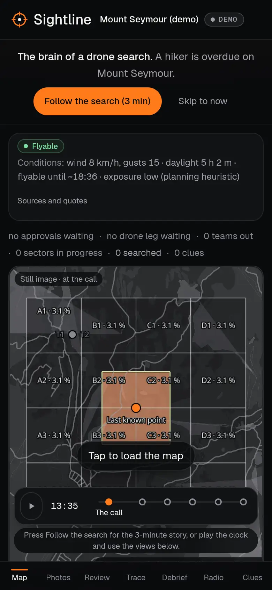

# Web audit: after the fixes

Same build, server, tools, settings and pages as `BASELINE.md` (Lighthouse 12.8.2, axe-core 4.14, Chrome 155
headless with software WebGL; desktop 1440×900, phone 390×844 with slow 4G and 4× CPU; median of 3 runs).
Machine-readable: `after-scores.json`.

| Page | Form | Perf | A11y | BP | SEO | FCP ms | LCP ms | TBT ms | CLS | axe violations |
|---|---|---|---|---|---|---|---|---|---|---|
| `#m/demo?t=0` | desktop | 100 | 100 | 100 | 100 | 406 | 689 | 50 | 0 | none |
| `#m/demo?t=2` | desktop | 96 | 100 | 100 | 100 | 405 | 808 | 159 | 0 | none |
| `#m/demo?t=5` | desktop | 95 | 100 | 100 | 100 | 432 | 731 | 172 | 0.052 | none |
| `#m/demo/trace` | desktop | 97 | 100 | 100 | 100 | 412 | 707 | 144 | 0 | none |
| `#about` | desktop | 100 | 100 | 100 | 100 | 412 | 739 | 0 | 0 | none |
| `#new` | desktop | 99 | 100 | 100 | 100 | 528 | 893 | 7 | 0 | none |
| `#m/demo?t=0` | phone | 72 | 100 | 100 | 100 | 1820 | 3330 | 857 | 0 | none |
| `#m/demo?t=2` | phone | 64 | 100 | 100 | 100 | 1812 | 3997 | 1124 | 0 | none |
| `#m/demo?t=5` | phone | 63 | 100 | 100 | 100 | 1914 | 3478 | 1545 | 0.065 | none |
| `#m/demo/trace` | phone | 66 | 100 | 96 | 100 | 1884 | 3316 | 1290 | 0 | none |
| `#about` | phone | 91 | 100 | 100 | 100 | 1905 | 3359 | 12 | 0 | none |
| `#new` | phone | 82 | 100 | 100 | 100 | 2644 | 3936 | 128 | 0 | none |

## Before → after (performance)

| Page | Desktop | Phone |
|---|---|---|
| `#m/demo?t=0` | 83 → 100 | 45 → 72 |
| `#m/demo?t=2` | 80 → 96 | 42 → 64 |
| `#m/demo?t=5` | 62 → 95 | 21 → 63 |
| `#m/demo/trace` | 69 → 97 | 43 → 66 |
| `#about` | 69 → 100 | 41 → 91 |
| `#new` | 99 → 99 | 79 → 82 |

Accessibility 96–100 → 100 everywhere; best practices 93–96 → 100 (96 on the phone Trace view); SEO 90 → 100.
First bundle 1.57 MB (448 KB gzip) → 358 KB (112 KB gzip).

## Targets

- Accessibility ≥ 95: met on every page and form.
- Best practices ≥ 95: met (lowest 96, phone Trace: Lighthouse's legible-text check, see below).
- Performance ≥ 85 desktop: met (95–100).
- Performance ≥ 70 phone: met on `#m/demo?t=0` (72), `#about` (91) and `#new` (82); **not met on the console views
  at t=2, t=5 and Trace (63–66)**. What is left is total blocking time (1.1–1.5 s) from the live map itself:
  MapLibre's start-up, its WebGL context and shader compiles and its first frames, run here on software WebGL
  (SwiftShader, as on PageSpeed Insights' servers) at 4× CPU slowdown. The map already waits until the console has
  painted, so FCP/LCP no longer include it, but Lighthouse counts every long task up to time-to-interactive. Getting
  those views over 70 on a throttled phone needs a design change: on phones, show a still image of the map (or the
  map at a lower level of detail) until the visitor touches it. That changes what the landing looks like on a phone,
  so it is left as a decision. On a phone with a real GPU these tasks are a fraction of what software WebGL takes.
- Phone Trace best practices 96: 45 % of its text is the 11 px caption size (Lighthouse wants 60 % at 12 px or more).
  Raising the caption step on phones is a type-scale change, so it is left as is.

## What changed

1. **Code-split the first bundle**: MapLibre and both maps (`MapView`, `LiveHeatMap`; `configureMapWorker` moved from
   `main.tsx` into `MapView.tsx`), the Trace view, the radio desk, the Debrief with its charts, About, Try a photo
   and the assignment card are `React.lazy` chunks.
2. **The map waits for the console to paint** (`afterPaint`: a largest-contentful-paint entry after the data is in,
   then two frames and an idle moment; fallbacks where the browser does not report paints), and while the About
   sheet covers the console. The ONNX model and onnxruntime-web were already loaded only by Try a photo.
3. **No layout shift on load**: the demo console appears whole once its fixtures and the recorded conditions lookup
   are in; the story's clock is set from the address before the first render (the landing's pitch bar is in the
   first frame); the DEMO chip shows from the start; the clue log keeps its height on wide screens; the two Geist
   faces the first screen uses are preloaded. The demo fixtures load in parallel with the cache, not after it.
4. **Map labels**: the live map's four label layers name the glyph font the site serves (`Noto Sans Regular`); they
   asked for MapLibre's default stack, which 404ed on every console page and left the POA, team, clue and drone
   labels blank.
5. **Faster heat replay**: typed-array copies with `new Float64Array(...)` instead of `Float64Array.from` (same
   values, same math; the contract vectors still pass); canvases read back with `getImageData` use
   `willReadFrequently`.
6. **Meta**: a description, `theme-color`, and the tab title "Sightline · drone search and rescue".
7. **Accessibility**: `role="group"` on the 21 labelled `
`s; the About sheet keeps Tab and Shift+Tab inside
   itself (it is `aria-modal`); 24 px minimum on the scrubber's checkpoints and the task rows' action chips;
   "Pick on map" scrolls without smooth motion under `prefers-reduced-motion` (the story clock, the heat tween and
   the fleet glide already honoured it).
8. **Images**: below-the-fold crops (review queue, approval evidence, trace re-looks, Try a photo's samples) load
   lazily with `decoding="async"`. The crops themselves are 400 px JPEGs from the demo cache (built by
   `scripts/`, outside `web/`); Lighthouse estimates ~170 KB from serving them at display size or as WebP, which is a
   change to the cache build.

Contrast: our own check (axe cannot judge text over the body's gradient) found no enabled text under 4.5:1 before
or after; no colour tokens changed.

## Phone placeholder

What the targets section above left as a decision, now made: on phones and slower devices the console shows a still
image of the map until the map is wanted, and only then starts MapLibre.

- **Who gets it**: a screen under 1024 px, a coarse pointer (touch) with `navigator.hardwareConcurrency` of 4 or
  fewer, `prefers-reduced-data`, or Save-Data (`web/src/map/MapStill.tsx`, `wantsStillMap`). A mouse or trackpad at
  1024 px and up always gets the live map, whatever its core count, so desktop is unchanged.
- **What it shows**: on the demo mission, a picture of the demo map at the call (t0) with the sectors, their POA and
  the last known point, taken with Playwright from the built site (`web/public/map/demo-t0-390.webp`, 41 KB, 2×
  for 390 px; `demo-t0-1440.webp`, 25 KB, for 1024 px and up), labelled "Still image · at the call"; on a live
  mission, a plain crop of the dark basemap (`basemap-still.webp`, 4 KB). The image has an alt text, and one button
  over the whole box reads "Tap to load the map" (keyboard: Tab, Enter); it changes to "Loading the map…" while the
  map starts.
- **Same box**: the still fills the map's frame (same border, radius and minimum height), measured at 366 × 439 px
  on a 390 × 844 phone for both, so nothing moves when the map arrives.
- **When the map loads**: at once on a tap (a touch starts it on pointer-down); after the next paint when the story
  reaches t1 (photos landing) or t4 (teams out), so the map is in before their coach marks, when a clue pick on the
  map is asked for, or when a team is picked on the roster. The map starts under the still, which fades out over
  300 ms once the map has drawn (no fade under `prefers-reduced-motion`). Once loaded it stays.
- Also fixed on the way: the Trace ledger chips' label and zero-delta text from `text-3` to `text-2` (axe measured
  4.47:1 on the chip's surface; accessibility 96 → 100 on the Trace view).

Same method as above (Lighthouse 12.8.2, axe-core 4.14, Chrome headless with software WebGL, the audit's static
server; median of 3), before and after measured back to back on the same machine. This machine was busier than for
the audit above, so its before numbers are lower than the table at the top; compare each row's before with its after.

| Page | Form | Perf before | Perf after | TBT ms before → after | LCP ms before → after | A11y after | axe after |
|---|---|---|---|---|---|---|---|
| `#m/demo?t=0` | phone | 61 | **87** | 1567 → 10 | 3775 → 3782 | 100 | none |
| `#m/demo?t=2` | phone | 56 | **72** | 1581 → 411 | 4453 → 4599 | 100 | none |
| `#m/demo?t=5` | phone | 24 | **82** | 3360 → 118 | 5587 → 3923 | 100 | none |
| `#m/demo/trace` | phone | 59 | **78** | 1990 → 324 | 3849 → 3992 | 100 | none |
| `#m/demo?t=0` | desktop | 100 | 100 | 32 → 35 | 733 → 729 | 100 | none |
| `#m/demo?t=2` | desktop | 90 | 94 | 254 → 183 | 850 → 851 | 100 | none |
| `#m/demo?t=5` | desktop | 96 | 92 | 140 → 218 | 771 → 770 | 100 | none |
| `#m/demo/trace` | desktop | 93 | 87 | 203 → 298 | 789 → 788 | 100 | none |

Phone performance ≥ 70 is now met on all four console views. The desktop code path is unchanged (the still is
never shown there); its rows move by a few points either way between runs, within this machine's run-to-run spread.
On the phone `#m/demo?t=5` the before run also shifted layout (CLS 0.903, the map arriving under the Debrief); after,
0.113. Phone best practices on t=2 and Trace stay at 96 (the 11 px caption share, as above). The still image is now the
largest paint on t=0, t=5 and Trace.

 
