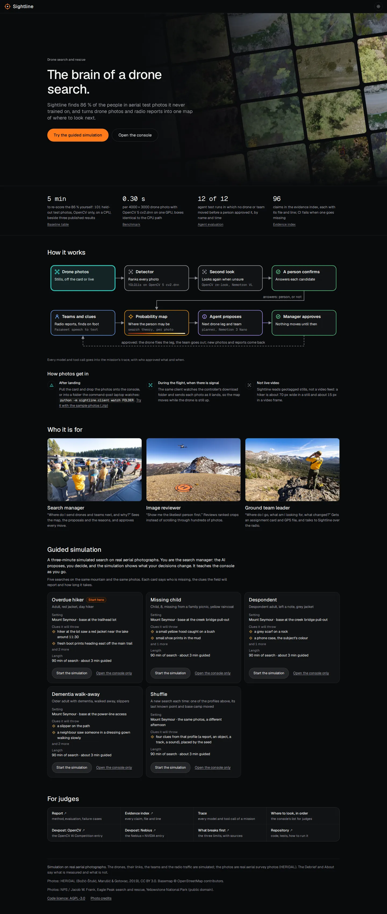

# web/src/front: the home page and the words about Sightline

The home page (`#`) sells Sightline and opens the console on a search; the console itself is `#m/demo`
(`web/src/shell/README.md`).

| File | What |
|---|---|
| `Home.tsx` | The home page, top to bottom: the hero (the name "Sightline" as the title, the tagline "The brain of a drone search.", one measured proof naming OpenCV 5, "Try the guided simulation" and "Open the console", and a "Built with" row of the stack, over the slow wall of real HERIDAL photos), four measured facts (a big number, a headline of at most eight words, one line with the exact figures, a small bar or row of squares, the source; they fade up 140 ms apart and count up once in view, final values at once under reduced motion; `EVIDENCE_CLAIMS` is checked against the evidence index's rows), Built with (`BuiltWith.tsx`), how it works (the diagram and how photos get in), who it is for (three roles, three photographs of a real search), the guided simulation (the one place that explains it, and the cards), for judges (the links they need), About (`About.tsx`; `#about` scrolls there and focuses its heading) and the footer (the one disclosure, the credits, the licence, the code). |
| `BuiltWith.tsx` | Built with, right after the agentic-vision chain: three equal cards side by side, OpenCV 5 (sees: the detector on `cv2.dnn`, the second look's zoom, the map), NVIDIA (reads, reasons, listens, speaks: Nemotron VL, Nano, Super, Parakeet, Magpie, and the radio clip) and Nebius (runs every model call: Token Factory, the Serverless Job, the circuit breaker), each with three steps, measured numbers and sources; Tavily as a row under them; one Physical AI line. Text wordmarks, no logos; every number is in `docs/report/EVIDENCE_INDEX.md`. |
| `home.css` | The page's motion and the hero's scrim: the wall at 5–7 px/s, sections fading up once in 280 ms, cards lifting 2 px. All of it off under `prefers-reduced-motion`; the wall is a still on phones and pauses off screen. |
| `motion.ts` | `useSeenOnce` (reveal and count once), `useOnScreen` (pause off screen), `canAnimate`. Without an IntersectionObserver (tests) everything renders finished. |
| `Architecture.tsx` | How it works, drawn in the colour tokens: one plain line per step and the model named small. On wide screens a photo travels the loop (photos → detector → second look → person → map → agent → manager, 9 s, each node lighting as it passes; SMIL, paused off screen, absent under reduced motion); on a phone the same steps as a list. |
| `scenarios.ts` | The five searches' words: who is missing, the setting, the clues each fixture throws, the length; `RECOMMENDED` is the one marked "Start here". `scenarios.test.ts` checks them against the fixtures. |
| `ScenarioCards.tsx` | The cards. "Start the simulation": `#m/demo?s=<seed>&guide=1`; "Open the console only": `#m/demo/map?s=<seed>`; Shuffle makes a new seed on each click. Clues past the second open on hover or focus (all shown on touch screens). |
| `ScenarioBanner.tsx` | The demo console's line under the app bar ("Overdue hiker · Mount Seymour · 13:35 PDT") and Change scenario, which opens the cards in a sheet. |
| `About.tsx` | The home page's About section, its last before the footer (`#about` lands there: old links from the Debrief, the `?` menu and the docs still work; it was a sheet over the console until v4). Only what the rest of the page does not say: who built it and the two competition entries, what the colours mean, what it will not do and where it struggles, where to ask. The models are in Built with, the licences and credits in the footer. |
| `photos.ts` | The four photographs of a real search (public domain, NPS; `public/front/CREDITS.md`), three of them under "Who it is for". |
| `copy.ts` | The words: the tagline, how photos get in (`INTAKE`), who it's for, the principles, the credits, the radio clip. |
| `judges.ts` | "Where to look, in order" (a fold of the Debrief; `#judges` opens it), what is simulated and what is real, and the three "what breaks first" lines, word for word from `docs/submission/WHAT_BREAKS_FIRST.md`. |
| `RadioClip.tsx` | "Hear Sightline on the radio": one briefing in Sightline's voice (NVIDIA Magpie TTS), served from `public/front/briefing.mp3`. In Built with's NVIDIA card and the Debrief. |

## How professional sites in this space sell, and the eight rules the home page follows

Read on 2026-10-23. What each page puts above the fold and in the first scroll:

- **Skydio, public safety** (https://www.skydio.com/public-safety): claim "When lives are on the line, get
  Skydio in the air."; one line on who it is for; "Get started" and a quieter "See DFR in action"; then one
  number ("More than 1,500 public safety agencies") and quoted results with figures.
- **DJI Enterprise, search and rescue** (https://enterprise.dji.com/public-safety/search-and-rescue): plain
  noun headline ("Search and Rescue"), pain point → advantage pairs, hard specs as proof (flight time, wind,
  sensor), the workflow as five numbered mission steps in the operator's words, "Contact Us".
- **Zipline** (https://www.zipline.com/): a short claim, real photographs of the use, one action "Try it
  now", three numbers with labels ("86 SECS fastest delivery time"), "How to zipline" in three verbs.
- **Flyability** (https://www.flyability.com/): claim plus outcome ("safer, faster & cheaper"), customer
  logos, then three steps; the hero is a rotating carousel and the steps repeat the value props (what not to do).
- **SARUAV** (its site is parked; https://pnrs.ensosp.fr/Plateformes/Fire-IN/Innovation/Technologies/SARUAV-software-for-AI-based-aerial-photo-analysis-in-SAR-missions-missing-person-mobility-simulation-SAR-mission-coordination
  and https://uwr.edu.pl/en/?p=274634): sold on documented finds (782 photos, the person found and his
  coordinates) and on the operator checking every detection.
- **D4H** (https://www.d4h.com/): "Uncomplicated software for crisis & emergency management", the product UI
  on devices, awards and numbers ("100k+ responders"), the problem before the solution, "Schedule a demo".
- **CalTopo** (https://caltopo.com/about): who it serves (individuals, teams, first responders), what works
  offline and in the field, "Start Mapping".
- **Linear** (https://linear.app/), **Vercel** (https://vercel.com/), **Raycast** (https://www.raycast.com/):
  a claim of five to eight words, one sentence under it, one primary action and one quieter one, the real
  product or a calm visual (never a stock photo), a proof line ("99.8% crash-free rate", "over 40,000 product
  teams"), sections headed by plain nouns, the action repeated at the end.

The rules, and where the page applies them:

1. **Claim, proof, one action.** A short claim, one sentence with a measured number, one primary action and
   one quieter secondary (Skydio, Linear, Vercel). Hero: the name "Sightline", the tagline "The brain of a drone search.", the 86 % sentence naming OpenCV 5,
   "Try the guided simulation" and "Open the console". The app bar carries no second copy of either.
2. **Show the real material, not a stock picture.** Real imagery of the work (Zipline, Skydio, DJI). The hero
   wall is the HERIDAL photos the detector reads, one with its 0.17 box; "Who it is for" uses photographs of a
   real search.
3. **Motion is ambient and slow.** Background only, the words still; no carousel (Flyability's rotates
   content away). The wall moves at 5–7 px/s, pauses off screen, is a still on phones and stops under
   reduced motion; no autoplaying video.
4. **Numbers with labels, and since we have no logos, sources.** The trust row (Zipline, D4H, Raycast) is
   four measured facts, each linked to the file that backs it; Vercel's numbers carry no source, ours do.
5. **How it works in the operator's words, few steps, each a verb.** (DJI, Zipline.) The diagram: one plain
   line per step, the model named small; and how photos get in, in three lines, including what it is not.
6. **Say who it is for.** (Skydio, CalTopo, D4H.) Three roles, each with the question they bring.
7. **Proof of the human in charge.** SARUAV sells the operator checking every detection; ours shows the
   approval gate measured (12 of 12) and the person in the loop on the diagram.
8. **Action labels say what happens; headings are plain nouns.** "Start the simulation", "Open the console
   only", never "Learn more" (DJI's "Contact Us" everywhere says nothing); headings "How it works", "Who it is
   for", "Guided simulation", "For judges".
