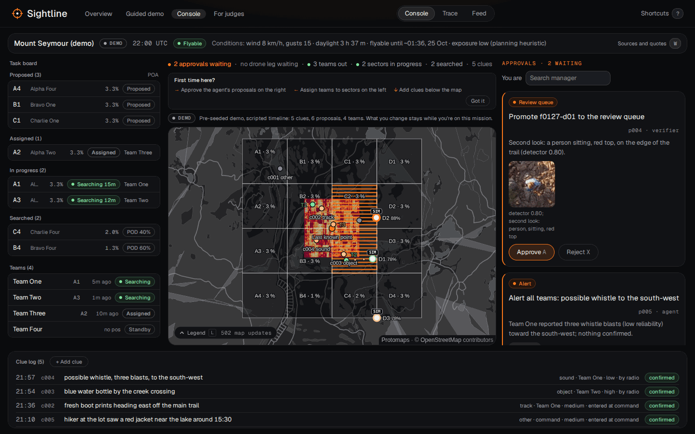
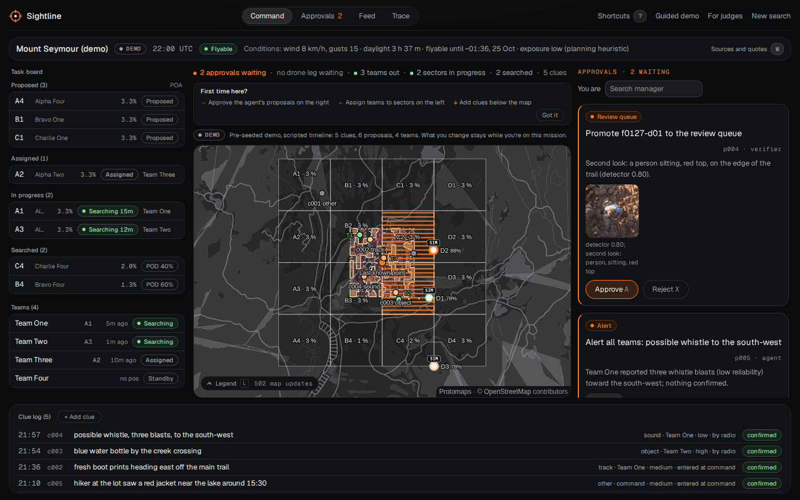
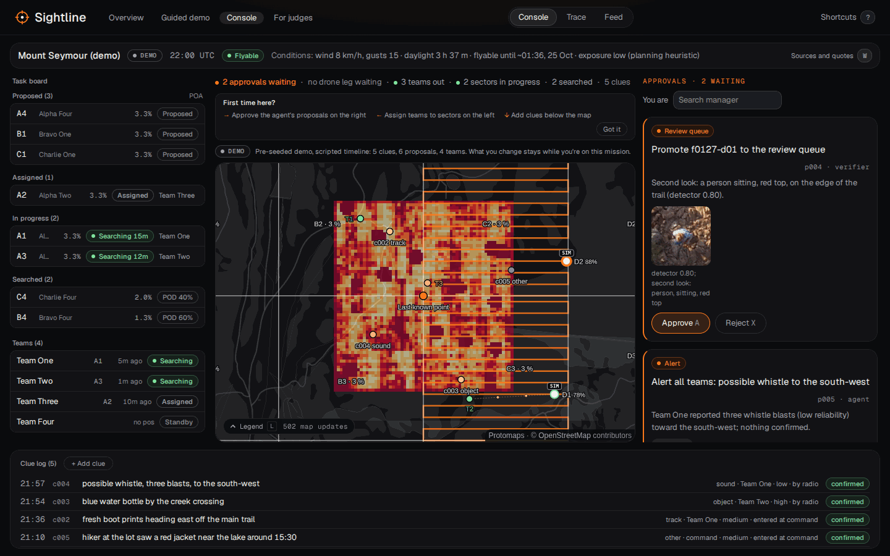
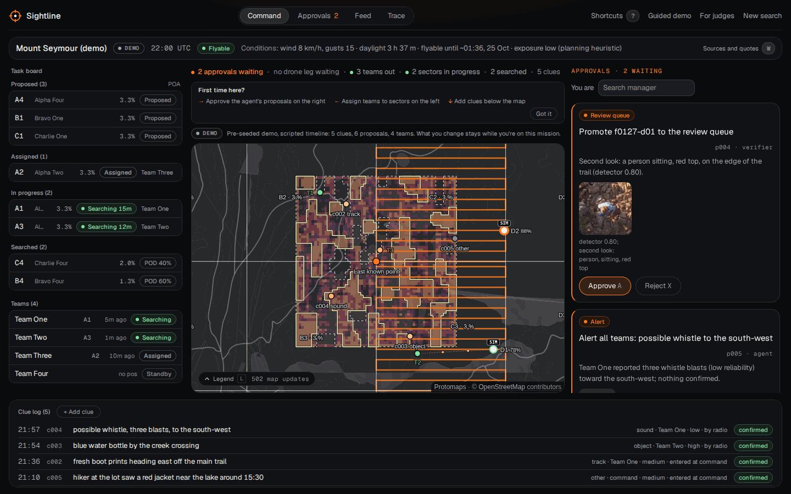
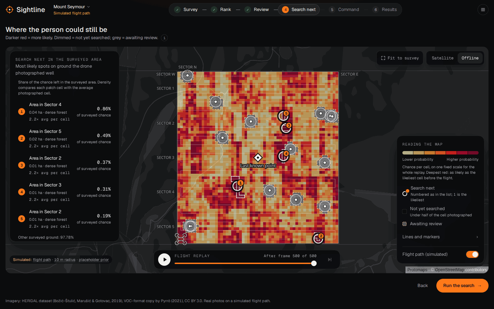
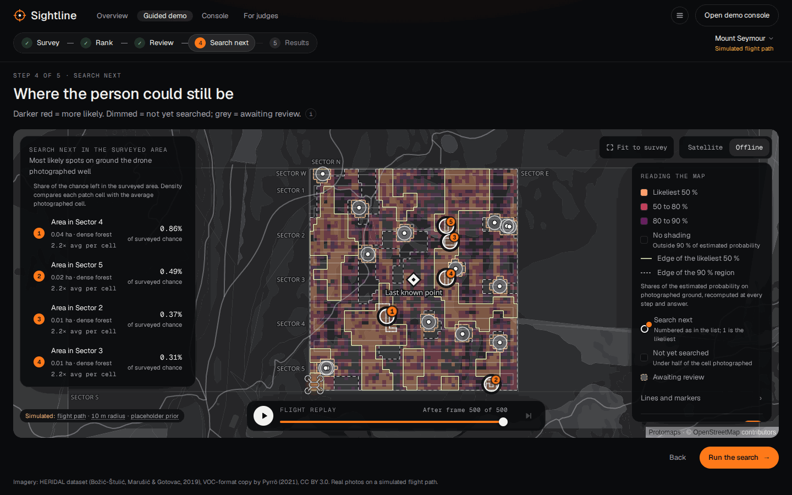
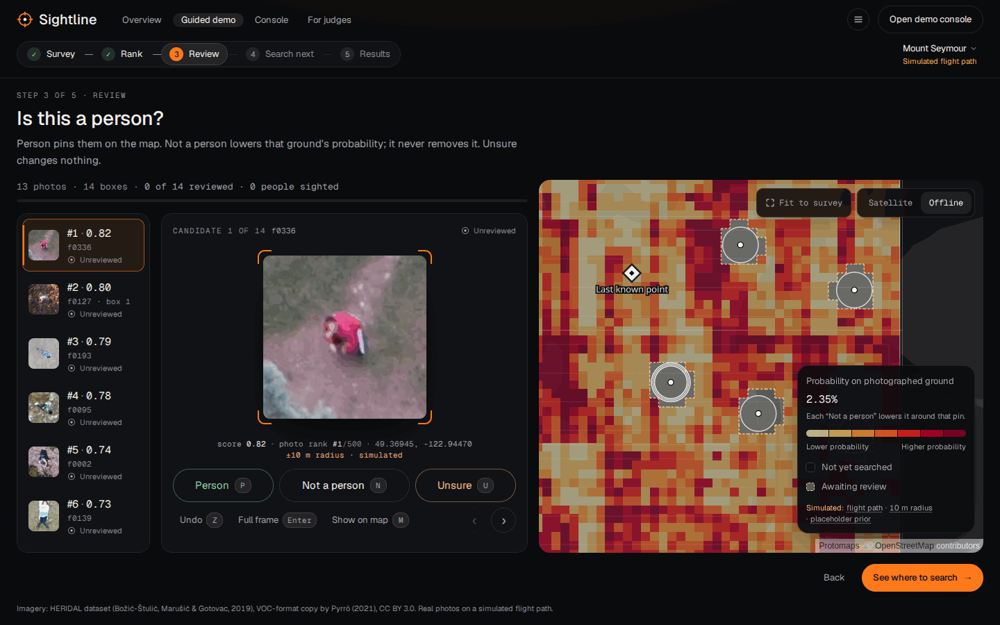
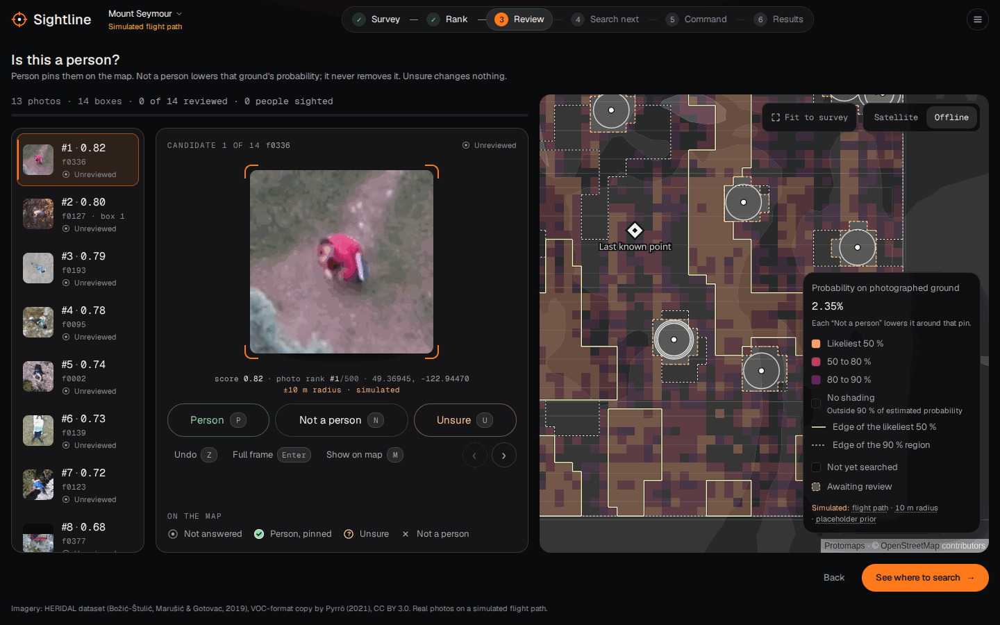

# Heat layer: the probability surface

**The console's heat (2026-10-22, `smooth.ts`).** On the live map the classes cover the whole search area
(the prior is known everywhere), not only photographed ground; ground no photo has looked at yet is a light
hatch over the heat. Each class region is dissolved: its mask is blurred a few cells and traced with marching
squares, simplified, and the bands filled even-odd between nested levels, so there is no per-cell staircase at
the console's zoom or at twice it. Only two lines: the 50 % edge at 1.5 px and a faint, solid 1 px 90 % edge.
Fills are a fifth lighter than before (satellite 0.24 / 0.36 / 0.48, dark 0.32 / 0.44 / 0.56). A flat map (the
prior before anything is known) draws no classes. Base camp and the teams sit on a dark halo. Before and after:
`docs/report/figures/command-post/heat-{before,after}-{console,zoom2x}.webp`. The search-next and review maps keep
the per-cell classes below.

The heat shows where the missing person most likely is as three classes of probability mass, not as a colour per cell. On the photographed ground the cells are sorted by probability and split into the fewest likeliest cells that hold 50 % of it, the next ones up to 80 %, and the next up to 90 % (highest-density regions; `classes.ts`). Cells outside the 90 % region get no fill, so the basemap shows where little probability is left; the legend calls this "outside 90 % of estimated probability" and never says the ground is empty. A solid line marks the edge of the 50 % region and a dashed one the edge of the 90 % region, each on a thin dark casing; the lines are generalised (spurs and gaps one cell wide smoothed out, parts and holes under 0.04 ha left out) so they trace regions, while the fills keep every cell exact. On satellite imagery the classes use a ColorBrewer YlOrRd subset (`#fed976` α 0.30, `#fd8d3c` α 0.45, `#e31a1c` α 0.60) and the imagery is desaturated (`raster-saturation` −0.6, `raster-brightness-max` 0.85) while the heat is on the map; on the dark offline map they use the upper range of magma with lightness inverted (`#8c2981`, `#de4968`, `#fe9f6d`, alpha 0.1 higher), so lighter means likelier and nothing turns olive (`palette.ts`). Fills fade from full strength at z13 to 0.55 of it at z16 (contours stay full), the Review variant is 0.75 of that, and the whole surface sits under the basemap's first road or label layer, so trails and names draw over it.

At rest the classes are GeoJSON fills (cells merged into rectangles, about 1,300 on the demo survey) and line layers (`surface.ts`); while the heat animates (the Search next build-up, an answer's tween, the flight replay, a live update) the same cell kinds are drawn by the canvas raster in the same colours and alphas, and the fills take over once MapLibre has drawn them. Classes, rectangles and contours for the 200 × 200 demo grid take about 7 ms; during the replay the fills wait for the pause, and replay frame times match the raster-only build (measured in headless Chromium). Sources: lost-person behaviour rings (ISRID and Koester's Lost Person Behavior; https://www.researchgate.net/publication/280971683_Evaluating_Lost_Person_Behavior_Models, https://www.sartrack.co.nz/StatisticalRings.html), highest-density regions (Hyndman, https://robjhyndman.com/papers/hdrgraph.pdf; https://jamesotto852.github.io/ggdensity/), muting the basemap rather than the data (Esri Firefly, https://www.esri.com/arcgis-blog/products/arcgis-enterprise/uncategorized/world-imagery-firefly-imagery-for-thematic-maps), overlay opacity and outlines (Hombeck et al., IEEE VIS 2020, https://arxiv.org/abs/2009.00931), fading by zoom (https://maplibre.org/maplibre-gl-js/docs/examples/create-a-heatmap-layer/), dark-mode ramps (https://ica-abs.copernicus.org/articles/7/144/2024/ica-abs-7-144-2024.pdf, https://www.datawrapper.de/blog/dark-mode-for-embedded-visualizations), colour-blind-safe ramps (https://pmc.ncbi.nlm.nih.gov/articles/PMC6070163), equal-interval pitfalls (https://data.europa.eu/apps/data-visualisation-guide/colour-for-numerical-data-colour-scales) and the MapLibre style spec (https://maplibre.org/maplibre-style-spec/layers/).

## Before and after (offline basemap, 1440 × 900)

No MapTiler key was available, so only the offline basemap is shown; the satellite palette and the imagery muting are covered by `palette.test.ts`.

| | Before | After |
|---|---|---|
| Demo mission console |  |  |
| Console, zoomed in |  |  |
| Search next |  |  |
| Review |  |  |
