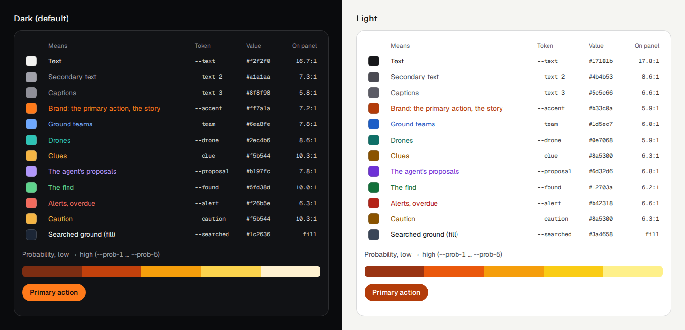

# web/src/shell: one console, its bar and its addresses

The site is a home page (`#`, `front/Home.tsx`: the hero over the survey's photos, measured facts, how it works, who it is for, the "Guided simulation" cards, For judges) and one console.
The console on the demo mission (`#m/demo`) starts at the start of its timeline; the guided simulation, New search, Try a photo, the results and For judges are moments, views,
rails or sheets of that console, never pages of their own. One mission state (`useMission`), one map
instance (it never unmounts while you stay on a mission), one clock.

| File | What |
|---|---|
| `flow.ts` | The address map: routes, views and every old address redirected (table below). |
| `AppBar.tsx` | The one header. Row one: wordmark (the home page) · mission name, Live/Demo chip, the demo's one disclosure chip ("Simulation on real aerial photographs") · view switch (Map · Photos · Trace · Debrief, `aria-pressed`) · one button · the theme toggle · `?`. Row two: the status line (`command/StatusLine.tsx`). Under 1024 px four tabs along the bottom: Map, Needs you (its count), Timeline, More (Photos, Trace, Debrief). |
| `icons.tsx` | The one icon set: drone, team, clue, base camp, last known point, the find, radio, decision, detection, check-in; 24-unit paths, 2-unit round strokes, no emoji. The map draws the same paths (`map/base/iconImages.ts`). |
| `Sheet.tsx` | A sheet over the console (Change scenario, the guided simulation's sheets): slides in, Esc or the dim closes it, focus goes back. |
| `components.tsx` | The visual system from #159: `Button` (one orange primary per screen), `Panel` (opaque), `PageHeader`, `Page`, `Stat`, `Badge`, `StatusPill`, `ModeChip`, `DisclosureChip`, `KeyHint`, `EmptyState`. |
| `Logo.tsx` | `Brand`: the logo and the name, a link to the home page (`#`). |
| `ShortcutOverlay.tsx`, `shortcuts.ts` | `?`: About and the home page, then the keys by region: Views, Needs you, Map, Timeline and radio, Guided simulation. |
| `theme.css` | Tokens for both themes (Colour, below), type scale, the status pill, motion (sheets and the guided search's marks 200–300 ms; none under reduced motion). |
| `notify.ts`, `toasts.tsx`, `notifyBell.tsx` | The notification centre: the store (toasts that merge by key, a log with an unread count), the toast stack (bottom right, 5 s, Show me) and the status line's bell. Which event becomes which toast is `command/notifications.ts`. |
| `theme.ts`, `ThemeToggle.tsx` | Dark or light: the system's preference until the visitor picks one with the app bar's toggle, then remembered (`localStorage` `sightline.theme`). `index.html` sets `data-theme` before the first paint with the same rule. |

## Colour

Dark is the default; light follows the system or the toggle. One colour per kind of thing, used everywhere
(the map, cards, the timeline, chips): a team is always blue, a drone always teal. The brand orange
(`--accent`) is for the primary action (one per screen) and the guided simulation only, never for a kind of thing.
Every text colour is at least 4.5:1 on `--bg`, `--surface-solid`, `--surface-strong` and its own pill in
both themes: `node scripts/check-contrast.mjs` prints every pair, and `scripts/contrast.test.ts` fails the
tests when one drops under. The figure is `node scripts/colour-swatches.mjs` screenshotted.

| Token | Tailwind | Means | Dark | Light |
|---|---|---|---|---|
| `--team` | `text-team` | ground teams | `#6ea8fe` | `#1d5ec7` |
| `--drone` | `text-drone` | drones | `#2ec4b6` | `#0e7068` |
| `--clue` | `text-clue` | clues | `#f5b544` | `#8a5300` |
| `--proposal` | `text-proposal` | the agent's proposals | `#b197fc` | `#6d32d6` |
| `--found` | `text-found` | the find | `#5fd38d` | `#12703a` |
| `--alert` | `text-alert` | alerts, overdue | `#f26b5e` | `#b42318` |
| `--searched`, `--searched-line` | `bg-searched` | searched ground (a fill and its outline, not text) | `#1c2636`, `#4a5d7c` | `#3a4658`, `#1f2937` |
| `--prob-1` … `--prob-5` | `bg-prob-3` | probability, low → high: rust → amber → cream (dark), rust → orange → yellow (light) | `#7c2d12` `#c2410c` `#f59e0b` `#fcd34d` `#fff1d0` | `#9a3412` `#ea580c` `#f59e0b` `#facc15` `#fef08a` |
| `--accent`, `--on-accent` | `bg-accent text-on-accent` | the primary action and the guided simulation | `#ff7a1a` on `#0a0b0d` | `#b33c0a` on `#ffffff` |
| `--ok`, `--caution`, `--alert` | `data-tone` | status (searching, caution, alert) | `#7ee2a0` `#f5b544` `#f26b5e` | `#12703a` `#8a5300` `#b42318` |
| `--text`, `--text-2`, `--text-3` | `text-text-2` | text, secondary, captions | `#f2f2f0` `#a1a1aa` `#8f8f98` | `#17181b` `#4b4b53` `#5c5c66` |
| `--bg`, `--surface-solid`, `--surface`, `--surface-strong`, `--border`, `--line` | `bg-surface-solid` | the page, panels, glass, hover, outlines, hairlines | `#0a0b0d` `#111215` (white at 5/8/12/8 %) | `#f5f5f2` `#ffffff` (ink at 3/6/16/9 %) |
| `--shadow-pop` | `shadow-[var(--shadow-pop)]` | popovers and menus | black 90 % | slate 28 % |

Pills take the semantic set as tones too: `data-tone="team" | "drone" | "clue" | "proposal" | "found"`.
Never write a hex value in a component: when a colour is missing, add a token here, in both themes.

## Addresses

| Address | Opens |
|---|---|
| `#`, `` | the home page: the hero over a wall of the survey's photos (Try the guided simulation, Open the console), four measured facts, how it works, how photos get in, who it is for, the "Guided simulation" cards (Start the simulation, Open the console only), the For judges strip, the footer (anything unknown lands here too) |
| `#m/demo` | the console on the demo mission at t0, the pitch bar |
| `#m/demo?s=<seed>&guide=1` | a scenario with the guided simulation started (a home card's Start the simulation) |
| `#m/demo/map?s=<seed>` | a scenario, just the console (a home card's Open the console only) |
| `#m/demo?t=0..6` | the console at a checkpoint's clock (the call, photos land, confirm, where next, the run, the find, the debrief), no coach marks; it settles on `#m/demo/map?t=N` |
| `#m/<id>/map` · `photos` · `trace` · `debrief` | a view of a mission; on the demo `?t=0..6` sets the mission clock (none: the end of the timeline) |
| `#m/<id>/map?needs` | the console with Needs you in front (`#m/<id>/review` lands here: the review folds into Needs you) |
| `#m/<id>/map?radio` | the console with the timeline on Radio and the talk bar ready (`#m/<id>/radio` lands here: the radio desk is the talk bar) |
| `#m/demo?s=<seed>` | the demo mission as a scenario (`overdue-hiker`, `missing-child`, `despondent`, `dementia`, or any seed) |
| `#m/<id>/map/conditions` · `trace?log` · `debrief?judges` · `photos?try` | the Conditions panel, the event log, For judges, Try a photo open |
| `#m/<id>/card/<sector>` | a sector's printable assignment card (live missions) |
| `#new` | the empty console: start a search or load the demo mission |
| `#about` | the home page, scrolled to its About section: who built it, the two entries, the colours, the limits, the licences, where to ask (it was a sheet over the console; old links land here) |

Old addresses, kept so links in the docs, the Devposts and the video still land somewhere sensible:

| Old | Now |
|---|---|
| `#survey`, `#rank` | `#m/demo?t=1` (photos land) |
| `#review` | `#m/demo?t=2` (confirm) |
| `#search`, `#searchnext` | `#m/demo?t=3` (where next) |
| `#results` | `#m/demo?t=6` (the debrief) |
| `#operate`, `#command` | `#m/demo/map` |
| `#judges` | `#m/demo?t=6&judges` (the debrief, For judges open) |
| `#try` | `#m/demo/photos?try` |
| `#m/<id>/command[/conditions]`, `#m/<id>/approvals` | `#m/<id>/map[/conditions]` |
| `#m/<id>/review` | `#m/<id>/map?needs` |
| `#m/<id>/radio` | `#m/<id>/map?radio` |
| `#m/<id>/feed` | `#m/<id>/trace?log` |

## Keys

`?` lists them (`shortcuts.ts`), grouped by the console's regions:

| Group | Keys |
|---|---|
| Views | 1 Map, 2 Photos, 4 Trace, 5 Debrief (the number keys wait during the guided simulation), C back to the map, `?` this list, Esc closes it or the Conditions panel |
| Needs you | 3 opens it (was Review); Tab to a card, then A approve, X reject, E edit; J/K (or the arrows) move through the candidates, P, N, U answer |
| Map | W conditions, L legend, Esc closes the sector popover or the sector list, or cancels Task mode |
| Timeline and radio | 6 the radio (the timeline on Radio, the talk bar ready; was the Radio view), V hold to talk, Space plays or pauses the mission clock outside the guided simulation |
| Guided simulation | A the agent's option, 1–4 an option, M pick on the map, T take over from Watch instead, Space pauses between decisions, Esc leaves |

## Type and spacing

One text family for everything: **Geist Sans** (variable, self-hosted through `@fontsource-variable/geist`,
no CDN at runtime), with tabular numerals on for the whole page (`font-feature-settings: "tnum"`), so clocks,
counts and percentages line up. **Geist Mono** only for ids and coordinates (`f0396-d01`, `p003`, `c004`,
`49.37121, -122.94379`) and for code (the watch command, the trace's JSON). No uppercase tracked labels:
section labels are sentence case, 12 px, medium weight (`Label`).

| Step | Size / line | For |
|---|---|---|
| `caption` | 12 / 16 | meta lines, chips, timestamps, table headers (the smallest size anywhere) |
| `small` | 13 / 20 | the console's working size: cards, rows, buttons |
| `body` | 15 / 22 | reading text: a proposal's reason, the debrief, sheets |
| `title` | 18 / 24 | panel and sheet titles |
| `headline` | 24 / 30 | page headings, big numbers |

`label`, `lead` and `display` are the same steps under older names (label = caption, lead = title, display =
headline). Spacing is the 4 px grid (Tailwind's `1` = 4 px): 4 inside a control, 8 between controls, 12 inside
a card, 16 between panels. Every panel header is `--panel-head` (40 px) tall (`.sl-panel-head`), and numbers in
tables are right-aligned (`.sl-num`).
